# Syntegra Canonical Enterprise Data Architecture (CEDA)

| | |
|---|---|
| **Document** | SYN-CEDA-001 — Canonical Enterprise Data Architecture |
| **Version** | 1.9.0 — document masters kept write-once under compliance object lock until the end of their retention, a searchable PDF copy of each scan beside the untouched original, and every copy that leaves the system stamped and entered in a release register that checks a copy presented later; authenticator self-enrolment enforced at sign-in for roles that need it; single sign-on by OpenID Connect built (CR-003); API writes need the same access level as the form; a staging rehearsal against real infrastructure before production (change request CR-008; §32). 1.8.0 added: after the password, the sign-in shows and records the school or office of the user (name and address); one account can be used by one person at a time; document management for digitised paper records, indexed for full-text search and filed under each school; five named access levels decide what each user sees (change request CR-007; §31). 1.7.0 added adds institutional budgets and imprest, funding and loan platforms for institutions, staff and learners, the government property register with facility condition, usability and proactive maintenance, the infrastructure data warehouse for the Commissioner, and security-agency curricula through each agency's structure (change request CR-006; §28); documents the Abia State demonstration and school performance comparison (§29) and adds the End-User Guide (§30). 1.6.0 added the federal unity colleges and federal special training institutions, extends the security agencies' institutions, and links every institution to the education watchdogs and examination bodies it depends on (change request CR-005; §27). 1.5.0 added the security agencies' education and training institutions, each under its own agency structure with its own curricula (CR-004; §26). 1.4.0 modelled two-factor authentication and single sign-on (CR-003); 1.3.0 the national clearance network (CR-002; §25); 1.2.0 the HRMS and fee-clearance due diligence (CR-001; §23, §24). Change log in §22 |
| **Date** | 15 October 2026 (1.0.0 to 1.7.0: 13–14 October 2026) |
| **Derived from** | SYN-MFS-002 v2.4, Master Functional Specification (consolidated single volume: Books 1–3, 517 functional requirements, 260 pages, Appendix J MySQL schema of 174 tables), extended by change requests CR-001 (23 requirements, 13 pages), CR-002 (6 requirements, 1 page), CR-003 (7 requirements), CR-004 (8 requirements, 4 pages), CR-005 (8 requirements, 3 pages) CR-006 (26 requirements, 7 pages), CR-007 (11 requirements, 4 pages) and CR-008 (9 requirements, 2 pages) |
| **Platform** | Python 3.12 · Django 5.2 LTS (+ FastAPI for high-throughput services) · MySQL 9.7 LTS · Red Hat Enterprise Linux 10 / OpenShift |
| **Machine-readable model** | `ceda/model/` (single source of truth) → `ceda/generated/` (DDL, dictionary, ERDs, JSON Schema, OpenAPI components, event schemas, metric catalogue, traceability) |
| **Status of artefacts** | Model validates with 0 errors, 0 warnings; every zone's DDL loads into MySQL 9.7.2; 12 database-level guarantees verified on MySQL 9.7 (§18) |

### Approvals

| Role | Name | Decision | Date |
|---|---|---|---|
| Chief architect | | | |
| Product owner | | | |
| Data protection officer | | | |
| State Ministry of Education / SUBEB representative | | | |
| Head of platform engineering | | | |
| QA lead | | | |

---

## 0. How to read this document

CEDA is the **authoritative data blueprint** for Syntegra. The MFS says *what* the platform must do; CEDA says *how every piece of data is named, identified, typed, classified, owned, placed, related, versioned, retained, moved and consumed*. Everything that touches data is built from it:

| Consumer | What it takes from CEDA | Where |
|---|---|---|
| **Python application** (Django apps, services, workers) | One Django app per CEDA module; models from the entity catalogue; field types from `types.yaml`; choices from `enums.yaml`; code lists from the jurisdiction pack; zone → database alias routing; append-only, effective-dating and versioning patterns | §4–§8, `generated/dictionary/`, `generated/mysql/` |
| **APIs** (DRF, FastAPI, partner and exchange APIs) | Resource shapes and field classifications from the generated JSON Schema / OpenAPI components; ETag = `row_version`; purpose binding; idempotency; event envelope and payloads | §10, `generated/openapi/`, `generated/jsonschema/`, `generated/events/` |
| **UX/UI** (syntegra_ui v2 page registry, Design System v2) | Page → entity → field traceability for all 260 pages; classification per field (masking, board-safe view, small-number suppression rendering); lifecycle states | §11, `generated/traceability/pages.md` |
| **Intelligence engine** (alerts, early warning, matching, agents, assistant, document AI) | Feature store, model register, recommendation/flag/action records, explanation and closed-loop storage, agent service identities and action log | §14 |
| **Government dashboards** (CMD-01…16, CMD-101…104, CUR-101, SUB-105 …) | Scope hierarchy and closure for drill-down and roll-up; the semantic-layer metric catalogue; live KPI read model; suppression and context rules | §12–§13, `generated/metrics/catalog.md` |
| **Reporting layer** (report library and builder, returns, BI connector, lineage) | Warehouse model, metric definitions, return definitions, lineage graph | §12, §15 |
| **Hosting infrastructure** (RHEL 10, OpenShift, MySQL InnoDB Cluster/ClusterSet, OpenSearch, S3 WORM, Kafka, Valkey, Vault/HSM) | Data zones → schemas → clusters; DB accounts and privileges; capacity model; partitioning and retention jobs; backup/RPO/RTO per store; key hierarchy | §6, §16 |

**Precedence.** (1) SYN-MFS-002 v2.4 governs requirements. (2) CEDA governs the data model and its physical realisation; where the MFS Appendix J DDL and CEDA differ, CEDA governs — it is a corrected, normalised re-specification of the same logical model (§19 lists every correction). (3) `BLUEPRINT.md` v1.0 (PostgreSQL/FastAPI/React) is superseded wherever it conflicts with the MFS stack (MySQL 9.7, Django 5.2, RHEL 10) or with CEDA. CEDA never changes a requirement; where it had to choose between readings of the MFS it records a decision (§3) and flags any that need confirmation.

**The model is code.** The narrative below explains the rules; the YAML in `ceda/model/` *is* the model. Nothing in `ceda/generated/` is edited by hand: run `python3 ceda/tools/cedagen.py generate`. CI fails if the model is invalid, if generated artefacts are stale, or if the DDL does not load into MySQL 9.7 with its guarantees intact (§18).

### At a glance

| Measure | Value |
|---|---|
| Domains (subject areas) | 37 operational + 1 warehouse |
| Canonical entities | 526 (174 re-specified from Appendix J, 352 added to give MFS and change-request requirements a home) |
| Physical tables | 556 across 6 data zones (platform 26, registry 199, ops 239, vault 26, records 22, warehouse 44) — 18 cross-cutting entities are replicated per zone |
| Columns · enforced foreign keys · soft references | 8,586 · 730 · 365 |
| Append-only tables · partitioned tables | 100 · 21 |
| Fixed enumerations · jurisdiction code lists | 393 · 51 (Nigerian pack) |
| Domain events · semantic-layer metrics · retention series | 171 · 74 · 33 |
| Coverage | 294/294 pages (260 MFS + 13 CR-001 + 1 CR-002 + 4 CR-004 + 3 CR-005 + 7 CR-006 + 4 CR-007 + 2 CR-008); 615/615 functional requirements accounted for (517 MFS + 23 CR-001 + 6 CR-002 + 7 CR-003 + 8 CR-004 + 8 CR-005 + 26 CR-006 + 11 CR-007 + 9 CR-008; 607 realised in data, 8 behavioural); 174/174 Appendix J tables mapped |

---

## 1. Purpose and scope

The platform holds every learner, teacher, class, curriculum, result and certificate in a state — up to 5 million learners, 15,000 institutions and 250,000 teaching professionals per state, 50 million learners nationally (MFS §1.2) — and every institution reports into one central dashboard. The operating rule is *enter once, verify once, reuse everywhere authorised, analyse once, decide better everywhere.* CEDA turns that rule into a data architecture:

- **one canonical record per real-world thing**, owned by exactly one module and referenced by identifier everywhere else (no copies between modules, P1/P2);
- **one identity per person across public and private institutions** in a state (P4, P14), held in the state registry;
- **one definition per indicator**, in the semantic layer, used by every dashboard, return, briefing and assistant answer;
- **one place per data class**: special-category data in the vault; analytics in a separate warehouse; documents in WORM object storage;
- **one change pipeline** for every consequential write: validate → match → authorise → policy → conflicts → finance → mandatory fields → audit (same transaction) → commit → outbox event (Book 3 §13).

Scope: all 36 MFS modules and the shared engines (identity and access, workflow, master data, validation, policy, audit, events, notifications), the warehouse and semantic layer, the intelligence engine's data, and the physical deployment of data on the binding stack (MFS §16).

---

## 2. Data architecture principles

Each principle is binding on every entity, API, page, job and deployment. The right-hand column shows the MFS principle it implements.

| # | Principle | Rule in CEDA | MFS |
|---|---|---|---|
| D1 | Single system of record | Every entity has exactly one owning module (`module`); other modules reference it by id and read it through that module's API or events. No module stores another module's facts. | P1, P2 |
| D2 | One person, one record | Learner, guardian and staff masters live once per state in the registry; identity matching runs before any create; merges keep aliases; national identifiers are attributes, never keys. | P4 |
| D3 | Identifiers are surrogate and stable | UUID v7 internal keys; human identifiers with check digits; nothing reused, even after merge or revocation. | Book 3 §8.3 |
| D4 | Everything is scoped | Every operational row is owned by a scope node (or derives its scope through a stated relationship); visibility is a subtree test against the closure table. | §2.3 |
| D5 | Classification is data | Every entity and, where higher, every field carries a classification; storage, encryption, search, warehouse, export, messaging and AI eligibility follow from it mechanically. | P6, §2.2 |
| D6 | Special category is isolated | Safeguarding, allegations, SEND detail, health and wellbeing text live in the vault zone (own schema, account, key); elsewhere such text is only ever a sealed (encrypted) field. | §2.2, §9.4, §18.11 |
| D7 | History is never overwritten | Effective-dated relationships, versioned configuration (published = immutable), append-only events and ledgers; queries take an `as_of`. | P10, Book 3 §8.4 |
| D8 | Consequential facts are tamper-evident | Hash-chained audit per zone and tenant, daily anchors to WORM storage; certificates, statements and frozen counts are hashed. | P10, §15 |
| D9 | Configuration, not code | Jurisdiction rules, code lists, thresholds, weights, fees and templates are versioned data validated against schemas; the database enforces only what is universal. | §4.4, Book 3 §7 |
| D10 | Analytics never touches the operational primary | CDC feeds a separate warehouse; dashboards read aggregates; learner keys are pseudonymised. | NFR-PLAT-110 |
| D11 | Define every number once | Every indicator is a metric in the semantic layer with formula, grain, sources, refresh, owner and lineage. | P8, FR-RPT-02/04 |
| D12 | Context before comparison; small numbers suppressed | Comparisons only within comparison groups; aggregates leaving the institution scope suppress cells under 10. | P7, FR-CMD-108 |
| D13 | Events carry identifiers, not data | Domain events are notifications with ids and minimal non-personal facts; consumers fetch under their own permissions. | Book 3 §16.2 |
| D14 | Explainable intelligence, human decisions | Every AI output stores finding, evidence, confidence and the human decision; consequential decisions are human-only by construction. | P5, P16 |
| D15 | Education is never withheld for money | No register, lesson, coursework, result, transfer or certificate path reads payment or subscription state. | P9, FR-SUB-116 |
| D16 | Residency by design | Each zone instance is pinned to an in-country residency region; global views are built from aggregates only. | NFR-PRIV-04, §3.3 |
| D17 | The database is the last line of defence | Isolation, uniqueness, four-eyes, append-only and statutory rules that must never be violated are enforced in MySQL (keys, generated columns, CHECKs, triggers, privileges) as well as in Python. | §16.2–16.3 |

---

## 3. CEDA decisions

Decisions CEDA had to take to make the MFS buildable. Status **Adopted** means the MFS implies or permits the choice; **Confirm** means a product or state decision is needed and CEDA's choice stands until it is made.

| # | Decision | Rationale | Status |
|---|---|---|---|
| CD-01 | **Hub-and-spoke master data.** The state registry zone holds the person masters (learner, guardian, staff and their identifiers), the state enrolment register, the institution register, curriculum library, teacher authorisations, certificate registry and programme financing. Private-provider tenants keep their *operational* data in their own ops schema and reference registry masters by id. | Appendix J places `learner` in each tenant's schema, which duplicates a learner who moves between a public school (state tenant) and a private school (provider tenant). That would break P4, FR-LRN-03, FR-SUB-101 ("never bill a learner in both channels") and FR-SUB-104 ("bill once, by the institution holding the enrolment"). | Adopted |
| CD-02 | **Six data zones** (platform, registry, ops, vault, records, dw), each a separate MySQL schema with its own account and key. Foreign keys are enforced inside a zone; cross-zone references are soft and checked by the nightly integrity job. | Gives MFS §16.3 layer 1 (physical separation) a precise definition; isolates special category (D6) and analytics (D10). | Adopted |
| CD-03 | **Identity and access in the registry.** One sign-in per person per state; role-at-scope grants may point at public or private institutions; the tenant is resolved from the hostname (AUT-01) and the person chooses a workspace grant (AUT-03). | A parent with children in a public and a private school, or a teacher with posts in both, has one account (FR-ACA-116). | Adopted |
| CD-04 | **Tenant-consistent foreign keys** — child `(tenant_id, x_id)` references parent `(tenant_id, id)`. | Adds a fifth, database-enforced isolation layer to the four in MFS §16.3: a row can never reference another tenant's row, even in pooled schemas. Verified on MySQL 9.7 (§18). | Adopted |
| CD-05 | **Owned versus derived scope.** Entities either carry `scope_node_id` (the node that owns them — institution, class, LGA …) or derive scope through a named relationship (a learner through enrolments, a guardian through learners). | Person masters are lifelong and cross-institution; their visibility must follow enrolment, not a fixed node. | Adopted |
| CD-06 | **Registry tenant rule.** In the registry zone `tenant_id` is always the state tenant; private ownership is carried by `operating_tenant_id` / `provider_tenant_id`. | Keeps each registry schema single-tenant so tenant-consistent keys hold and LGA/state queries need no cross-tenant joins. | Adopted |
| CD-07 | **Global Learner ID** = `LRN-NNNN-NNNN-CC` (CC = ISO 7064 MOD 97-10 check digits); serials allocated nationally in leased blocks (`glid_block`) so IDs are unique across states without per-insert coordination. | The MFS example `LRN-0004-1185` leaves no room for the check digits it requires at the 5 million/50 million scale. | **Confirm** (product owner) |
| CD-08 | **Certificate number** = `<country>-<authority>-<year>-<seq><CC>` with MOD 97-10 check digits, plus a separate short verification code. | MFS gives the pattern but not the check-digit scheme. | **Confirm** (certification registrar) |
| CD-09 | **Append-only is structural.** Append-only and snapshot tables have no `updated_*`/`row_version` columns, the application account lacks UPDATE/DELETE on them, and BEFORE UPDATE/DELETE triggers refuse changes. | Appendix J gives 24 append-only tables `updated_at` and `row_version`, contradicting MFS §16.2. | Adopted |
| CD-10 | **Partial uniqueness via stored generated columns** — e.g. one active primary enrolment per learner, one open gap per target per rule, one valid certificate per learner per award, one invoice per learner per period, one teacher of record per class-subject. | MySQL has no partial unique indexes; MFS §16.2 prescribes this technique but Appendix J does not apply it. | Adopted |
| CD-11 | **Lesson occurrences are materialised on demand** (when a register, cover, delivery log or rating needs a dated lesson). | Registers, cover (G8) and delivery evidence (G6) need one dated lesson record; pre-generating every lesson for a state (~190 million a year) is waste. | Adopted |
| CD-12 | **Audit and outbox per zone.** Each zone has its own `audit_event`, `audit_anchor`, `audit_chain_head` and `outbox_event`, so the audit row and the event are written in the same transaction and database as the change. Each tenant's chain in a zone is split into lanes (16 by default, chosen by a hash of the record id); a writer locks only its lane's `audit_chain_head` row. | Satisfies "audit in the same transaction" (Book 3 §15) with per-zone accounts. Lanes remove the single-row hot spot at the 07:30–09:00 register peak while every lane stays a verifiable hash chain. | Adopted |
| CD-13 | **Warehouse is pseudonymised; the vault never replicates.** CDC excludes the vault and encrypted columns; vault indicators reach the warehouse only as counts produced inside the vault. | MFS §28.1 and §2.2. | Adopted |
| CD-14 | **Enumerations versus code lists.** Values fixed by the global core are enums enforced by CHECK; values a country, state or institution may vary are jurisdiction code lists (`code_list`/`code_value`) validated by the application. | Book 3 §7: configuration is data; "do not hard-code 16 or 18". | Adopted |
| CD-15 | **Renames from Appendix J**: `consent_response` → `consent_record` (one consent record for every source); `lesson_plan` → `scheme_of_work` (+ `scheme_week`); reserved-word columns renamed (`condition`, `schema`, `lines`, `key` → `abac_condition`, `field_schema`, `line_items`, `workflow_key`, …). | Clarity and MySQL 9.7 compatibility (§19). | Adopted |
| CD-16 | **Audit granularity is the command**, not the row: a register submission is one audit event summarising its marks. | Per-row audit of ~26 million marks a day would add ~5 TB a year per state with no accountability gain. | Adopted |
| CD-17 | **Retention values not stated in the MFS are proposals** (series marked `basis: proposed` in `retention.yaml`). | Open decision D10 (state archives). | **Confirm** (D10) |
| CD-18 | **Change requests extend the requirement and page registers.** Requirements and pages that do not come from the MFS are held in `model/change_requests/CR-*.yaml` and merged by the validator, so they are traced exactly like MFS content (every CR requirement must be realised by an entity or metric). | The MFS extracts are regenerated from the specification and must not be edited by hand. | Adopted (CR-001) |
| CD-19 | **HRMS is split between a state HR hub and employer operations.** Establishment, cadres, salary structures, employment records, postings, promotions, separations, bank-account tokens and payroll-integrity flags are in the registry; leave, employee relations and pay elements are in the employer's ops zone; payroll runs and payslips remain in STF. | Deployment across public and private employers, ghost-worker and double-employment detection must see every employer at once; day-to-day HR belongs to the employer. | Adopted (CR-001, §23) |
| CD-20 | **Fee clearance informs a human admission decision; it never refuses.** The check is mandatory before re-admission or transfer, is purpose-bound, logged and visible to the family; outstanding obligations require a recorded decision (admit, admit with payment plan, defer pending settlement, admit as protected); learners entering public basic education are always admitted; SDAF is never an obligation; ledgers never reach the admission decision (import contract). | MFS P9 (education is never withheld for money), admission refusal is human-only (A1), UBE Act 2004, MFS §20.9 (SDAF via state revenue only), NDPA 2023. | Adopted (CR-001, §24) — **confirm** with the State Ministry's legal adviser |
| CD-21 | **Releases are frozen; upgrades are expand-only deltas.** `ceda/releases/<version>/` holds the full baseline DDL (1.1.0) and, for each later release, the derived delta plus any hand-written expand script; one Django migration per release; `release.py check --mysql` proves the replayed releases are structurally identical to the current DDL. | A live state database is upgraded, never rebuilt (§17.4). | Adopted |
| CD-22 | **Cross-state clearance is a federation of state registries, not a national register.** Each state keeps its own obligations register; a national directory (`exchange_peer`) lists all 36 states and the FCT with their hosting, endpoint and verification key. A check asks every other state with a signed (ES256), expiring, single-use message; the subject is identified by Global Learner ID, a national NIN lookup token and demographics, never the NIN; a state answers with obligations only for a confident match (≥ 0.98); states that are not on the network or do not answer are recorded as coverage gaps and never block the admission. Both states log the message. | NDPA 2023 data minimisation and state data sovereignty (each state controls its register); a single national copy of family debts would be a new, larger target. Completeness is reported, not assumed, on every check. | Adopted (CR-002, §25) |
| CD-23 | **Sector registries.** Education and training that belongs to a national body rather than a state is held in a national *sector registry* — a registry tenant of kind `sector_registry` beside the 37 state registries, with its own GLID block, roles and scope hierarchy. The first is the Federal Security Education registry (`ng-fse`) for the security agencies' institutions; each agency's own structure is its scope tree, so access is granted at agency, command or institution level and no state ministry sees it. | The agencies are national, their institutions span many states, and their trainees' records need stronger isolation than a state registry gives; a sector registry reuses every registry capability (learners, institutions, programmes, enrolment, audit) unchanged. | Adopted (CR-004, §26) |
| CD-24 | **Every institution has an explicit regulatory profile.** The education watchdogs — ministries, regulators and accreditors, examination, admission, curriculum, teacher, funding and professional bodies — form one national directory (platform zone) with their dependencies; each institution, in whichever registry it lives, has links to the bodies it depends on (supervision, accreditation or licensing, curriculum, examination, admission, teacher registration, professional regulation, funding), derived from rules on category, ownership and levels when it is registered, adjustable per institution, and checked for gaps. | "Who supervises, accredits and examines this institution?" must have one answer per institution, not be inferred by each consumer; gaps (no supervisor, no accreditor, no examination body) become visible. | Adopted (CR-005, §27) |

---

## 4. Conceptual model

### 4.1 Zones and the hub-and-spoke pattern

```mermaid
flowchart LR
  subgraph CP["Platform control plane (per residency region)"]
    PLT[Tenants · plans · operator billing · GLID blocks · model register]
  end
  subgraph REG["State registry — master-data hub (one schema per state)"]
    GOV[Hierarchy · config · code lists · policy · workflow defs]
    IAM[Users · roles · grants · service identities]
    PERSON[Learner · Guardian · Staff masters + identifiers]
    ENR[State enrolment register · transfers]
    INS[Institution register · licences · inspections · providers]
    CUR[Curriculum library · subjects · programmes · qualifications]
    CER[Certificate registry · verification · reissue]
    SUB[SDAF census · demand · collection · remittance]
  end
  subgraph OPS["Operational stores (state public pool · large private providers · pooled small privates)"]
    O1[Classes · timetable · attendance · assessment · LMS]
    O2[Behaviour · interventions · plans · finance · operations]
    O3[Comms · forms · alerts · agents · outbox]
  end
  subgraph V["Vault (per ops tenant)"]
    VA[Safeguarding · allegations · SEND detail · health · wellbeing text]
  end
  subgraph R["Records (per tenant)"]
    RD[Documents · file plan · retention · digitisation]
    S3[(S3 WORM object storage)]
  end
  subgraph DW["Analytics warehouse (separate cluster per state)"]
    D1[Dimensions · facts · aggregates · live KPIs · features]
  end
  REG <-- ids / API --> OPS
  OPS -- ids only --> V
  OPS & REG & V -- documents --> R
  RD --- S3
  REG & OPS -- CDC (no vault, no encrypted columns) --> DW
  V -- counts only --> DW
  CP -. tenant config .-> REG
```

### 4.2 Subject areas

| Code | Domain | Module (Django app) | Entities | Zones |
|---|---|---|---|---|
| PLT | Platform, tenancy and operator commercial records | `platform` | 16 | platform |
| GOV | Governance hierarchy, configuration, reference data, policy and workflow | `governance` | 15 | registry; ops (workflow runtime) |
| IAM | Identity, access, permissions and service identities | `iam` | 12 | registry |
| MDM | Master data management, identity matching and data quality | `mdm` | 8 | registry; ops (DQ issues) |
| INS | Institution 360, register, licensing, inspection, compliance | `institutions` | 17 | registry |
| PVT | Private provider admission and regulation | `providers` | 13 | registry |
| LRN | Learner 360, state enrolment register, transfer, Education Passport | `learners` | 9 | registry |
| FAM | Family 360, guardians, contacts, restrictions, consent | `families` | 7 | registry, ops, vault |
| STF | Staff/Teacher 360, authorisations, HR, cover, recruitment, CPD, payroll | `people` | 16 | registry, ops |
| ACA | Academic structure — calendars, subjects, programmes, classes, departments, courses | `academic` | 16 | registry, ops |
| CUR | Curriculum 360, adoption, teaching chain, coverage gaps | `curriculum` | 9 | registry, ops |
| TIM | Timetable, lesson occurrences, duties, bookings | `timetable` | 7 | ops |
| ATT | Attendance, absence reporting, sign-in, visitors, evacuation | `attendance` | 8 | ops |
| ASM | Assessment, grading, moderation, report cards, exams, GPA, transcripts | `assessment` | 20 | registry (scales), ops |
| CER | Certificate 360 and the state certificate registry | `certificates` | 17 | registry |
| BEH | Behaviour, rewards, seating, intelligence events, detentions, on-call, on-report | `success` | 20 | registry (framework), ops |
| SAF | Safeguarding, allegations about adults, community reporting | `safeguarding` | 12 | vault; ops (forms) |
| SEN | SEND, gifted, wellbeing, interventions, learning plans | `success` | 16 | vault, ops |
| SEC | Early years, post-16 and careers, TVET, higher and medical education | `sectors` | 29 | registry, ops, vault |
| LMS | Course spaces, assignments, submissions, quizzes, live classes, digital skills | `lms` | 19 | ops; registry (content library) |
| COM | Messaging gateway, WhatsApp/Zenzap, templates, conversations, campaigns, notifications | `comms` | 14 | ops |
| FIN | Billing, payments, funding, ledger, budgets, procurement | `finance` | 24 | ops |
| SUB | Programme financing (SDAF) | `financing` | 18 | registry |
| OPS | Estate, assets, maintenance, transport, activities, trips, meals, library, textbooks | `operations` | 21 | ops |
| FRM | Forms/Daybook and parents' meetings | `forms` | 4 | ops |
| DOC | Records, archives and digitisation | `records` | 14 | records |
| INT | Alerts, investigations, recommendations, early warning, models, agents, assistant, planning | `intelligence` | 19 | platform, registry, ops, records |
| RPT | Semantic-layer registry, reports, returns | `reporting` | 6 | registry, ops |
| INTG | Integration, exchange, imports, webhooks, idempotency, data-subject requests | `integration` | 11 | registry, ops |
| AUD | Audit, anchors, outbox | `core` | 3 | every zone |
| DW | Analytics warehouse | `analytics` | 38 | dw |

Each domain has a generated data dictionary (`generated/dictionary/<nn>_<domain>.md`) and a Mermaid ERD (`generated/erd/<nn>_<domain>.mmd`).

### 4.3 The intelligence objects (360 records)

A 360 *page* assembles a view; it stores nothing (Book 3 §4.4). Its master record lives in one place:

| 360 object | Master entity (zone) | Key relationships |
|---|---|---|
| Learner 360 | `learner` (registry) | `enrolment` → `institution`; `learner_guardian` → `guardian`; `class_membership`, `attendance_mark`, `assessment_result`, `exam_result`, `certificate`, `passport_entry`; vault: `send_profile`, `safeguarding_case` |
| Institution 360 | `institution` (registry) | `scope_node`, `campus`, `org_unit`, `licence`, `approval`, `inspection`, `compliance_status`, `curriculum_adoption`, `staff_post`, `enrolment` |
| Staff / Teacher 360 | `staff` (registry) | `staff_post`, `staff_qualification`, `teaching_assignment` (ops), `cpd_record`, `training_completion`, `payslip` |
| Family 360 | `guardian` + `learner_guardian` (registry), `family` (ops) | `consent_record`, `account`, `channel_contact`, vault `contact_restriction` |
| Education Administrator 360 | `app_user` + `role_grant` (registry) | `alert`, `investigation`, `recommendation`, `agent`, delegations (`role_grant.delegation_of_id`) |
| Curriculum 360 | `curriculum` → `curriculum_version` → `curriculum_node` | `curriculum_adoption`, `class_subject_plan`, `scheme_of_work`, `delivery_log`, `coverage_gap` |
| Class 360 · Department 360 · Course 360 | `class_group` (ops) · `department` (registry) · `course` / `course_section` | `class_subject_plan`, `teaching_assignment`, `course_registration`, `course_space` |
| Programme / Qualification 360 | `programme`, `qualification` (registry) | `programme_component`, `licence` (accreditation), `exam_series` |
| Certificate 360 | `certificate` (registry) | `certificate_event`, `verification`, `reissue_case`, `security_stock`, `legacy_award` |
| Provider 360 | `provider` (registry) | `provider_application`, `approval`, `sanction`, `reg_snapshot` |
| Document 360 | `document` (records) | `document_link` → any record; `scanned_page`, `extracted_field` |

### 4.4 Cardinality rules (Book 3 §8.2, enforced)

| Rule | Enforcement |
|---|---|
| One person → one learner master | Matching before create; `merge_journal`; aliases (`merged_into`) |
| One learner → many enrolments over time, at most one active primary | `enrolment.active_primary_key` generated unique (CD-10) |
| One learner billed once per period across channels | `billing_period_billed` unique (billing period, learner) |
| One class-subject → exactly one teacher of record at a time | `teaching_assignment.of_record_key` generated unique |
| One class → one resolved curriculum version per subject per period | `class_subject_plan.curriculum_version_id` + effective dating |
| One certificate → one authoritative award; one valid certificate per learner per award | `certificate.award_key` generated unique; numbers never reused |
| One open coverage gap per target per rule | `coverage_gap.open_key` generated unique |
| One guardian → many learners and families | `learner_guardian`, `family_member` |
| One staff member → many posts; one post → one employer | `staff_post.employer_scope_id` |

---

## 5. Logical model conventions

### 5.1 Entity metadata

Every entity in `model/domains/*.yaml` declares:

| Field | Meaning |
|---|---|
| `title`, `notes` | What the entity is (shown in the dictionary, DDL comments, schemas) |
| `kind` | master · reference · config · transaction · link · event · snapshot · projection · queue (warehouse: dimension · fact · aggregate · feature) |
| `zone` | Data zone (or a list, for cross-cutting entities replicated per zone) |
| `class` | Default classification of a row (public … special) |
| `history` | none · lifecycle · effective · versioned · append · snapshot |
| `scope` | `owned` (adds `scope_node_id`), `owned?`, `derived: <rule>`, or `none` with a `scope_note` |
| `module` | Owning Django app (defaults to the domain's) |
| `origin` | `appj` (re-specifies an Appendix J table; `appj_name` when renamed) or `ceda` (added) |
| `retention` | Retention series (defaults to the domain's) |
| `reqs`, `pages`, `events` | Traceability to MFS requirements, pages and the event catalogue |
| `attrs` | Attributes in the DSL `name: type(args)[!] [flags] \| description` |
| `uq`, `ix`, `checks`, `generated`, `partition`, `pk` | Physical hints (unique keys, indexes, CHECK constraints, stored generated columns, partitioning, composite primary key) |

Attribute flags: `!` required · `uq` unique · `ix` indexed · `pii` personal data · `restricted`/`special` field classification above the entity's · `lookup`/`mask4` for secrets · `soft` reference without FK · `derived` generated column.

### 5.2 Canonical types

`model/types.yaml` defines 45 canonical types with their MySQL, Django, JSON Schema and OpenAPI mappings. The most important:

| Type | MySQL | Use |
|---|---|---|
| `uuid` / `ref(entity)` | `BINARY(16)` | UUID v7 keys and references (time-ordered → sequential InnoDB inserts) |
| `name`, `title`, `str(n)` | `VARCHAR(200/300/n) COLLATE utf8mb4_0900_ai_ci` | Human text; NFKC-normalised; accent- and case-insensitive (Hausa, Igbo, Yorùbá, Ibibio, Arabic script — NFR-PLAT-112) |
| `code(n)`, `enum(x)`, `cl(list)` | `VARCHAR(n) CHARACTER SET ascii COLLATE ascii_bin` | Identifiers and codes (exact, cheap to index) |
| `money` | `BIGINT` as `<name>_minor` | Minor units; a `currency CHAR(3)` on the same row is mandatory |
| `ts` / `date` / `time` | `DATETIME(6)` UTC / `DATE` / `TIME` | Instants are UTC (`time_zone '+00:00'`); tenant time zone applied on display |
| `secret` | `<name>_enc VARBINARY(1024)` (+ `_hmac BINARY(32)`, `_last4`) | Envelope-encrypted restricted values (NIN, bank accounts) with keyed lookup and masked display |
| `sealed` | `MEDIUMBLOB` | Special-category free text encrypted with a per-record data key (crypto-shreddable); never indexed |
| `hash` / `hmac` | `BINARY(32)` | SHA-256 digests (receipts, payloads, chains) / keyed lookup tokens |
| `point` | `POINT SRID 4326` | Locations; `ST_Distance_Sphere` for the 500 m / 5 km duplicate checks |
| `path` | `VARCHAR(512) ascii_bin` | Materialised scope path for prefix queries |
| `json` | `JSON` | Documents validated against a named JSON Schema; searched keys get generated columns |

### 5.3 Identifiers

| Identifier | Format | Rules |
|---|---|---|
| Internal key | UUID v7, `BINARY(16)` | Generated in Python (`uuid7`), never exposed as a sequence |
| Global Learner ID | `LRN-NNNN-NNNN-CC` | National block allocation (`glid_block`); never reused; survives merge (CD-07) |
| Staff number | `STF-NNNN-NNNN` + check | Per state |
| Institution ID | `INS-<country>-NNNNNN` | Plus the government registration number |
| Certificate number | `<country>-<authority>-<year>-<seq><CC>` | Authority-wide sequence; never reused (CD-08) |
| Case references | `SG-YYYY-NNNN`, `SC-YYYY-NNNN` | No learner data in the reference |
| External identifiers | Per scheme | `external_identifier`: encrypted value, HMAC lookup, last four for display; NIN never a key or sole match key |

### 5.4 History patterns

| Pattern | Columns and behaviour | Examples |
|---|---|---|
| `lifecycle` | `status` with a fixed enum; transitions audited | `institution`, `learner`, `assessment` |
| `effective` | `valid_from`, `valid_to` (CHECK `valid_to ≥ valid_from`); overlap prevented in the domain service plus a unique key on the open row; queries take `as_of` | `scope_node`, `staff_post`, `role_grant`, `teaching_assignment`, `class_membership`, `curriculum_adoption` |
| `versioned` | `version`/`version_label` + `status` (`version_status`); published versions immutable; edits create a new version | `policy_rule`, `curriculum_version`, `billing_rule`, `sdaf_rate_card`, `form_definition` |
| `append` / `snapshot` | No `updated_*`, no `row_version`; triggers refuse UPDATE/DELETE; corrections are new rows | `certificate_event`, `ledger_entry`, `audit_event`, `census_learner`, `sdaf_collection`, `remittance`, `agent_action` |

### 5.5 Classification

Five classes (MFS §2.2) drive handling everywhere:

| Class | Storage | Search index | Warehouse | External messaging | AI training | Display / API |
|---|---|---|---|---|---|---|
| public | Any zone | Yes | Yes | Yes | Yes | No authentication needed where the page is public |
| internal | Any zone | Yes (trimmed) | Yes | Yes | Yes | Authenticated user in scope |
| confidential | registry/ops/records | Yes (trimmed) | Pseudonymised | Notifications only, no detail beyond need | Only with DPIA | Role + scope; bulk export logged |
| restricted | `secret` fields; restricted entities | Never the value | Never the value | Never | Never | Masked; reveal needs purpose + MFA; every reveal audited |
| special | Vault zone or `sealed` fields | Never | Counts only (produced in the vault) | Never ("You have a new item — sign in to view") | Never without lawful basis and DPIA | Named need-to-know; every view audited with purpose |

Digitised documents inherit the classification of their document category; messages inherit the classification of what they discuss (MFS §2.2).

### 5.6 Scope and visibility

`allow = permission(role, resource, action) ∧ scope_contains(grant.scope, record.scope) ∧ clearance(grant) ≥ classification(record/field) ∧ abac(role, user, record) ∧ purpose_recorded if restricted/special ∧ ¬policy_denied` (Book 3 §10.2).

- **Owned scope**: `scope_contains` is one indexed lookup in `scope_closure (tenant_id, ancestor_id, descendant_id)`.
- **Derived scope**: learners are visible through enrolments at institutions inside the subtree; guardians through their learners; staff through posts; vault records through named access grants (`case_access_grant`).
- **Trimming everywhere**: lists, search, exports, dashboards, assistant answers and notifications all use the same evaluator; the warehouse applies the same rule through `dim_scope_closure`.

---

## 6. Data zones, tenancy and isolation

### 6.1 Zones

| Zone | MySQL schema | DB account | Tenant column | Holds |
|---|---|---|---|---|
| platform | `syn_platform` | `svc_platform` | no | Tenants, residency, operator plans and private subscription billing, GLID blocks, model register, agent library, DR evidence |
| registry | `syn_reg_{state}` | `svc_registry_{state}` | yes — always the state (CD-06) | Masters and registers shared by all public and private institutions in the state |
| ops | `syn_ops_{tenant}` | `svc_ops_{tenant}` | yes | Day-to-day operations; one schema for all public institutions of a state, one per large private provider, one pooled schema for small private institutions |
| vault | `syn_vault_{tenant}` | `svc_vault_{tenant}` | yes | Special-category data, separate key, excluded from search/CDC/AI |
| records | `syn_rec_{tenant}` | `svc_records_{tenant}` | yes | Document metadata, file plan, retention, legal holds, digitisation |
| dw | `syn_dw_{state}` (separate cluster) | `svc_dw_{state}` | yes | Warehouse |

Cross-cutting entities replicated per zone (same definition, zone-local data): `audit_event`, `audit_anchor`, `audit_chain_head`, `outbox_event` (all writable zones); `workflow_instance/task/transition`, `alert`, `alert_event`, `investigation`, `agent`, `agent_action`, `data_quality_issue`, `integration_connection`, `inbound_webhook`, `idempotency_key`, `import_job`, `import_row_issue` (registry and ops).

### 6.2 Isolation layers

| Layer | Mechanism | Source |
|---|---|---|
| 1 Physical separation | Zone schemas; state and large private tenants get their own ops schema and account; national/state oversight never reads another tenant's schema (governed query services and the warehouse) | MFS §16.3 |
| 2 Mandatory scoping in the data layer | Every tenant model uses a manager that refuses queries without tenant and scope context; raw SQL only through reviewed repositories; a build test fails if any model lacks it | MFS §16.3 |
| 3 Scope checks on every request | The authorisation evaluator above, subtree tests via the closure table | MFS §16.3 |
| 4 Continuous leakage testing | Cross-tenant tests on every build and nightly on production replicas with synthetic tenants; DB audit rule on any account touching two tenants' schemas | MFS §16.3 |
| **5 Tenant-consistent keys** | Composite foreign keys `(tenant_id, x_id) → (tenant_id, id)` in every zone | CEDA CD-04 |

### 6.3 How public and private data meet

- A private institution's operational data stays in its provider's ops schema. The regulator sees only the configured **regulatory dataset** (`reg_dataset_definition`) delivered as `reg_snapshot` projections into the registry (FR-PVT-111), plus the shared registers (learner identities for exam entry, transfer and certificates; staff authorisations; certificates).
- Learners, guardians and staff of private institutions are registry masters, so transfers, census, certificates and coverage work across ownership without copies.
- Private subscription billing lives in the platform zone (operator ↔ provider); SDAF lives in the registry (state ↔ operator); state regulatory fees live in the registry under `providers` — three separate money flows that never mix (FR-SUB-122, MFS §20.9).

---

## 7. Physical design on MySQL 9.7 LTS

### 7.1 Standard columns

| Column | Type | On |
|---|---|---|
| `id` | `BINARY(16)` UUID v7, primary key | All tables except those with a declared composite key |
| `tenant_id` | `BINARY(16)` | All tenant zones |
| `scope_node_id` | `BINARY(16)` | Entities with `scope: owned`; FK to `scope_node` in the registry zone, soft elsewhere |
| `valid_from`, `valid_to` | `DATE` | `history: effective` |
| `created_at`, `created_by` | `DATETIME(6)`, `BINARY(16)` | All tables (actor = user or service identity) |
| `updated_at`, `updated_by`, `row_version` | `DATETIME(6)`, `BINARY(16)`, `INT UNSIGNED` | Mutable tables only (never append-only) |
| `loaded_at`, `load_batch_id` | `DATETIME(6)`, `BIGINT` | Warehouse tables |

### 7.2 Keys, indexes and constraints

- Every tenant-zone unique key and index is prefixed by `tenant_id` (pooled schemas stay correct).
- Every foreign key column gets a supporting `(tenant_id, col)` index; parents referenced by tenant-consistent keys get `UNIQUE (tenant_id, id)`.
- Foreign keys are `RESTRICT` (no cascades — nothing is deleted except by retention jobs). Partitioned tables neither hold nor receive foreign keys (InnoDB limitation); their integrity is checked by the nightly job.
- Fixed enumerations become `CHECK (col IN (…))`; statutory and four-eyes rules become CHECKs (UBE Act payer rule, recorder ≠ approver, author ≠ approver, one-sided ledger entries, 12-month exception window, frozen census needs hash and confirmation).
- Partial uniqueness uses stored generated columns (CD-10).
- Constraint, foreign-key and trigger names are unique per schema (`ck_<table>__<rule>`, `fk_<table>__<col>`, `tr_<table>__no_update`), hashed when longer than 64 characters.
- No identifier is a MySQL 9.7 reserved word; the validator checks against `information_schema.KEYWORDS` of MySQL 9.7 (`sources/mysql97_reserved_words.txt`).

### 7.3 Partitioning

| Table | Partitioning | Why |
|---|---|---|
| `attendance_mark` | RANGE COLUMNS(`session_date`) monthly | Largest table (≈ 24–26 million marks per school day per state) |
| `staff_attendance`, `boarding_record` | monthly | High-volume logs |
| `message`, `notification` | monthly on `created_on` | 2 million messages/day per state |
| `ledger_entry` | monthly on `posted_on` | NFR-SCAL-03 |
| `verification`, `agent_action`, `case_access_log` | monthly | Logs with retention by age |
| `audit_event`, `outbox_event`, `llm_call_log` | daily | Retention by dropping partitions; outbox purged after 7 days |

The partition manager (a scheduled job per zone) keeps 3 future partitions, merges nothing, and drops or archives expired partitions per the retention series; generated DDL ships an initial window plus `pmax`.

### 7.4 Configuration baseline

As MFS §16.5 (utf8mb4/utf8mb4_0900_ai_ci, strict SQL mode, UTC, READ-COMMITTED, `innodb_flush_log_at_trx_commit=1`, `sync_binlog=1`, ROW/FULL/GTID binlog, encryption of tables/redo/undo/binlog, TLS 1.3 only, `local_infile=OFF`). CEDA adds: `binlog_row_value_options` left empty (full JSON images for Debezium) and `information_schema_stats_expiry=0` on the warehouse cluster.

### 7.5 Schema change rules

Expand/contract only (MFS §16.1): add nullable column or new table → backfill → switch reads → enforce NOT NULL/constraint → drop old in a later release. `INSTANT`/`INPLACE` DDL where possible; `gh-ost` for large tables. Renaming a column, removing an enum value or changing a type is a breaking change that needs a CEDA minor version and an ADR (§17.4).

---

## 8. Security, privacy and data protection controls

### 8.1 Encryption and key hierarchy

```
HSM / KMIP key manager (in-country)
 ├─ Platform KEK ── platform zone data key
 ├─ State KEK (per state) ── registry data key ── secret-field DEKs (per tenant × identifier scheme)
 │                         └─ warehouse data key; pseudonymisation HMAC key (held outside the warehouse)
 ├─ Tenant KEK (per ops tenant) ── ops data key · records data key · secret-field DEKs
 │                              └─ vault key ── per-record DEKs for sealed text (crypto-shredding)
 └─ Certificate signing keys (ES256, HSM-only, dual control, annual rotation; old keys verify forever)
```

- InnoDB tablespace, redo, undo and binary-log encryption with keys from the external key manager (NFR-PLAT-106).
- Application envelope encryption for `secret` and `sealed` types (Python `cryptography`), HMAC-SHA-256 lookup columns keyed per tenant and scheme.
- Phone numbers used for inbound matching are stored as HMAC lookups plus encrypted values (NFR-SEC-102).

### 8.2 Purpose, audit and access logging

- Revealing a restricted field or opening a special-category record requires `X-Syntegra-Purpose` (`purpose_code`); the purpose is written to `audit_event.purpose_code`.
- Reads that are audited: special-category views, restricted reveals, bulk exports (`report_export`), assistant queries, state-level learner opens from the control room (FR-CMD-107).
- Audit chain per zone and tenant: `hash = SHA-256(prev_hash ‖ canonical(event))`; `audit_anchor` daily to WORM; nightly verification; special-category values appear in `field_changes` only as hashes.

### 8.3 Data-subject rights, erasure and legal hold

| Right | Data mechanism |
|---|---|
| Access / portability | `privacy_request` → export assembled from the dictionary's `pii` fields of every entity linked to the subject, permission-checked, delivered as JSON + PDF |
| Rectification | Through the owning module's normal change path (audited) |
| Erasure | Mutable PII → overwritten with redaction markers; `sealed` text → per-record key destroyed (crypto-shredding); append-only and hash-chained rows keep their hashes but lose decryptable content; refused where a legal hold, statutory retention (results, certificates) or safeguarding duty applies — the refusal and basis are recorded |
| Restriction / objection | Flags on the subject's masters honoured by messaging, AI eligibility and exports |

Legal holds (`legal_hold`) suspend every disposal job for matching subjects, institutions or series.

### 8.4 Retention

`model/retention.yaml` defines 32 series (trigger, period, end action, basis). Every entity has one (validated). The records module maps file-plan series to them; jobs drop partitions, purge, anonymise or propose disposal; nothing is destroyed before QA of the digital copy and the records manager's approval (MFS §13.2). Series not fixed by the MFS are proposals awaiting D10 (CD-17).

### 8.5 Residency

Each zone instance runs in the tenant's residency region (`residency_region`, `tenant.residency_region_id`). Message content, documents, prompts and logs stay in-country; providers receive only what they need to deliver. National and global dashboards read aggregates computed in-country (FR-CMD-10).

---

## 9. Data in motion

### 9.1 Write path

```
API / page / job / agent command
  → validate shape & types → match (MDM) → authorise (role × scope × clearance × purpose)
  → policy rules → conflict checks → financial checks → mandatory fields for target state
  → BEGIN; write rows; INSERT audit_event; INSERT outbox_event; COMMIT        (one zone, one transaction)
  → Debezium (outbox router, binlog) → Kafka topic syn.<region>.<domain>.v<major>
  → consumers (modules, search indexer, notifications, agents, warehouse loaders)
```

A command that must change two zones (e.g. enrolment in the registry and class membership in ops) writes its primary zone first and lets the second follow from the event (saga with compensations recorded in the workflow engine); it never holds a distributed transaction.

### 9.2 Events

- 133 events in `model/events.yaml`; envelope = CloudEvents 1.0 with `tenantid`, `scopenodeid`, `actor` ("agent:X for owner:Y"), `schemaversion`, `correlationid`, `classification` (`generated/events/envelope.schema.json`); payload schemas in `generated/events/payloads.schema.json`.
- Payloads are identifiers and non-personal facts; `SAF.*` events carry no detail (FR-SAF-02).
- Versioning: additive payload changes keep the major version; breaking changes publish `v2` alongside `v1` for 12 months.
- Ordering: Kafka key = aggregate id; consumers are idempotent (store processed event ids) and tolerate reordering across aggregates.

### 9.3 CDC to the warehouse and search

- Debezium reads the binlog of registry, ops and records zones (never the vault), excluding `secret`/`sealed` columns via column filters; learner/staff ids are pseudonymised by the loader with the HMAC key.
- OpenSearch indices per tenant and entity family (people, institutions, documents) are fed by events + API fetch, store permission fields (scope ancestors, classification, document category) for trimming, and never contain special-category text or restricted values.

### 9.4 Integration and exchange

Adapters (`integration_connection`) implement ports owned by the module they serve; secrets are referenced in Vault, never stored. Inbound webhooks are signature-verified and processed once (`inbound_webhook` unique on source + external id). Data exchange (`exchange_transfer`) is bound to a `data_sharing_agreement` (purpose, datasets, legal basis, expiry; cross-border flag) and carries OneRoster/Ed-Fi-style payloads with a hash.

### 9.5 Offline and idempotency

Registers, behaviour logging, inspection findings, asset inspections, roll calls and learner submissions work offline. Each client operation carries an idempotency key (`client_op_id` / `idempotency_key`, 24 h); conflicts follow documented rules (latest teacher mark wins; office overrides audited) and device and server times are both stored where lateness matters (`submission.device_submitted_at`, `synced_at`).

---

## 10. API contract derivation

- **Resources map to entities.** Each REST resource in Book 3 §26.2 is backed by one owning entity (and its children); request/response bodies are composed from `generated/openapi/components.yaml`. DTOs never expose physical artefacts: `_enc`/`_hmac` columns appear as one logical field, write-only, with `x-classification`.
- **Field trimming.** The serializer drops fields whose `x-classification` exceeds the caller's grant clearance, masks restricted fields (`_last4`) unless revealed with purpose, and never serialises special-category fields outside vault endpoints.
- **Concurrency.** `ETag` = `row_version`; `If-Match` required on updates (412 on conflict). Append-only resources accept POST only.
- **Idempotency.** `Idempotency-Key` on POSTs that create or move money, issue certificates or enrol learners, stored in `idempotency_key` with the response for 24 h.
- **Errors.** RFC 9457 problem+json with validation codes; validation levels hard/soft/anomaly map to 422 / 409-with-override / 202-queued-for-review.
- **Pagination.** Cursor on `(created_at, id)` — UUID v7 makes `id` order match creation order.
- **Events and webhooks.** Outbound webhooks deliver the same CloudEvents envelope, HMAC-signed, retried for 24 h (`webhook_delivery`).

---

## 11. UX/UI data contract

- **Every page maps to data.** `generated/traceability/pages.md` lists, for each of the 260 pages, the CEDA entities and metrics that serve it and the MFS master objects it names. The syntegra_ui page registry's `DataProvider` for a region reads exactly those entities through their module APIs.
- **Fields.** Page field tables (MFS Book 2) bind to entity attributes; validation messages come from the same rules (hard/soft/anomaly). Code-list fields render the jurisdiction pack's labels in the user's language.
- **Classification on screen.** Restricted values are masked with a "Reveal" action that asks for a purpose; special-category tabs are hidden unless granted; board-safe view hides every sensitive seating field; prints carry viewer name and time (FR-BEH-110, FR-DOC-112).
- **Numbers.** Every KPI tile is a metric: value, unit, target, trend, status word, `label_kind`, as-of, freshness and a lineage link (MFS §14.4 rule 6). Suppressed cells render "< 10".
- **States.** Lifecycle enums drive status chips and allowed actions; versioned records show "draft / published / superseded"; append-only records show corrections as new entries.
- **Offline.** Pages flagged offline in Book 2 cache the entities they need and queue operations with idempotency keys (§9.5).

---

## 12. Analytics warehouse and semantic layer

### 12.1 Layers

| Layer | Content | Store |
|---|---|---|
| Raw | CDC landing tables (one per source table, append, schema-versioned) | Warehouse cluster, not modelled in CEDA |
| Conformed core | 10 dimensions (SCD2 where history matters) and 21 facts | `syn_dw_{state}` — `generated/dictionary/90_warehouse.md` |
| Aggregates | 6 aggregate tables: `agg_*`, `agg_metric`, `live_kpi` | Same |
| Features | `feature_learner_weekly` (point-in-time correct) | Same |
| Semantic layer | 51 metrics (`model/metrics.yaml` → `metric_definition` in the registry) | Service over the warehouse + Valkey cache |

Dimensions: `dim_date`, `dim_scope` (+ `dim_scope_closure`), `dim_institution` (with comparison context), `dim_learner` and `dim_staff` (pseudonymised), `dim_subject`, `dim_curriculum_node`, `dim_class`, `dim_period`. Facts cover enrolment census, attendance, staff presence, class-subject coverage, coverage gaps, curriculum delivery, assessment, exams, behaviour, LMS activity, digital skills, messaging, finance, SDAF, certificates, digitisation, data quality, health index, compliance, infrastructure and alerts.

### 12.2 Rules

- **Pseudonymisation**: `learner_pseudo`/`staff_pseudo` = HMAC(id) with a key held outside the warehouse; re-identification only through the operational API with permissions.
- **Vault data**: only `agg_wellbeing_safeguarding_count`, produced inside the vault, enters the warehouse.
- **Suppression**: applied in the semantic-layer service before any value leaves it (`is_suppressed`), for every aggregate outside the institution scope.
- **Lineage**: metric → `sources` (facts and operational entities) → CDC table → operational records; RPT-04 renders it and drills to permitted records.
- **Freshness**: every fact load updates `dataset_freshness` and the tile's as-of.

### 12.3 Refresh paths

| Need | Path | Latency |
|---|---|---|
| Live tiles in school hours (attendance today, registers, staff present) — FR-CMD-112 | Kafka stream aggregation of `ATT.REGISTER_SUBMITTED` + CDC of marks → `live_kpi` | ≤ 5 min (target ≤ 15 min) |
| Daily indicators (coverage, DQI, health index, compliance) | Nightly ELT → facts → `agg_metric` | Next morning (before the 07:00 briefing) |
| Termly / per series (results, census, infrastructure) | Event-triggered rebuild | On commit |
| BI tools (FR-RPT-101) | Governed connector over the semantic layer (same trimming and suppression) | As the underlying metric |

---

## 13. Government dashboards

- **Levels.** Global (CMD-01), national (CMD-02), state (CMD-03, CMD-101), LGA (CMD-04), network (CMD-05), institution (CMD-06) — each a scope in `dim_scope`; every tile is `agg_metric(metric_code, scope_key, grain, period, dims)`.
- **Drill-down and roll-up** (FR-CMD-02, FR-CMD-118): down through `dim_scope_closure` to the institution, then to records via the operational API (learner opens from the centre require a purpose — FR-CMD-107); up from any record to every ancestor scope with the same metrics ("show in context").
- **Control room (CMD-101)**: KPI row (INS-LIVE, ENR-COUNT, ATT-RATE, STF-PRESENCE, CUR-COVERAGE, CUR-GAPS-OPEN, CERT-INTEGRITY, DQI), where-to-act list (alerts ranked by severity and owner), institution performance table (INST-PERFORMANCE), what's working (`practice_share`, improving trends).
- **Fair comparison** (CMD-102, CMD-11): rankings only within `dim_institution.comparison_group`; context columns from `institution_profile`.
- **Health index** (INS-05): `fact_health_index` stores each indicator's raw value, normalised score, weight and policy version — the tile is decomposable (P8).
- **Coverage assurance** (CUR-101/103): `fact_class_subject_coverage` and `fact_coverage_gap` from the ops gap register; private institutions via `reg_snapshot`.
- **Programme financing** (SUB-105): `fact_sdaf`.
- **Executive and public views**: the monthly briefing pack and public school report cards are reports over the same metrics with publication-level suppression.

---

## 14. Intelligence engine data

| Capability | Data it reads | Data it writes |
|---|---|---|
| Rules and alerts (policy engine) | Operational entities, `agg_metric`, `alert_rule`, `policy_rule` | `alert` (deduplicated by `dedupe_key`), `alert_event` |
| Coverage engine (G1–G12) | Class subject plans, assignments, authorisations, timetable, schemes, delivery logs, assessments | `coverage_gap`, `gap_event` |
| Identity matching | Person masters, `external_identifier.value_hmac`, `match_pair_decision` (training signal) | `match_review`, `merge_journal` |
| Early warning | `feature_learner_weekly` (no protected characteristics) | `risk_flag` (probability, explanation), `recommendation` |
| Recommendations (cover, fee matching, resources, seating) | Module data | `recommendation` → human decision → `outcome` (closed loop) |
| Document intelligence | `document`, `scanned_page` | `document_extraction`, `extracted_field` (with confidence), routed to human QA |
| Agents | Events and schedules under a `service_identity` bound to the owner's grant | `agent_action` (append-only: trigger, evidence, rule, tool, typed parameters, outcome, explanation, undo window) |
| Assistant | Governed APIs and the semantic layer as the user | `assistant_conversation` (30-day retention, never trained on), `llm_call_log` |
| Planning | Warehouse facts and population projections | `planning_scenario`, `resource_proposal` |

Model governance: `ai_model` / `ai_model_version` (platform: purpose, owner, training data, excluded features, metrics, fairness, drift) and `model_deployment` (registry: state approval). Every prediction records `model_version_id`. Human-only decisions are listed in `agent_template.human_only_actions` and enforced in code (FR-INT-05, FR-AGT-103).

---

## 15. Reporting layer

- **Report library and builder** (RPT-01/02): `report_definition` holds metric/dimension queries over the semantic layer — never SQL against operational tables; `min_cell_size` defaults to 10.
- **Exports**: `report_export` logs every export (format, row count, expiring object); bulk exports of confidential data are audited.
- **Government returns** (RPT-03): `return_definition` (recipient, spec, validation, calendar) → `return_submission` generated from live data, anomalies explained (Returns Agent draft), head-certified, hashed and submitted; corrections are made in source records, never in the return.
- **Scheduled delivery**: `report_schedule`.
- **Lineage**: generated from `metrics.yaml` sources and the warehouse `sources` declarations.

---

## 16. Hosting and data infrastructure

### 16.1 Store topology per residency region

| Store | Technology (MFS §16.1) | Contents | HA / DR |
|---|---|---|---|
| Operational database — platform | MySQL 9.7 InnoDB Cluster (3 nodes) + MySQL Router | `syn_platform` | ClusterSet replica in the second in-country site |
| Operational database — state | MySQL 9.7 InnoDB Cluster per state (Enterprise Edition, D17) | `syn_reg_{state}`, `syn_ops_{state}`, `syn_vault_{state}`, `syn_rec_{state}` | ClusterSet; government tier RPO ≤ 5 min, RTO ≤ 1 h |
| Operational database — private | Shared cluster(s) for private providers (Community allowed for institution-only tenants) | `syn_ops_{provider}` / pooled schema, matching vault and records schemas | ClusterSet; standard tier RPO ≤ 15 min, RTO ≤ 4 h |
| Analytics | Separate MySQL 9.7 cluster per state (columnar engine optional at national scale, D18) | `syn_dw_{state}` | Rebuildable from CDC + backups; RPO 24 h acceptable |
| Object storage | S3-compatible with object lock (ODF or MinIO) | Buckets per tenant: `docs`, `archive-worm`, `certs-worm`, `submissions`, `exports` (expiring), `audit-anchors-worm` | Replicated to the second site; WORM retention locks |
| Search | OpenSearch | Permission-trimmed indices per tenant | Rebuildable from source |
| Events | Kafka (Red Hat AMQ Streams) + Debezium | Topics per region and domain | 3 brokers, RF 3, 7-day retention |
| Work queues | RabbitMQ (Celery) | Jobs (billing runs, imports, eligibility, notifications) | Quorum queues |
| Cache, sessions, locks | Valkey | Namespaced `syn:{tenant}:{module}:…`; never the system of record | Replica + sentinel |
| Secrets and keys | Vault; HSM/KMIP key manager | Credentials, adapter tokens, KEKs, signing keys | Per site, dual control |

### 16.2 Database accounts and privileges

| Account | Grants |
|---|---|
| `svc_<zone>_app` (per zone and tenant) | SELECT, INSERT, UPDATE, DELETE on mutable tables; SELECT, INSERT only on append-only tables; no DDL; no access to other zones' schemas |
| `svc_<zone>_migrate` | DDL on its schema only; used by the release pipeline |
| `svc_cdc` | REPLICATION SLAVE, REPLICATION CLIENT, SELECT on registry/ops/records (never vault) |
| `svc_partition_manager` | ALTER on partitioned tables (add/drop partitions) |
| `svc_dw_loader`, `svc_semantic` | Warehouse write / read |
| DBA | Just-in-time via Red Hat IdM with MFA, session recording; break-glass notified to the DPO |

### 16.3 Capacity model (per state at design scale: 5 million learners, 15,000 institutions, 250,000 staff)

Estimates for sizing and partition planning; validated by the pilot and the load tests in Book 3 §33.

| Data | Volume | Growth | Notes |
|---|---|---|---|
| Learner, guardian, staff masters | ≈ 5 M + 8 M + 0.25 M rows (+ historic learners from digitisation, up to 20 M) | Slow | ≈ 2 KB/row incl. indexes → ~ 70 GB |
| Attendance marks | ≈ 26 M per school day (AM/PM for all, lesson registers in secondary) → ≈ 4.9 B/session | ≈ 1.2 TB/session hot | Two sessions hot in ops; older partitions archived to the warehouse and WORM storage under RS-ATT |
| Register submissions at peak | 200,000 registers 07:30–09:30 | — | One multi-row INSERT per register; ≈ 2,000 register transactions/s peak on the primary |
| Audit events | ≈ 5 M/day (command granularity, CD-16) | ≈ 0.5 TB/year | Daily partitions; > 1 year archived to WORM with anchors |
| Messages | 2 M/day | ≈ 0.7 TB/year | Monthly partitions; 2-year retention in ops |
| LMS files | Up to 5 GB per institution per session | ≤ 75 TB/session (object storage) | Compressed uploads; tiered storage |
| Digitisation | 50 M pages in 24 months; ≈ 500 M extracted fields | ≈ 150 TB masters + 10 TB access copies (object storage); ≈ 200 GB metadata | 500,000 pages/day ingest (NFR-SCAL-103) |
| Warehouse | `fact_attendance` ≈ 4.9 B rows/session (~ 0.5 TB) | Linear | D18 columnar engine if national scale needs it |

### 16.4 Operations jobs owned by the data layer

Partition manager (daily) · retention and disposal (daily, proposals to records managers) · audit-chain verification and anchoring (nightly) · cross-zone integrity check of soft references and partitioned tables (nightly) · closure-table rebuild check (nightly) · DQI computation (nightly) · census freeze checks (per period) · outbox purge (hourly) · idempotency-key purge (hourly) · backup/restore tests (`backup_run`, monthly per tenant, quarterly site failover).

---

## 17. Data governance

### 17.1 Ownership

| Domain | Data owner (accountable) | Data steward (operational) |
|---|---|---|
| Governance, policy, code lists | State Ministry (STA) / Federal (FED) for country layer | Platform administrator (PLAT) with DPO |
| Learners, families, enrolment | State Ministry / SUBEB | Data steward (DQ), registrars (REG) |
| Staff, authorisations | State Ministry / TESCOM / SUBEB; HR for private | HR officers, data steward |
| Institutions, providers | State Ministry; Private Schools Regulator (PRA) | Registry officers |
| Curriculum | Curriculum authority (CURA, NERDC/State) | Curriculum officers |
| Certificates | Certification registrar (CERT) | Integrity investigator (INTEG) |
| Safeguarding, SEND | Head of institution with DSL / SENCO | DSL, SENCO |
| Finance, SDAF | Bursar (FINO) / State revenue officer (REV) and SDIN finance (OPF) | Finance officers |
| Records | Records manager (RECM) | Digitisation operators (DIGO) |
| Intelligence, agents | Agent owners (AGTO); DPO for models | Data steward |
| Warehouse and metrics | Chief data officer of the state (STA) | Analytics engineering |

### 17.2 Data quality

Data-quality rules (`data_quality_rule`) per dimension feed `data_quality_issue` queues and the DQI (`fact_data_quality`, metric DQI); stale datasets are tracked in `dataset_freshness`; duplicates in `match_review`; anomalies (exam, certificate, register patterns) in their review queues. The Data Quality Agent prepares fixes; people approve merges.

### 17.3 Reference data

Fixed enums change only through a CEDA release. Jurisdiction code lists change through `code_value` (effective-dated); packs add values, lower layers may extend extensible lists, nobody deletes values.

### 17.4 Changing the model

1. New requirements or pages that are not in the MFS: add or extend a change request in `ceda/model/change_requests/` (CD-18).
2. Edit YAML in `ceda/model/` (never `generated/`); bump `ceda.version` in `_meta.yaml`: patch = docs only; minor = additive (new entity, column, enum value, event); major = breaking (rename, removal, type change) — needs an ADR and the expand/contract plan.
3. `python3 ceda/tools/cedagen.py generate` and `python3 ceda/tools/gen_django.py generate`; review the DDL, dictionary and model diff.
4. `python3 ceda/tools/release.py delta <version>` derives the expand-only delta. If it reports a changed existing table, write the expand script in `ceda/releases/<version>/manual/<zone file>` (it runs before the delta), then derive again.
5. Add the migration `src/syntegra/schema/migrations/NNNN_ceda_<version>.py` (`apply_release("<version>")`).
6. `python3 ceda/tools/release.py check --mysql` and `python3 -m pytest ceda/tests tests` (with MySQL 9.7).
7. Pull request; CI must be green (§18).

**Definition of done for a data change**: model valid with no warnings; generated artefacts current; DDL loads in MySQL 9.7 and conformance tests pass; every new entity has owner module, zone, classification, scope rule, retention series and traceability; events and metrics updated; migration reviewed.

---

## 18. Conformance and tooling

| Tool | What it does |
|---|---|
| `ceda/tools/cedagen.py validate` | Parses the model; checks names (≤ 64 chars, no MySQL 9.7 reserved words), types, enums, code lists, references, zone rules (special only in vault; sealed fields elsewhere), append-only rules, partition rules (keys include the partition column; no FKs), index sizes (≤ 3,072 bytes), row size (≤ 65,535 bytes), money/currency pairing, events, metrics, retention, and full traceability (260 MFS pages + change-request pages, 517 MFS FRs + change-request FRs, 174 Appendix J tables) |
| `ceda/tools/cedagen.py generate` / `check` | Writes / verifies `ceda/generated/` and the index of artefacts with the build's pinned versions (§21) |
| `ceda/tools/mysql_check.py` | Loads every zone's DDL into MySQL 9.7 and proves the database guarantees (18) |
| `ceda/tools/release.py` | Freezes releases, derives expand-only deltas, and proves (`check --mysql`) that replaying the releases reproduces the current DDL structurally |
| `ceda/tools/gen_django.py` | Generates the Django models and the runtime catalogue from the model; `check` fails when stale |
| `ceda/tests/test_ceda.py` | 15 conformance tests (model, coverage incl. change requests, zone rules, append-only, partitions, money, event payloads, release replay, MySQL) |
| `.github/workflows/ceda.yml` | Runs all of the above on every change under `ceda/`, with a `mysql:9.7` service |
| `ceda/tools/extract_mfs.py` | Re-extracts the page catalogue and requirement register from the MFS when it is revised |

Verified on MySQL 9.7.2 (15 October 2026): all 7 DDL files load (553 tables: platform 26, registry 198, ops 239, vault 26, records 20, warehouse 44); the 1.1.0 baseline plus the 1.2.0 to 1.8.0 deltas replays to a structurally identical schema in every zone, and upgrades a seeded database in place; the following hold in the database itself — one active primary enrolment per learner; tenant-consistent keys refuse cross-tenant references; UBE Act payer rule; enum CHECKs; append-only UPDATE and DELETE refused (registry and vault); four-eyes on policy exceptions; 12-month exception window; one-sided ledger entries; one open coverage gap per target per rule; partitioned attendance accepts marks; one open fee obligation per learner × creditor × kind; SDAF can never be a school obligation; a protected admission must state its reason; one active holder per establishment position; posting approver ≠ requester; leave balances refuse over-booking.

---

## 19. Corrections to MFS Appendix J

The Appendix J DDL (174 tables) was extracted from the MFS and loaded into MySQL 9.7.2. **9 of 174 tables fail to create**, and several design rules of MFS §16.2 are not applied. CEDA re-specifies every table; `generated/traceability/appj_mapping.md` maps each one.

| # | Defect in Appendix J | Evidence | CEDA correction |
|---|---|---|---|
| J1 | `audit_event` declares `tenant_id` twice and its primary key uses `occurred_at`, which is not a column (the column is `at`) | MySQL ERROR 1060 (duplicate column); table not created | Composite key `(chain_id, chain_seq, occurred_at)`, daily partitions, per-zone chains (CD-12) |
| J2 | `outbox_event` declares `tenant_id` and `created_at` twice | ERROR 1060 | Re-specified; daily partitions; purge after publication |
| J3 | Reserved words as column names: `condition` (`role_permission`, `billing_rule`, `intel_rule`, `room`), `schema` (`form_definition`), `lines` (`reconciliation_statement`), `key` (`workflow_definition`) | ERROR 1064 × 7 | Renamed (`abac_condition`, `conditions`, `rule_expression`, `condition_grade`, `field_schema`, `line_items`/`reconciliation_line`, `workflow_key`); validator rejects reserved words |
| J4 | `tenant` table carries a `tenant_id` column (a tenant owned by a tenant) | DDL | Platform zone has no tenant column; `parent_id` models nesting |
| J5 | 370 columns typed `VARCHAR(255)` regardless of content (codes, statuses, names, URLs) | DDL | 45 canonical types with fitting lengths and collations (ascii_bin for codes) |
| J6 | 61 `status` columns and most code columns without CHECK constraints (44 CHECKs in total) | DDL | Every enum column has a CHECK generated from `enums.yaml` |
| J7 | 24 append-only tables carry `updated_at`/`row_version` | DDL | Append-only tables have neither; triggers + privileges (CD-09) |
| J8 | Foreign keys are single-column `(x_id) → (id)` — they cannot stop a pooled-schema row referencing another tenant's row | 321 FKs, none tenant-consistent | Tenant-consistent composite keys (CD-04), verified in MySQL |
| J9 | Partial uniqueness rules of the MFS (one active enrolment, one open gap per rule, one certificate per award, no duplicate invoice per learner per period) are not enforced | DDL | Stored generated columns with unique keys (CD-10), verified in MySQL |
| J10 | `scope_node_id` present on only a handful of tables although "every operational row carries a tenant and a scope path" (MFS §2.3) | 19 occurrences | Explicit owned/derived scope on every entity (CD-05) |
| J11 | Learner, guardian and staff masters are tenant-local, duplicating people across public and private tenants | Design | Hub-and-spoke registry (CD-01) |
| J12 | No home for many specified capabilities (payroll, procurement, timetable versions, lesson occurrences, cover, CPD, report cards, transcripts, eligibility runs, signatories, signing keys, alerts rules, investigations, model register, notifications, imports, data-sharing agreements, data-subject requests, warehouse) | Requirements without tables | 284 entities added with requirement traceability |

---

## 20. Open data decisions

| # | Decision | Owner | CEDA position until decided |
|---|---|---|---|
| D10 | Retention periods per record series | State records manager + archives | `retention.yaml` proposals (CD-17) |
| D17 | MySQL edition per tier | Ministry + provider | Enterprise for state clusters; Community allowed for private-only clusters |
| D18 | Columnar engine for national analytics | Chief architect | MySQL analytics cluster per state; `agg_*` tables keep dashboards fast |
| D19 | OpenShift vs Podman on RHEL VMs | Provider + state ICT | Zones are deployment-agnostic schemas |
| D25 | SDAF rates, census dates, payers, exemptions | State + Executive Council | Modelled as versioned config (`sdaf_rate_card`, `billing_period`, `sdaf_payer_rule`, `sdaf_exemption_category`) |
| D26 | Legal and treasury instrument for remittance | Justice + Finance + SDIN | `sdaf_rate_card.approval_instrument`, `remittance` advice fields |
| D27 | Tax treatment of SDAF and subscriptions; e-invoicing | SDIN + state revenue | `tax_rule`, `subscription_invoice.e_invoice_ref` |
| CD-07 / CD-08 | Global Learner ID and certificate number check-digit formats | Product owner; certification registrar | As in §5.3 |
| — | Lesson-register adoption per level (drives the attendance volume in §16.3) | State Ministry | Daily registers for all; lesson registers where institutions choose |
| D28 | Fee-clearance policy: lawful basis and DPIA, limitation period, reconfirmation period, dispute service level, protected categories | State Ministry legal adviser + DPO | CD-20 as built: legitimate interest (admission due diligence), 6-year limitation, 90-day reconfirmation, 10 school days for disputes, protections as listed in §24 |
| D29 | Cross-state clearance through the national exchange | Federal Ministry + states | **Built** in 1.3.0 (CD-22, §25). States on the platform join automatically; a state hosted elsewhere joins when it signs the exchange agreement (`agreement_ref`, default `NG-NCX-2026-001`) and the platform operator onboards its endpoint and key. Until every state has joined, each check reports which states were not covered |
| D30 | Statutory payroll tables and the state's approved salary scales | State Head of Service, payroll and tax advisers | Versioned tables seeded with the 2026 values (Nigeria Tax Act 2025 PAYE bands; pension 8%/10%; NHF 2.5%); salary scale `AB-TSS-ILLUSTRATIVE` is a placeholder that must be replaced before a live pay run |
| D31 | Retirement rules per cadre (teachers 65 years / 40 years of service; others 60 / 35) | Head of Service | Cadre attributes (`retirement_age`, `max_years_service`), not code |
| D32 | Security agencies' reference data: agencies, structures, ranks, institutions and course catalogues | Each agency's training directorate + Office of the National Security Adviser | Seeded from public sources and marked `illustrative` or `to_confirm`; nothing is `verified` until the agency confirms it. Course detail is syllabus headings only, and courses whose detail an agency withholds are `content_held = false` |
| D33 | Official lists of federal unity colleges and federal special training institutions; supervising ministries of NBS, OSGOF, FRSC, NDLEA, EFCC and DSS institutions | Federal Ministry of Education and each owning body | Seeded lists marked `to_confirm`; the reference import (`syntegra_federal_registry import`, template `ceda/templates/federal_institutions.csv`) completes and corrects them; missing supervisors stay visible as profile gaps |
| D34 | Columns for an activity's meeting day and time, leader and register dates (CR-009 phase 4) | Product owner + data architect | Held in `activity.eligibility_rule` until the next CEDA release adds `activity.meets`, `activity.lead_staff_id` and an `activity_session` register (§37.4) |

---

## 21. Index of artefacts

<!-- cedagen:index — written by ceda/tools/cedagen.py generate; do not edit by hand -->

| Path | Content |
|---|---|
| `ceda/model/_meta.yaml` | Zones (6), standard columns, vocabularies, naming; CEDA 1.9.0 |
| `ceda/model/types.yaml` | 45 canonical types → MySQL, Django, JSON Schema |
| `ceda/model/enums.yaml` | 393 fixed enumerations |
| `ceda/model/reference/*.yaml` | Jurisdiction packs: 51 code lists |
| `ceda/model/domains/*.yaml` | 38 domain models (526 entities, 556 tables) |
| `ceda/model/events.yaml` | 171 domain events |
| `ceda/model/metrics.yaml` | 74 semantic-layer metrics |
| `ceda/model/retention.yaml` | 33 retention series |
| `ceda/model/traceability.yaml` | Behavioural requirements and Appendix J notes |
| `ceda/model/change_requests/CR-*.yaml` | 8 change requests (CR-001, CR-002, CR-003, CR-004, CR-005, CR-006, CR-007, CR-008): 34 pages and 98 requirements beyond the MFS (CD-18) |
| `ceda/sources/` | Extracted MFS page catalogue (260) and requirement register (571), Appendix J table index (174), MySQL 9.7 reserved words (264) |
| `ceda/generated/mysql/` | DDL per zone + jurisdiction code-list seed (7 files, 556 tables, 8,586 columns) |
| `ceda/generated/dictionary/` | Data dictionary per domain (39 files) |
| `ceda/generated/erd/` | Mermaid ERDs per domain (38 files) |
| `ceda/generated/jsonschema/`, `ceda/generated/openapi/components.yaml` | Canonical resource schemas (37 JSON Schema bundles + OpenAPI components) |
| `ceda/generated/events/` | Event catalogue, envelope and payload schemas (3 files) |
| `ceda/generated/metrics/catalog.md` | Metric catalogue |
| `ceda/generated/traceability/` | Page (294/294), requirement (607/615 realised in data) and Appendix J (174/174) traceability |
| `ceda/generated/summary.json` | Counts |
| `ceda/releases/<version>/` | Frozen release DDL: 1.1.0 baseline; 1.2.0 to 1.9.0 deltas and expand scripts (CD-21) |
| `ceda/templates/federal_institutions.csv` | Column layout of the federal institutions reference import (FR-FED-04) |
| `ceda/guide/img/` | End-User Guide screenshots (31) (§30) |
| `ceda/tools/gen_django.py` → `src/syntegra/*/models.py`, `src/syntegra/core/catalog/ceda_catalog.json` | Django models (`managed = False`) and the runtime catalogue (events, metrics, enums, code lists, pages) for the application |

### Build and runtime versions

Read from the files that pin them; `cedagen.py check` fails when this table no longer matches them.

| Layer | Version | Pinned in |
|---|---|---|
| Operating system — application image | Red Hat Enterprise Linux 10 (UBI 10 minimal) | `deploy/Containerfile`: `registry.access.redhat.com/ubi10/python-312-minimal` |
| Python | >=3.12, <3.13 | `pyproject.toml` |
| Database — MySQL LTS | 9.7 | `deploy/compose.yaml`: `docker.io/library/mysql:9.7` |
| Cache and rate limits — Valkey | 8 | `deploy/compose.yaml`: `docker.io/valkey/valkey:8` |
| Runtime library — Django | 5.2.7 | `pyproject.toml` |
| Runtime library — djangorestframework | 3.16.1 | `pyproject.toml` |
| Runtime library — mysqlclient | 2.2.7 | `pyproject.toml` |
| Runtime library — cryptography | 45.0.7 | `pyproject.toml` |
| Runtime library — argon2-cffi | 25.1.0 | `pyproject.toml` |
| Runtime library — PyYAML | 6.0.2 | `pyproject.toml` |
| Runtime library — Jinja2 | 3.1.6 | `pyproject.toml` |
| Runtime library — celery | 5.5.3 | `pyproject.toml` |
| Runtime library — gunicorn | 23.0.0 | `pyproject.toml` |
| Runtime library — segno | 1.6.6 | `pyproject.toml` |
| Runtime library — pypdf | 6.19.0 | `pyproject.toml` |
| Runtime library — PyJWT | 2.15.1 | `pyproject.toml` |
| Runtime library — tesserocr | 2.12.0 | `pyproject.toml` |
| Runtime library — pypdfium2 | 5.14.0 | `pyproject.toml` |
| Runtime library — pillow | 13.0.0 | `pyproject.toml` |
| Runtime library — boto3 | 1.43.105 | `pyproject.toml` |
| Runtime library — botocore | 1.43.105 | `pyproject.toml` |
| Runtime library — fpdf2 | 2.8.3 | `pyproject.toml` |
| Quality gate — pytest | 8.4.2 | `pyproject.toml` [dev] |
| Quality gate — pytest-django | 4.11.1 | `pyproject.toml` [dev] |
| Quality gate — ruff | 0.13.3 | `pyproject.toml` [dev] |
| Quality gate — mypy | 1.18.2 | `pyproject.toml` [dev] |
| Quality gate — django-stubs | 5.2.5 | `pyproject.toml` [dev] |
| Quality gate — djangorestframework-stubs | 3.16.4 | `pyproject.toml` [dev] |
| Quality gate — import-linter | 2.5 | `pyproject.toml` [dev] |
| Quality gate — types-PyYAML | unpinned | `pyproject.toml` [dev] |
| Quality gate — moto[s3] | 5.2.3 | `pyproject.toml` [dev] |
| Continuous integration — app | ubuntu-24.04, Python 3.12, mysql:9.7 | `.github/workflows/app.yml` |
| Continuous integration — ceda | ubuntu-24.04, Python 3.12, mysql:9.7 | `.github/workflows/ceda.yml` |

<!-- /cedagen:index -->

---

## 22. Change log

### 1.9.0 — 23 October 2026 (change request CR-008)

| Change | Reason |
|---|---|
| `document`: `master_store`, `master_lock_mode` (enum `object_lock_mode`), `master_retain_until` (§32.1) | Masters are held write-once in object storage under compliance object lock until the end of their file-plan retention; the record says where and until when |
| New `document_rendition` (enum `rendition_kind`), event `DOC.RENDITION_CREATED` (§32.2) | A searchable PDF copy of each scan — the page images with the OCR words laid invisibly over them — beside the untouched master, with its own hash and the master's |
| New `document_release` (append-only; enum `release_kind`), event `DOC.RELEASED`; page DOC-109 (§32.3) | Every copy that leaves the system is stamped and registered; a copy presented later is checked against the register; certified true copies need `document:certify` and a reason |
| New `mfa_recovery_code`; requirements FR-AUT-104, FR-AUT-105 on `mfa_factor` (§32.4) | Authenticator self-enrolment with a QR code and ten single-use recovery codes, enforced after the password for roles that need a second factor |
| Page ADM-103 on `identity_provider_config`; FR-AUT-106 (§32.5) | Single sign-on by OpenID Connect, configured per state; the CR-003 model is now built |
| Behavioural FR-ADM-203 (§32.6) | Writes through the API need the access level of the web form that performs the same action |
| Release 1.9.0: an expand script adding the three NULLable `document` columns (INSTANT) and their CHECK, plus the derived delta | Upgrading a live 1.8.0 database in place |

### 1.8.0 — 15 October 2026 (change request CR-007)

| Change | Reason |
|---|---|
| `user_session`: `affiliation_scope_id`, `affiliation_name`, `affiliation_address`, `affiliation_confirmed_at`, `ended_reason`; `role_grant.office_scope_id`; `scope_node.address` (§31.1) | The school or office of the user, with its address, shown after the password and recorded on the session; offices of ministries, boards and LGA education authorities have addresses |
| One account, one session; enum `session_end_reason`; events `AUTH.CONCURRENT_REFUSED`, `AUTH.SESSION_ENDED` (§31.2) | Two people cannot use the same credentials at the same time; administrators see and end sessions |
| `document`: `reference_no` (unique), `description`, `source_reference`; new `document_index` with a FULLTEXT key over title, keywords and text; enum `text_source`; event `DOC.INDEXED` (§31.3) | Digitised paper documents filed under each school with reference numbers, indexed and searchable; an editable Word copy on demand |
| Access levels 1–5 over the classifications, enforced on pages, menus, fields and documents; caps per grant (§31.4) | Different levels of access privileges for platform users |
| `cedagen`: `fulltext:` physical hint (InnoDB FULLTEXT over utf8mb4 text columns; never special category) | Full-text search in MySQL without a separate search engine |
| Release 1.8.0: expand scripts adding NULLable columns to `scope_node`, `user_session`, `role_grant` and `document` and two keys on `document`, plus the derived delta (`document_index`) | Upgrading a live 1.7.0 database in place |
| Pages DOC-107, DOC-108, ADM-101, ADM-102; DOC-104 and DOC-105 built; roles RECM; purpose `records_retrieval` | Upload, school register, search, viewer, access-level and session administration |

### 1.7.0 — 14 October 2026 (change request CR-006)

| Change | Reason |
|---|---|
| Finance (22): `cost_centre`, `budget_line`, `budget_commitment`, `budget_virement`, `imprest`, `imprest_retirement` (§28.1) | Institutional accounting and budgets: commitments before spending, virements and imprest with a second approver |
| Domain **FND** (module `funding`, 6 entities): `funding_programme`, `funding_application`, `funding_agreement`, `funding_disbursement`, `repayment_instalment`, `funding_repayment` (§28.2) | Funding and loan platforms for institutions (capital), staff (welfare) and learners (support) |
| Domain **EST** (module `estate`, 4 entities): `property_site`, `facility_assessment`, `maintenance_schedule`, `facility_action` (§28.3) | The government property register, facility condition and usability, preventive maintenance and proactive actions |
| Warehouse: `dim_facility`, `fact_facility_condition`, `fact_maintenance_work`, `agg_infrastructure_scope`, `fact_budget_execution`, `fact_funding` (§28.4) | The Commissioner's holistic view of school infrastructure, budgets and funding |
| Security training: `security_course_unit`, `security_career_requirement` (§28.5) | Curricula tied to each agency's structure and careers |
| Roles OPSM and COMM; 28 enums, 13 events (incl. `LRN.ROLL_IMPORTED`), 11 metrics, retention series RS-FUND; room types and asset categories for estate; 7 pages | Needed by the new domains |
| Release 1.7.0: expand script adding the unique key `(tenant_id, id)` to the ops-zone tables the new entities reference (`budget`, `capital_plan_item`, `maintenance_request` …), plus the derived delta | Upgrading a live 1.6.0 database in place |
| Application: bulk roll import, national GLID block leasing, assessment service, Abia bodies (ASUBEB, ABMOE, ABMTE), the Abia demonstration loader, the control room and school comparison (§29), CR-006 pages, forms and API, the End-User Guide (§30) | End-to-end testing at state scale; performance comparison; using the platform |

### 1.6.0 — 14 October 2026 (change request CR-005)

| Change | Reason |
|---|---|
| Domain **FED** (module `federal_institutions`, 3 entities): `federal_body`, `federal_body_unit`, `federal_institution`; Federal Institutions registry `ng-fed` (CD-23) | Federal unity colleges and federal special training institutions under their owning bodies and structures |
| Domain **REG** (module `regulation`, 3 entities): `regulatory_body` and `body_dependency` (platform zone), `institution_regulation` (registry zone) (CD-24) | Education watchdogs, their dependencies and every institution's regulatory profile |
| Security institution type `secondary_school`; 17 further security-agency institutions | The agencies' secondary schools and further specialist schools (CR-005 extends CR-004) |
| 10 enums, event `REG.PROFILE_CHANGED`, metric `REG-PROFILE-COMPLETE` | Needed by the new domains |
| Release 1.6.0: expand script widening the security institution type check, plus the derived delta | Upgrading a live 1.5.0 database in place |

### 1.5.0 — 14 October 2026 (change request CR-004)

| Change | Reason |
|---|---|
| Domain **STI** (module `security_training`, 8 entities, §26): `security_agency`, `agency_unit`, `agency_rank`, `security_institution`, `security_course`, `security_course_module`, `security_course_intake`, `trainee_record` | CR-004: the security agencies' education and training institutions, each agency with its own structure, ranks and curricula |
| Tenant kind `sector_registry`; scope levels `agency` and `formation`; scope reference kinds `security_agency` and `agency_unit` (CD-23) | Agency structures are scope trees in a national registry isolated from the state registries |
| 12 enums, 2 events (`STI.COURSE_PUBLISHED`, `STI.TRAINEE_OUTCOME_RECORDED`), 2 metrics (`STI-INTAKE-FILL`, `STI-PASS-OUT-RATE`); code-list values for security institution categories and the service-number identifier scheme `SVC-NO` | Needed by the new domain |
| Release 1.5.0: expand scripts that re-create three widened CHECK constraints (tenant kind; scope node level and reference kind; warehouse scope level), plus the derived delta | Upgrading a live 1.4.0 database in place |

### 1.4.0 — 14 October 2026 (change request CR-003)

| Change | Reason |
|---|---|
| Entity `identity_provider_config` (per-state OpenID Connect providers; client secret envelope-encrypted); `mfa_factor.last_step`; `user_session.auth_method` | Data model for second-factor enforcement and single sign-on (FR-AUT-01..07). The application code for these is not yet built |

### 1.3.0 — 14 October 2026 (change request CR-002)

| Change | Reason |
|---|---|
| Platform entity `exchange_peer` — the national directory of the 36 state registries and the FCT (hosting, endpoint, key id, public JWK, agreement, status, last contact) | Checks must be able to say which states were asked and which were not (CD-22) |
| Registry entity `clearance_exchange_query` (append-only, unique on direction × query reference × counterpart state) | Both states log every cross-state message; the unique key refuses replayed messages |
| `clearance_check.federation` (json); `external_identifier.value_national_hmac` with index `(tenant_id, scheme, value_national_hmac)` | Per-state coverage on every check; a NIN lookup token computed with the national federation key, the same in every state, so states can match without exchanging NINs (the per-state `value_hmac` cannot be compared across states) |
| Enums `peer_hosting`, `peer_status`, `exchange_match`; event `FCL.EXCHANGE_QUERY_RECEIVED`; metric `FCL-NATIONAL-COVERAGE`; page FCL-04 | CR-002 requirements FR-FCL-09..14 |
| Release 1.3.0: delta plus expand script (`ALTER … ALGORITHM=INSTANT` for the two new columns); `release.py` treats tables altered by earlier expand scripts as covered and ignores charset introducers MySQL re-prints in CHECK constraints after an `ALTER` | Upgrading a live 1.2.0 database in place |
| Schema-per-state seeding: the release migration seeds a state registry's code lists with that state's tenant id | Needed once more than one state is provisioned |

### 1.2.0 — 14 October 2026 (change request CR-001)

| Change | Reason |
|---|---|
| Domain **HRM** (module `hr`, 18 entities, §23) and domain **FCL** (module `clearance`, 4 entities, §24) | CR-001: enterprise HRMS for every employer in the ecosystem; fee-clearance due diligence before admission and transfer |
| Change-request register `model/change_requests/` merged by the validator (CD-18) | New requirements (FR-HRM-01..15, FR-FCL-01..08) and pages (HRM-01..10, FCL-01..03) are traced like MFS content |
| 30 enums, 16 events, 8 metrics; identifier schemes NG-BVN, PENCOM-RSA, NHF, IPPIS; leave types casual, examination, sabbatical, leave of absence | Needed by the new domains; code-list values appended so existing sort orders do not move |
| `staff_post` and `learner_transfer` gain the unique key `(tenant_id, id)` | Targets of new tenant-consistent foreign keys; added online by the hand-written expand script of release 1.2.0 |
| Release management (CD-21): `ceda/releases/`, `tools/release.py`, one migration per release | Upgrading a live 1.1.0 database in place, proven structurally in MySQL 9.7 |

### 1.1.0 — 14 October 2026 (first application build)

Building the Django application on the model (`src/syntegra`, generated by `ceda/tools/gen_django.py`) surfaced three changes, made in the model and regenerated:

| Change | Reason |
|---|---|
| New replicated entity `audit_chain_head` (platform, registry, ops, vault, records): `chain_id`, `lane`, `last_seq`, `last_hash`; CD-12 amended with chain lanes | Appending to a hash chain needs the previous hash under a lock. One chain per tenant and zone would serialise every register submission in a state at peak; lanes keep the lock short and local. |
| `idempotency_key` changed from `history: append` to `history: none` | It is a 24-hour transient queue (retention RS-TRANSIENT). As an append-only table its rows could never be purged, so retention could not be enforced and an expired key could never be reused. |
| Event triggers that contain commas are quoted in `events.yaml` | Ten events (e.g. `ATT.REGISTER_SUBMITTED`) were parsed with a spurious extra key because a comma in an unquoted flow-mapping value split the trigger text. Payload contracts were unaffected; the catalogue and event schemas are now exact. |

---

## 23. Enterprise Human Resource Management Suite (HRMS)

Change request CR-001 asks for an enterprise HRMS that serves every employer in the education ecosystem and is
integrated across the CEDA. The employers are the State Ministry, SUBEB (primary teachers), TESCOM/PPSMB (secondary
teachers), tertiary institutions and private providers.

### 23.1 Shape

The HRMS **extends** domain STF; it does not duplicate it.

- **Unchanged in STF.** One person remains one `staff` master. Each post remains a `staff_post`. Teaching
  authorisations, absence, cover, vacancies, appraisal, CPD, training, payroll runs and payslips stay where they were.
- **Added by domain HRM (module `hr`).** HRM adds the employment layer that STF lacked:

| Area | Entities (zone) | What it holds |
|---|---|---|
| Pay structure | `salary_structure`, `salary_scale_point` (registry) | Versioned scales (CONPSS, CONTISS, CONUASS, state teacher scales, private scales): grade level × step → annual basic + standard allowances |
| Careers | `cadre` (registry) | Staff category, entry and ceiling grade, years per promotion, statutory retirement age and maximum years of service |
| Establishment | `position` (registry) | One approved seat per row at an institution, unit or office, with employer, cadre, grade band, subject specialism and funding |
| Employment | `employment_record` (registry) | One per post: appointment type and letter, first and present appointment, confirmation, grade and step, position held, projected retirement |
| Movement | `staff_posting`, `promotion_case`, `separation` (registry) | Posting orders between institutions and employers; promotion cases with eligibility and board decision; exits with a clearance checklist |
| Pay integrity | `staff_bank_account`, `hr_integrity_flag`, `headcount_exercise`, `headcount_result` (registry) | Encrypted salary accounts with lookup tokens; flags raised by the state-wide scan; staff verification exercises |
| Employer operations | `leave_policy`, `leave_balance`, `leave_request`, `employee_relations_case`, `pay_element`, `staff_pay_element` (ops) | Entitlements and balances; leave with approval; queries, discipline and grievances; payroll elements and recurring elements per post |

### 23.2 Rules the database enforces

| Rule | How it is enforced |
|---|---|
| One active holder per position | Generated `seat_key` with a unique key |
| A posting order is approved by someone other than the requester | CHECK constraint |
| A bank-detail change is approved by someone other than the requester | CHECK constraint |
| A leave balance can never be over-booked, even by concurrent requests | CHECK: `taken + pending ≤ entitled + carried over` |
| One open integrity flag per kind per staff member | Generated `open_key` with a unique key |
| A promotion only moves upward | CHECK constraint |
| Scale points stay within GL 1–17 and step 1–15 | CHECK constraint |

### 23.3 Integration across the CEDA

| HR event | Effect elsewhere |
|---|---|
| Posting order raised | The G9 impact is computed: class-subjects for which the post is teacher of record. Approval requires a handover note when classes would lose their teacher. |
| Posting effective | The old `staff_post` ends and a new post fills the receiving position, carrying the employment history. Role grants held at the old institution end and the same roles are granted at the new one (IAM). Teaching assignments of the old post end (academic). The coverage engine runs for the sending institution **as of the first day without the teacher**, so the G2 gap is open and owned before the teacher leaves. |
| Separation | The post and employment record end. If no other post remains, the staff member becomes a leaver, the `app_user` is deactivated, every role grant ends and every session is revoked. `STF.LEFT` is published. Classes are re-evaluated as for a posting. |
| Leave approved | A planned `staff_absence` is created, which starts the cover process (G8). `HR.LEAVE_APPROVED` and `STF.ABSENCE_RECORDED` are published. |
| Promotion approved | The employment record and post move to the new grade and step; payroll computes arrears. |
| Payroll run | Payslips are computed from the scale point, standard allowances, recurring elements and the versioned statutory tables (`payroll_tax_table`). Posts with a human pay hold are excluded; other open flags appear on the payslip as exceptions. Approval needs two people, neither the preparer. |
| Integrity scan | Runs across all employers in the state. It looks for: a shared bank-account or BVN token, concurrent posts with different employers, a post past its statutory retirement date, pay after separation, a teacher with no staff attendance in 30 days (excluding approved absence), a failed headcount, and a post without a position. |
| Analytics | Metrics HR-ESTAB-FILL, HR-VACANCIES, HR-ATTRITION, HR-RETIRE-12M, HR-LEAVE-LIABILITY and HR-INTEGRITY-OPEN. Vacancies by subject also feed TCH-DEMAND-SUPPLY. |

### 23.4 Statutory parameters are data

Statutory parameters live in versioned tables and are never written into code. The seeded values are those in force
in 2026, and the state's payroll and tax advisers confirm them (D30):

- **PAYE (Nigeria Tax Act 2025).** First ₦800,000 at 0%, the next ₦2.2m at 15%, the next ₦9m at 18%, the next ₦13m
  at 21%, the next ₦25m at 23%, and above ₦50m at 25%. Pension, NHF and NHIS contributions are deductible, and rent
  relief is 20% of rent up to ₦500,000.
- **Pension (Pension Reform Act 2014).** 8% from the employee and 10% from the employer, on basic + housing +
  transport.
- **NHF.** 2.5% of basic salary.
- **Leave entitlements.** Annual leave is 21 working days for GL 01–06 and 30 for GL 07+. Sick leave is 30 working
  days, maternity 16 weeks, paternity 14 working days, and casual leave 7 days.
- **Retirement (cadre attributes, D31).** Teachers retire at 65 years of age or 40 years of service; others at 60 or
  35.
- **Salary scale.** The seeded scale `AB-TSS-ILLUSTRATIVE` is a placeholder. It must be replaced by the approved scale
  before the first live pay run.

### 23.5 Human-only decisions

These decisions are refused unless a person makes them (A1):

- promotion decisions;
- employee-relations outcomes. Severe sanctions also need the staff member's response (or a lapsed deadline) and a
  recorded hearing;
- pay holds on integrity flags;
- dispute resolutions.

Agents and system jobs may compute, flag and propose; they never decide these.

---

## 24. Fee-clearance due diligence

### 24.1 Purpose and guardrails

CR-001 asks that, before admission, the system check whether a learner who is transferring from another school owes
fees or other dues. The aim is to stop "debt hopping" between schools across the ecosystem.

The MFS binds how this may work:

- **P9.** Unpaid fees never automatically restrict attendance, teaching, assessment, results or record transfer.
- **Human-only refusal.** Admission refusal is a human-only decision.
- **UBE Act 2004.** Public basic education is free.
- **SDAF.** SDAF arrears are pursued only through state revenue processes.
- **NDPA 2023.** Financial data about a family is restricted personal data.

CEDA therefore makes the check **mandatory and informative, never prohibitive** (CD-20).

### 24.2 Entities (registry, state-wide)

| Entity | Holds |
|---|---|
| `learner_obligation` | Outstanding fees or dues owed to a creditor institution by a learner's payer. It is a summary (kind, amount, oldest due date, periods) backed by evidence (invoice numbers and content hashes, or documents for manual claims). There is one open obligation per learner × creditor × kind. It expires unless the creditor reconfirms it within 90 days. |
| `obligation_dispute` | A dispute raised by the family, the admitting institution or the creditor, resolved by the creditor's LGA (or the state) within 10 school days. |
| `clearance_check` | Every check: who ran it, why, the snapshot of obligations, the total, the result (`clear`, `outstanding`, `disputed_only`, `protected`) and pattern flags. It is append-only and visible to the family. |
| `clearance_decision` | The recorded admission decision on a check: `admit`, `admit_with_payment_plan`, `defer_pending_settlement` or `admit_protected`. **There is no refusal value.** |

`obligation_kind` covers tuition, boarding, examination fees, transport, meals, books and materials, uniform,
development levy, damaged property, library and other dues. **SDAF is deliberately absent:** the enum CHECK and the
publication rules both refuse it.

### 24.3 Flow

1. **Publication (creditor, nightly).** `finance.obligations.publish_from_ledger` reads overdue issued invoices (past
   the 30-day grace period) in the institution's ledger. It attributes the balance to obligation kinds pro rata to
   the invoice lines; the SDAF share of a balance is dropped, not redistributed. It publishes a summary per learner
   and kind, and settles obligations the ledger no longer supports. Manual claims (e.g. damaged property) need an
   evidence document. Claims older than the 6-year limitation period are refused.
2. **Check (admitting institution).** `clearance.services.gate` runs before every transfer (`learners.transfer`) and
   before the re-admission of a known learner who was enrolled elsewhere (`learners.register` on an auto-linked
   match). It reads every open obligation in the state except those owed to the admitting institution itself, and —
   from 1.3.0 — asks every other state on the national clearance network (§25); a learner who is new to the state
   is also checked nationally before being enrolled. The
   check is logged, the creditors and the family are notified (`FCL.CHECK_PERFORMED`), and a learner with
   obligations at two or more creditors, or with two or more prior "outstanding" checks in 24 months, is flagged
   `repeat_unsettled_transfers` for state review.
3. **Decision.** The decision depends on the result:

| Result | Outcome |
|---|---|
| Clear | Enrolment proceeds. |
| Disputed obligations only | They are shown for information, and enrolment proceeds. |
| Public basic education (ECCDE, primary or JSS in a public institution) | `admit_protected` is recorded automatically. The creditor keeps its claim. |
| Outstanding | The call returns 409 `FCL-DECISION-REQUIRED` with the obligations and allowed decisions; nothing is enrolled. A person with `admission:decide` records a decision on the check (API headers `X-Syntegra-Clearance-*`, or page FCL-01). `defer_pending_settlement` records the decision and creates no enrolment. Every other decision lets the enrolment proceed. The head may record `admit_protected` for SEND, safeguarding, a child in care, displacement or other vulnerability, and must give the reason. |

4. **Disputes.** The creditor may dispute, and so may an institution or family that is a party to a check on the
   learner in the last 30 days. Anyone else is refused, which prevents fishing for information. A disputed
   obligation shows as disputed. Upheld disputes withdraw the claim; partly upheld disputes reduce it.

### 24.4 What the check never does

- It never refuses: refusal is not a value of `clearance_decision_kind`.
- It never holds back the learner's records or touches attendance at the current school. The transfer of records is
  not gated.
- It never shows ledgers. The import contract "Fee clearance sees published obligation summaries only" forbids
  `syntegra.clearance` from importing `finance` or `financing`.
- It never includes SDAF.

### 24.5 Metrics

| Metric | Shows |
|---|---|
| FCL-OUTSTANDING-RATE | The share of incoming learners with outstanding obligations |
| FCL-DISPUTE-UPHELD | Disputes upheld per creditor institution, which exposes unsupported claims |

The state therefore sees both forms of abuse: families moving to avoid debts, and institutions publishing claims they
cannot support.

---

## 25. National clearance network (cross-state fee clearance)

### 25.1 Why a federation

A family can move a child from Lagos to Abia as easily as between two schools in Aba. CR-002 extends the fee-clearance
check of §24 to every state. CEDA does this by federating the 37 state registries rather than copying every state's
obligations into one national register (CD-22):

- each state remains the controller of its own obligations register (NDPA 2023, state data sovereignty);
- only the minimum leaves a state: a match outcome and, for a confident match only, the obligation summaries;
- the requesting state learns exactly which states answered, so completeness is reported rather than assumed.

### 25.2 Directory and keys

`exchange_peer` (platform zone) has one row for each of the 36 states and the FCT, seeded from the state list
(`platform/states.py`) when the platform is first provisioned.

| Field | Meaning |
|---|---|
| `hosting` | `co_hosted` — provisioned on this platform and answered in-process by its own registry; `remote` — hosted by another operator and reached over HTTPS |
| `status` | `not_on_network` → `onboarding` → `active`; `suspended` stops traffic both ways |
| `kid`, `public_jwk` | The state's exchange signing key (`exchange-ng-xx`, ES256 / P-256). Private keys stay in the state's HSM (`KeyProvider`) |
| `endpoint_url` | Remote peers only: `https://…`, called at `/api/v1/exchange/clearance` |
| `agreement_ref` | The exchange agreement the state signed (default `NG-NCX-2026-001`) |

Provisioning a state on the platform (`manage.py syntegra_state NG-LA`, or `--all` for every state and the FCT) creates
its tenant, scope hierarchy, roles and GLID block and makes it an active co-hosted peer. A state hosted elsewhere is
added with `manage.py syntegra_exchange onboard NG-XX --endpoint https://… --jwk '{…}'`. The platform publishes the
keys of the states it hosts at `GET /api/v1/exchange/keys` for other operators' directories.

### 25.3 The message

A query is a compact JWS (ES256) signed with the requesting state's key:

| Claim | Content |
|---|---|
| `iss`, `aud` | Requesting and answering state codes (`NG-AB`, `NG-LA`) |
| `iat`, `exp` | Issued at; expires after 120 seconds |
| `jti` | Query reference, logged by both states; a second message with the same reference is refused as a replay |
| `purpose` | `admission`, `transfer` or `re_enrolment` only |
| `subject` | Global Learner ID, national NIN lookup token (hex HMAC, never the NIN), legal names, date of birth and precision, sex |
| `requester` | Requesting institution code and name (shown to the answering state and the family) |

The answer is signed by the answering state and carries `in_reply_to` = `jti`, the match outcome and, for a match, the
obligation summaries (creditor, kind, amount, oldest due date, status). Refusals are signed answers too.

The national NIN lookup token (`external_identifier.value_national_hmac`) uses one federation HMAC key held in the
national HSM, so the same NIN gives the same token in every state. `manage.py syntegra_exchange backfill NG-XX` adds
it to identifiers recorded before 1.3.0.

### 25.4 Matching in the answering state

The answering state looks up candidates by Global Learner ID, by national NIN token, and — if neither finds anyone —
by demographic blocking (phonetic family name or date of birth). It scores them with the same model as registration
(§9 of the MFS, `learners.domain.matching`):

| Outcome | Returned |
|---|---|
| `matched` | One unambiguous candidate at ≥ 0.98: the learner's open obligations |
| `possible_match` | A candidate at 0.80–0.98, or two at ≥ 0.98: **no data**; the admitting head is told to ask the family about schooling in that state |
| `not_found` | Nothing |
| `refused` | Bad signature, unknown or suspended state, expired, replayed, or a purpose outside the network |
| `unavailable` | Timeout or network error (recorded by the requesting state) |
| `not_on_network` | The state has not joined (no message is sent) |

### 25.5 Effect on the check

`clearance.services.check` queries the network before it opens its transaction: co-hosted states in-process, remote
states in parallel with a 3-second timeout. Obligations from other states join the assessment with their state code
and count towards the `repeat_unsettled_transfers` pattern. The check records `coverage = national` and
`federation` — the requesting state, `states_total` (37), `covered` (answering states plus itself), `complete`, and the
list of states per outcome. Every message is written to `clearance_exchange_query` in both states, and the answering
state emits `FCL.EXCHANGE_QUERY_RECEIVED`.

The guardrails of §24 hold unchanged: an outstanding obligation in another state needs the same human decision;
public basic education is still admitted automatically; a state that is not on the network, does not answer, or
refuses is a **coverage gap shown on the check, never a reason to block or delay** the admission (P9).

A learner who is new to the admitting state is now checked nationally too: when other states are on the network,
`learners.register` creates the learner record, runs the gate, and enrols only once the clearance outcome allows it.
If a decision is required, the response carries the check id and the retry with the decision enrols the same record.

### 25.6 Transparency and oversight

- The family sees checks made in other states about their child (`GET /learners/{id}/clearance-checks`, rows with
  `coverage = cross_state` and the requesting state).
- Page **FCL-04** (`/clearance/network`, state administrators) lists all 37 registries with status, hosting, key, last
  contact and the queries sent, received and matched in the last 30 days, plus the share of this state's checks with
  complete national coverage.
- Metric **FCL-NATIONAL-COVERAGE** reports the average number of states covered per check.

### 25.7 Verification

The application tests provision Lagos on the same platform as Abia and show that: a debt at a Lagos private school is
found when the child is admitted in Abia, by NIN token or by demographics alone; a possible match shares no data;
replayed, expired, forged, out-of-purpose and unknown-state messages are refused; a remote state answers over the
HTTPS endpoint; an unreachable state is recorded as unavailable and the child is admitted; the family sees the
cross-state query; and, with all 36 states and the FCT provisioned, a check sends 36 signed queries and reports
complete national coverage (37 of 37).

---

## 26. Security agencies' education and training institutions

### 26.1 Scope

Change request CR-004 brings into CEDA the education and training institutions of Nigeria's security agencies: the
tri-service institutions of Defence Headquarters, the Nigerian Army, Navy and Air Force, the Nigeria Police Force,
and the paramilitary, law-enforcement, emergency and security services. Each agency is modelled **individually**:

| Entity | Holds |
|---|---|
| `security_agency` | The agency, its category (armed forces, police, paramilitary, law enforcement, intelligence and security, emergency service), supervising ministry and establishing law |
| `agency_unit` | The agency's own structure as a tree: headquarters, services, directorates, departments, commands, training commands, formations, zones, state, area and sector commands |
| `agency_rank` | The agency's ranks in seniority order (commissioned, warrant, non-commissioned, other ranks, senior and junior staff, cadet, recruit) |
| `security_institution` | One profile per institution — agency, owning unit, type (academy, defence university, staff, war and defence colleges, depot, training school, specialist school, technical institute …), accreditation, access regime. The institution master (domain INS) keeps name, location, levels and status |
| `security_course` | Each institution's own course catalogue — its curricula: category (initial officer, cadet degree, recruit, junior leadership, promotion, specialist, command and staff, strategic, academic), award, accrediting body, duration, entry requirements, target ranks; versioned and published. Degree courses also point to their academic programme and Curriculum 360 |
| `security_course_module` | The course's syllabus headings by area (academic, professional core, leadership and ethics, law and human rights, physical fitness, field practicals, ICT, health, management, community relations, research), hours and assessment |
| `security_course_intake` | A run of a course (e.g. *78 Regular Course*) with dates and capacity |
| `trainee_record` | A trainee on an intake — rank at entry and outcome (passed out, commissioned, failed, relegated, withdrawn, discharged) — on the lifelong learner record; restricted |

### 26.2 Where the data lives and who sees it (CD-23)

The institutions are held in the **Federal Security Education registry** (`ng-fse`), a national *sector registry*
beside the 37 state registries:

```
NG (country)
├── NG-FSE (the registry)
│   └── agency ── headquarters ── commands / training commands / formations (nested) ── institution
└── NG-KD, NG-LA … (state location references; nothing is granted there)
```

Every agency, unit and institution is a scope node, so a grant at an agency sees the whole agency, a grant at a training
command (e.g. the Army's TRADOC) sees only the schools under it, and a grant at an institution sees only that institution.
Two roles are added: **SADM** (security training administrator, granted at the registry, an agency or a command) and
**STO** (security training officer, granted at an institution). State ministries do not see the registry at all.
Trainees are registered through the single registration path (LRN-02) with their service number as an identifier
(`SVC-NO`); the national clearance network does not apply to sector registries.

### 26.3 What is never held

CEDA holds education and training **administration** only: institutions, courses, syllabus headings, intakes,
enrolment and outcomes. Operational, deployment, intelligence, weapons and tactical content is never stored. Module
titles are headings (e.g. *Field practicals — detail held by the agency*), and a course whose detail the agency does
not release is recorded with `content_held = false` and no modules (e.g. the National Institute for Security Studies'
executive course). Institutions carry an access regime: `standard`, `restricted` or `content_not_held`.

### 26.4 Reference data

`security_training/reference.py` seeds 14 agencies, 262 units (including a state command in all 36 states and the FCT
for the Police, Civil Defence, Correctional Service, Immigration and NDLEA, and a sector command for the FRSC), the rank
structures of the Army, Navy (officers), Air Force and Police, 33 institutions and 38 courses with their syllabus
headings. Everything is public, high-level and marked `illustrative` or `to_confirm`; nothing is `verified` until the
agency confirms it (D32). Durations and contact hours are left for the agencies to supply.
`manage.py syntegra_security_registry --admin <e-mail>` provisions the registry and loads the data (idempotent).

### 26.5 Pages, API and metrics

STI-01 directory of agencies and institutions, with each agency's structure and ranks; STI-02 institution and its course
catalogue; STI-03 course curriculum with modules and intakes; STI-04 intake and trainees. The API is under
`/api/v1/security-training/…`. Metrics `STI-INTAKE-FILL` and `STI-PASS-OUT-RATE`.

---

## 27. Federal institutions and the education watchdogs

### 27.1 Federal unity colleges and federal special training institutions

Change request CR-005 brings into CEDA the federal institutions that are not state schools. They are held in the
**Federal Institutions registry** (`ng-fed`), a sector registry (CD-23), under their owning body and that body's own
structure:

| Owning body | Structure (examples) | Institutions |
|---|---|---|
| Federal Ministry of Education | Department of Senior Secondary Education → Federal Unity Colleges → six geopolitical zones; Department of Technology and Science Education → Federal Science and Technical Colleges; Department of Tertiary Education → Federal Colleges of Education | Federal Government Colleges, Federal Government Girls' and Boys' Colleges, King's College and Queen's College; Federal Science and Technical Colleges; federal colleges of education, including technical and special |
| National Teachers' Institute (FME parastatal) | Headquarters | NTI Kaduna |
| Ministries of agriculture, environment, aviation, marine and blue economy, petroleum; NBS; Office of the Surveyor-General | Training departments | Colleges of agriculture, animal health, land resources, horticulture, fisheries, co-operatives, forestry and wildlife; schools of statistics and surveying; the College of Aviation Technology, the Maritime Academy and the Petroleum Training Institute |

`federal_institution` records the type, geopolitical zone, gender intake, boarding and admission basis (the
National Common Entrance Examination for unity colleges, UTME for tertiary colleges). Access follows the structure:
a grant at the South West zone of the unity colleges sees only those colleges.

The security agencies' registry (§26) gains the agencies' secondary schools — the Nigerian Military School, Command
Secondary Schools, the Air Force Military School and Navy Secondary Schools — and further institutions: the Army College
of Nursing, the Army schools of military police, finance and administration and education, the peacekeeping centre,
three more police colleges and the Defence Intelligence College (administration only, `content_not_held`).

### 27.2 The watchdog directory

`regulatory_body` (platform zone) holds the bodies Nigerian education depends on, each with type, jurisdiction,
statutory basis, functions and the levels it covers:

| Type | Bodies |
|---|---|
| Ministries | FME; Health; Defence; Police Affairs; Interior; Finance; Agriculture; Environment; Aviation; Marine and Blue Economy; Petroleum; each state's ministry of education |
| Regulators and accreditors | NUC, NBTE, NCCE, UBEC, each state's SUBEB, NMEC, NCNE |
| Curriculum, teachers, funding | NERDC, TRCN, TETFund, NTI |
| Examination and admission | WAEC, NECO, NABTEB, NBAIS, each state's examinations board; JAMB |
| Professional councils and sector regulators | NMCN, MDCN, PCN, MLSCN, CHPRBN, COREN, VCN, SURCON; NCAA, NIMASA |

`body_dependency` records how they depend on each other: the FME parastatals are *supervised by* the FME; SUBEBs are
*funded by* UBEC; JAMB *recognises the results of* WAEC, NECO and NABTEB; NUC *accredits with* MDCN, PCN, NMCN, MLSCN
and COREN; the health councils are supervised by the Federal Ministry of Health.

### 27.3 Every institution's regulatory profile (CD-24)

`institution_regulation` links an institution to each body it depends on, with the relationship, what the link covers,
the levels and effective dates. The rules (`regulation.reference.profile`) derive the links when an institution is
registered in any registry:

| Institution | Depends on |
|---|---|
| State public primary or junior secondary | State ministry (supervision), SUBEB (supervision), UBEC (funding), NERDC (curriculum), TRCN (teachers), state examinations board (BECE) |
| Private school | State ministry (approval and licensing), NERDC, TRCN, and the examinations of its levels |
| Senior secondary (any owner) | WAEC (WASSCE) and NECO (SSCE) in addition to the above |
| Federal unity college | FME (supervision), NECO (National Common Entrance, BECE and SSCE), WAEC, NERDC, TRCN |
| Federal Science and Technical College | as a unity college, plus NABTEB (NTC/NBC) and NBTE (accreditation) |
| University, polytechnic, college of education | NUC, NBTE or NCCE (accreditation), JAMB (admissions), TETFund (public institutions), the owning ministry |
| Nursing and health schools | NMCN or CHPRBN (professional regulation) |
| Security institutions | the supervising ministry (Defence, Police Affairs, Interior, Finance) and their academic accreditors (e.g. NDA and POLAC: NUC and JAMB) |

Sector regulators are added for special institutions (NCAA for the College of Aviation Technology, NIMASA for the
Maritime Academy). A state or federal administrator can add or end a link for one institution (`regulation:manage`).
Each profile is checked for **gaps** — no supervising or licensing body, no accreditor where one is required, no
examination body for examined levels, no curriculum authority — and the metric `REG-PROFILE-COMPLETE` reports the share
of complete profiles. Gaps that remain in the seeded data are deliberate: where a supervising ministry is not
confirmed (statistics and surveying schools; FRSC, NDLEA, EFCC and DSS institutions) the profile says so (D33).

### 27.4 Reference data, import and pages

The seed holds 132 federal institutions (76 unity colleges, 10 Federal Science and Technical Colleges, 19 federal
colleges of education and 27 other special training institutions) and 50 security-agency institutions. Lists are from
public sources and marked `to_confirm` unless well established; the **official lists complete and correct them**:
`manage.py syntegra_federal_registry import <file.csv> [--dry-run]` (or `POST /api/v1/federal-institutions/import`)
validates every row before anything is written, adds new institutions with their regulatory profiles, corrects names,
categories and levels of existing ones, and reports what changed. `manage.py syntegra_regulation` loads the directory
and applies the rules to every institution in every registry.

Pages: FED-01 `/federal-institutions` (by body, zone and type, with each institution's dependencies); REG-01
`/regulators` (public directory with dependencies); REG-02 `/institutions/{id}/regulation` (an institution's profile and
gaps). API: `/api/v1/regulators`, `/api/v1/institutions/{id}/regulation`, `/api/v1/federal-institutions`.

---

## 28. Institutional finance, funding and loans, and the government property warehouse

Change request CR-006 (1.7.0) widens Syntegra from records into the money and the buildings of education.

### 28.1 Institutional accounting and budgets (FR-ACC-01..06)

| Concept | Entity | Rule |
|---|---|---|
| Cost centre | `cost_centre` | Administration, a department, boarding, feeding, estate, ICT, transport, a project … per institution |
| Budget | `budget`, `budget_line` | A versioned draft per institution and year; lines by cost centre, economic code and funding source (subvention, overhead, capital allocation, IGR, grant, intervention, loan …). The preparer cannot approve it; approving supersedes the previous approved version |
| Commitment | `budget_commitment` | Money reserved on a line before an order, contract, requisition, imprest or disbursement; refused when the line has not enough **available** (revised − committed − actual) |
| Virement | `budget_virement` | Budget moved between two lines with a reason, approved by someone other than the requester |
| Imprest | `imprest`, `imprest_retirement` | Cash advanced to a named holder against a line, approved and issued by a second person, retired with receipts and refunds by a due date; overdue imprest is flagged daily |

Budget execution (page FIN-02) shows original, revised, committed, actual, available and execution % by institution,
cost centre and economic code. The warehouse fact `fact_budget_execution` rolls it up every level of the hierarchy.

### 28.2 Funding and loan platforms (FR-FND-01..07)

Programmes (`funding_programme`) are seeded from public sources and marked *to confirm*: NELFUND student loans,
state scholarships and bursaries, SEND support, TETFund interventions, UBEC matching grants, development-partner
grants, bank capital loans, PTA and alumni support, staff co-operative loans, salary advances, NHF mortgages, vehicle
loans and staff development. An **application** is made for an institution, a member of staff or a learner; the
programme's eligibility rules are evaluated and shown, never decisive. A reviewer recommends; a **different person
decides** (FR-FND-02). Signing creates the **agreement** and, for repayable instruments, its repayment schedule.
A staff loan repaid from pay is refused if the instalment would take net pay below the policy floor
(`FND-NET-PAY-FLOOR`, one third of gross by default). Disbursements can be paid into a budget line (the institution's
revised budget rises); repayments are allocated oldest instalment first and are idempotent on their reference; a
daily job computes arrears. Loan data is restricted; borrowers see their own agreements. Unpaid loans never restrict a
learner's attendance, teaching, results or record transfer (P9).

### 28.3 Government property, facility condition and proactive maintenance (FR-EST-01..05)

Every site (land) used by a public institution is in `property_site` — owner, land title and reference, area,
fencing, encroachment and valuation, *to confirm* until checked against the land registry. Buildings, rooms and
equipment are the existing operations entities. A **facility assessment** records, on a date, the condition grade
(good, fair, poor, unsafe), the usability (fully usable … condemned), the structural risk, whether it is still in
use, learners affected and the repair estimate. **Maintenance schedules** plan repeating tasks (generator servicing,
fire-safety checks, borehole service …). Rules (`estate.domain.rules`) turn the facts into **facility actions** for the
head of institution — *stop using an unsafe block*, *assessment overdue*, *service due*, *safety check overdue* —
with a priority, an owner and a due date; overdue actions escalate to the LGA and then the ministry. The platform
proposes and escalates; it never closes a facility by itself.

### 28.4 The infrastructure data warehouse (FR-IDW-01..04)

The nightly load (`syntegra_jobs warehouse`, or `analytics.warehouse.load()`) writes `dim_facility`,
`fact_facility_condition`, `fact_maintenance_work`, `fact_budget_execution`, `fact_funding` and rolls infrastructure up
every level of the governance hierarchy into `agg_infrastructure_scope`: usable classrooms, learners per usable
classroom (counted only where classrooms are recorded), unsafe facilities still in use, sites fenced and encroached,
water and power, open, critical and overdue actions, the repair backlog and an infrastructure index (0–100). The
Commissioner's page EST-03 reads it and drills down area by area.

### 28.5 Security-agency curricula through each agency's structure (FR-STI-09..12)

Each agency's courses carry syllabus headings specific to its mandate (`security_training.curricula`), the units that
sponsor, approve, deliver and hold quotas on each course (`security_course_unit`), and per rank the courses required
for promotion, appointment or command (`security_career_requirement`). Page STI-05 shows them. CR-004's constraint
holds: syllabus headings and administration only, never operational content.

### 28.6 Pages and API

| Page | Route | For |
|---|---|---|
| FIN-02 Budget against actual | `/finance/performance` | Bursar, head, state |
| ACC-01 Imprest and retirement | `/finance/imprest` | Bursar, head, state |
| FND-01 Funding and loan programmes | `/funding` | Bursar, head, state, Commissioner |
| FND-02 Funding agreement | `/funding/agreements/{id}` | Bursar, state, the borrower |
| OPS-01 Facilities workspace | `/estate` | Head, facilities officer |
| EST-01 Government property register | `/estate/property` | Facilities, head, LGA, state, Commissioner |
| EST-02 Facility actions | `/estate/actions` | Head, facilities, LGA, state |
| EST-03 State infrastructure overview | `/estate/state` | Commissioner, state, LGA |
| STI-05 Agency careers and course requirements | `/security-training/agencies/{id}/careers` | Security training administrators |

Twenty-five forms (`/forms`) cover every write action. The API is `/api/v1/finance/…` (cost centres, budgets,
approval, commitments, spending, release, virements, imprest), `/api/v1/funding/…` (programmes, overview,
applications, recommendation, decision, agreement, disbursements, repayments, own agreements) and `/api/v1/estate/…`
(sites, buildings, rooms, equipment, assessments, schedules, actions, work orders, workspace, infrastructure). The pages,
forms and API validate with the same serializers and call the same services.

---

## 29. The Abia State demonstration and school performance

### 29.1 What is loaded

`manage.py syntegra_demo_abia` (development and test only — it refuses to run unless `DEBUG` is on) builds a complete
state for end-to-end testing:

| Layer | Content |
|---|---|
| Governance | Abia State, its 17 LGAs; the **Abia State Ministry of Education** with the **Abia State Universal Basic and Secondary Education Board (ASUBEB)** under it; the **Abia State Ministry of Tertiary Education** |
| Regulators | ASUBEB (supervised by the Ministry of Education, funded by UBEC), ABMOE and ABMTE replace the generic state ministry and SUBEB in every Abia institution's regulatory profile; ASUBEB also supervises public secondary schools |
| Schools | 5 government primary and 5 government secondary schools in each LGA — **170 schools of 500 learners each (85,000)** — with classes per level and arm, subjects, first-term continuous assessment and examination marks (locked), and ten days of attendance registers |
| Tertiary | **Abia State University, Uturu (ABSU)** — 380 students across its faculties and departments — and **Abia State College of Education (Technical), Arochukwu (ASCETA)** — 120 students; each student with programme, cohort, JAMB registration and institution ID, courses, marks and attendance |
| Staff | 150 lecturers and support staff (ABSU 100, ASCETA 50) on positions in the establishment, with appointments and grade levels |
| CR-006 samples | Sites, buildings, classrooms, toilets and generators with assessments and maintenance plans at 14 institutions; ABSU's approved 2026 budget with commitments and spending; an imprest; a staff co-operative loan and a TETFund intervention taken through review, decision, agreement and disbursement |
| Warehouse | Loaded at the end, so the Commissioner's views have data |

Learners are written through the **bulk roll import** (`learners.roll.import_roll`, part of FR-ADM-12): one audited
command per school, all or nothing, the same validation as single registration (identity, a guardian with parental
responsibility for every minor, duplicates within the roll and against the state). Global Learner IDs are leased from
the national service in blocks of 10,000 (`platform.glid.lease_block`). The loader is idempotent and resumable:
a re-run adds only what is missing.

### 29.2 Comparing schools and choosing the best

The **control room** (CMD-101, `/command/control-room`) and the **school comparison** (CMD-102, `/command/compare`)
compute, for every institution in the caller's scope:

* **mean score** — the mean of each learner's weighted subject totals (CA + examination, out of 100);
* **pass rate** — the share of subject totals of 50 or more;
* **attendance** — present, late or approved activity ÷ sessions recorded;
* **performance index** = 0.60 × mean score + 0.25 × pass rate × 100 + 0.15 × attendance × 100.

Schools are ranked **only within their group** — primary, secondary, tertiary (P7: context before comparison). The
**best school** is the highest index among primary and secondary schools, and the best of each group is shown. The
**best student** is the highest overall average among learners assessed in at least five subjects (three in tertiary),
attendance breaking ties; learner names are shown only to roles holding `learner:view`. Results are computed in the
database and cached for ten minutes.

On the loaded data (seed 2026): best school **Community Primary School, Apumiri** (Umuahia South, index 83.8); best
secondary school **Comprehensive Secondary School, Utuga** (Arochukwu, 81.3); best student **Kenechukwu Nwangwu**
(`LRN-0045-5218-10`, Community Primary School, Apumiri, average 99.0 across five subjects, attendance 100 %); best
secondary student **Somtochukwu Chikere** (Community Secondary School, Ihechiowa, 98.6); best tertiary student
**Ebube Onyekwere** (ABSU, 93.0). The marks are synthetic: they test the platform, not real schools.

---

## 30. End-User Guide

This part is for the people who use Syntegra every day — the Commissioner, ministry and board officers, head
teachers, bursars, HR officers, facilities officers and security-training administrators. Every task is written as
numbered steps; the red numbered circles on each picture show exactly where to click or type, in the same order as
the steps. The pictures are from the Abia demonstration (§29); your screens show your own school or state.

### 30.1 Before you start

**What you need.** A computer, tablet or phone with an up-to-date browser (Chrome, Edge, Firefox or Safari), the
address of your state's Syntegra (for example `https://abia.syntegra.ng`), and the username and password your
administrator gave you.

**Demonstration accounts** (development and training systems only; password `Demo-password-2026`):

| Account | Role | Use it to try |
|---|---|---|
| `commissioner.education@abia.gov.ng` | Commissioner (COMM) | Control room, school comparison, infrastructure, funding |
| `chairman.asubeb@abia.gov.ng` | ASUBEB (COMM) | The same views for the board |
| `director.planning@abia.gov.ng` | State ministry (STA) | Registering schools, every state-level form |
| `head.secondary.abn1@abia.demo` (and `head.primary.<lga><1–5>`, `head.secondary.<lga><1–5>`) | Head of school (HEAD) | Registers, learners, fee clearance, facilities |
| `vc.absu@abia.demo`, `provost.asceta@abia.demo` | Head of institution (HEAD) | Approvals at ABSU and ASCETA |
| `bursar.absu@abia.demo` | Bursar (FINO) | Budgets, imprest, funding |
| `hr.absu@abia.demo` | HR (HR) | Establishment, appointments, leave |
| `estate.ins-ng-000002@abia.demo` | Facilities officer at ABSU (OPSM) | Facilities, assessments, maintenance |
| `admin.fse@demo.ng` (at the security-training address) | Security training administrator (SADM) | Agencies, courses, careers |

**How every screen is laid out.**

| Part | Where | What it does |
|---|---|---|
| Top bar | Top of every page | Your state, the menu, your name and role, **Switch role** and **Sign out** |
| Menu | In the top bar | Only the pages your role may open. If a page is missing, your role does not include it |
| Page line | Above the title | The module, the page code (e.g. `CMD-101`) and how sensitive the page is (*internal*, *confidential*, *restricted*, *special*). Quote the page code when you ask for help |
| Links under the title | Below the title | The actions you can take from this page (they open forms) |

**How every form works.**

1. Fields marked *(optional)* may be left empty; all others are required.
2. Money is typed in **naira** — `12500`, `12,500` or `12,500.50`. Syntegra stores it exactly.
3. Dates use the date picker. Choose from the lists offered — they only show records you are allowed to act on.
4. Press the green button. If anything is wrong, **nothing is saved**: the form comes back with each problem in red
   beside its field. Correct them and press the button again.
5. When it is saved, a green message says what happened and gives a link to the result.
6. **Four eyes.** Approvals (budgets, virements, imprest, funding decisions, certificate reissues, postings) must be
   made by someone other than the person who asked. If you try to approve your own request, Syntegra refuses and says
   so.

---

### 30.2 Sign in

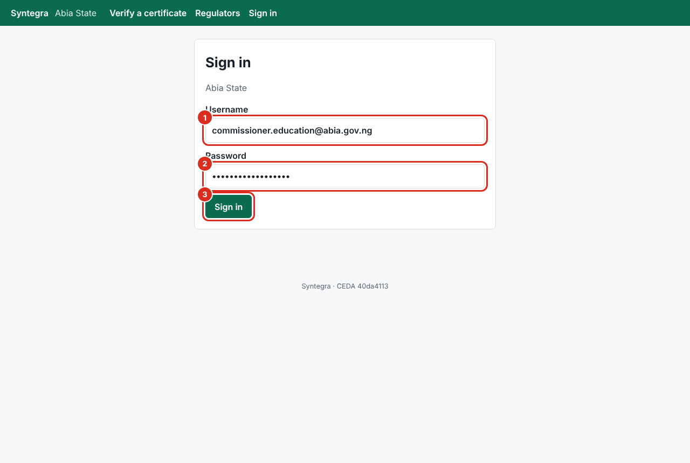

1. Type your **username** (usually your e-mail address).
2. Type your **password**.
3. Press **Sign in**.

You arrive at your home page. If you hold more than one role (for example head of one school and teacher at another),
choose the one you want to work in; you can change it at any time with **Switch role** in the top bar. **Sign out**
when you leave a shared computer.

*Problems.* "The username or password is incorrect" — check Caps Lock and try again; after repeated failures wait a few
minutes or ask your administrator to reset the password.

---

### 30.3 Commissioner and ministry: see how every school is doing

**Who:** Commissioner, ASUBEB, state ministry, LGA education officers (an LGA officer sees only that LGA).
**Where:** menu **Control room** (`/command/control-room`, page CMD-101).

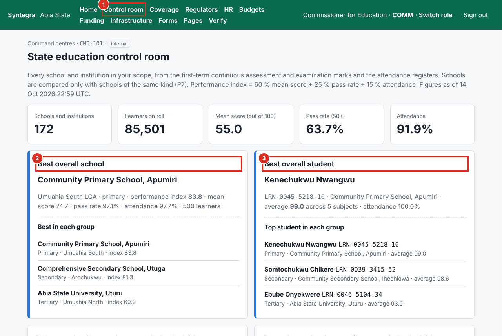

1. Click **Control room** in the menu.
2. Read the **Best overall school** card: the school, its LGA, its performance index and how it was reached (mean
   score, pass rate, attendance). Under it, the best school in each group — primary, secondary, tertiary.
3. Read the **Best overall student** card: the learner's name and Global Learner ID, school, average and attendance.
   Under it, the top student in each group.

The five tiles at the top are the state's headline figures: schools and institutions, learners on roll, mean score,
pass rate and attendance.

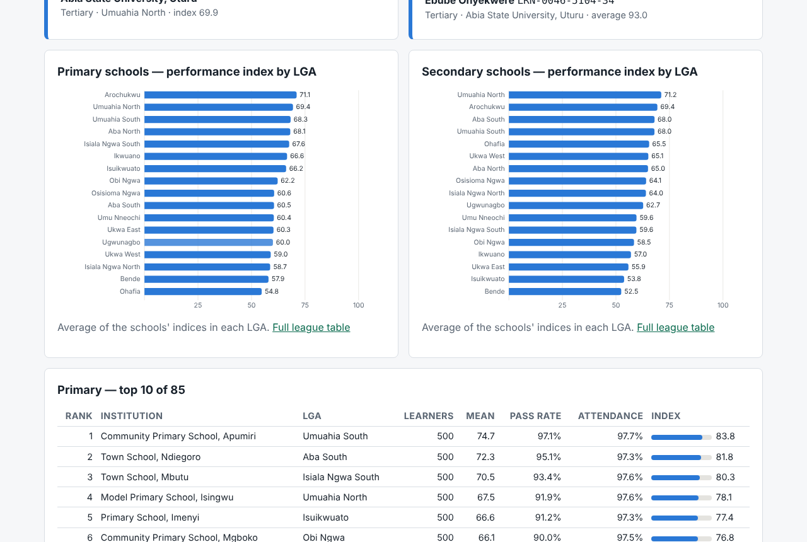

4. Scroll down to **performance index by LGA**: one bar per LGA, longest first, for primary and secondary schools.
   Hover over a bar to see the exact value and the number of schools.
5. Below the charts, the **top 10** of each group. Click **See all** for the full list.

*How the index is worked out:* 60 % mean score + 25 % pass rate + 15 % attendance. Schools are compared only with
schools of the same kind, so a primary school is never ranked against a university.

---

### 30.4 Compare schools against each other

**Where:** **See all** under any top-10 table, or `/command/compare` (page CMD-102).

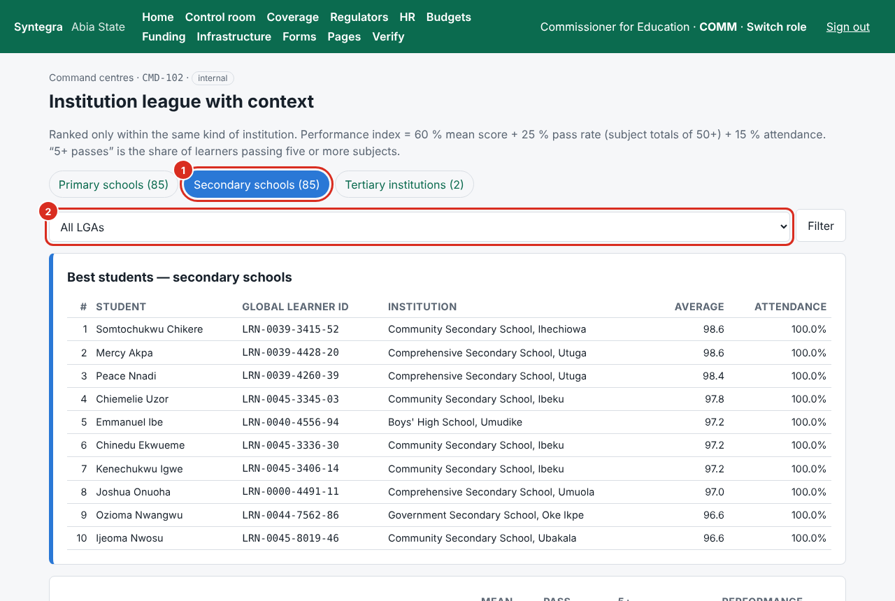

1. Choose the group: **Primary schools**, **Secondary schools** or **Tertiary institutions**.
2. To look at one LGA, choose it in the list and press **Filter**. Choose *All LGAs* to go back.
3. The first table is the **best students** of the group; the second ranks **every school** with its learners, mean
   score, pass rate, share of learners with five or more passes, attendance and performance index.

---

### 30.5 See the state of school buildings (Commissioner's infrastructure view)

**Where:** menu **Infrastructure** (`/estate/state`, page EST-03).

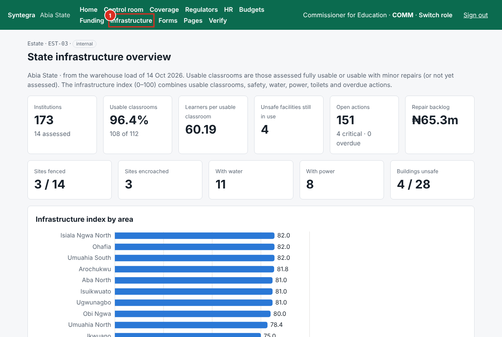

1. Click **Infrastructure**.
2. Read the tiles: how many classrooms are usable, how many learners share each usable classroom, unsafe facilities
   still in use, open and critical actions, and the cost of repairs waiting (the backlog).
3. **Infrastructure index by area** compares the LGAs. Click an LGA's name in the table below the chart to look inside
   it; keep clicking to reach a single school.
4. **Institutions needing attention first** lists the lowest-scoring institutions first.

The figures come from the nightly warehouse load; the date of the load is shown under the title.

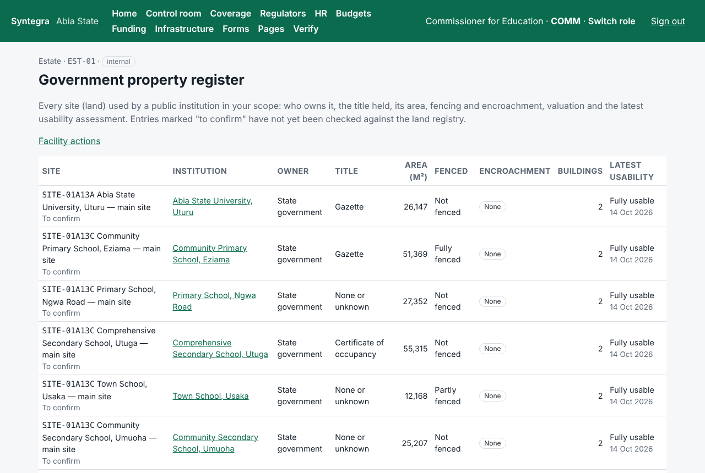

5. For the land itself, open **Property register** (link at the foot of the page, `/estate/property`): each site's
   owner, title document, area, fencing, encroachment and latest assessment. Rows marked *to confirm* still need
   checking against the land registry.

---

### 30.6 See funding and loans across the state

**Where:** menu **Funding** (`/funding`, page FND-01).

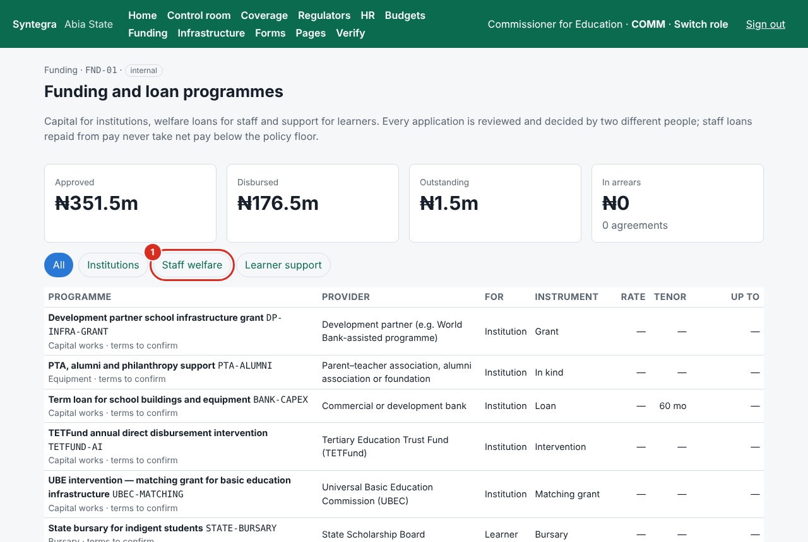

1. Use the tabs — **Institutions**, **Staff welfare**, **Learner support** — to see the programmes for each.
2. The tiles show what has been approved, disbursed, is still owed and is in arrears.
3. Scroll down to **Applications** and **Agreements**. Click an agreement number to open it (§30.20).

---

### 30.7 Head of school: your home page

**Who:** head teacher, principal, provost, rector, vice-chancellor. **Where:** **Home**.

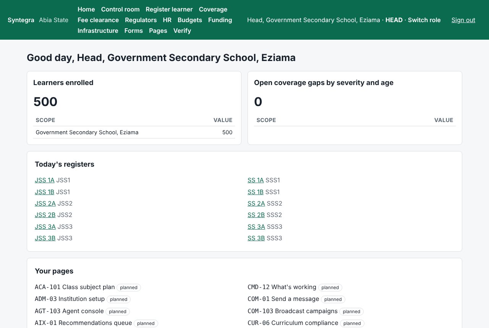

Your home page shows learners enrolled, open coverage gaps, **today's registers** for every class (click a class to
take its register) and the pages your role can use (*planned* pages are not yet available).

---

### 30.8 Take the class register

**Where:** **Home → Today's registers →** the class.

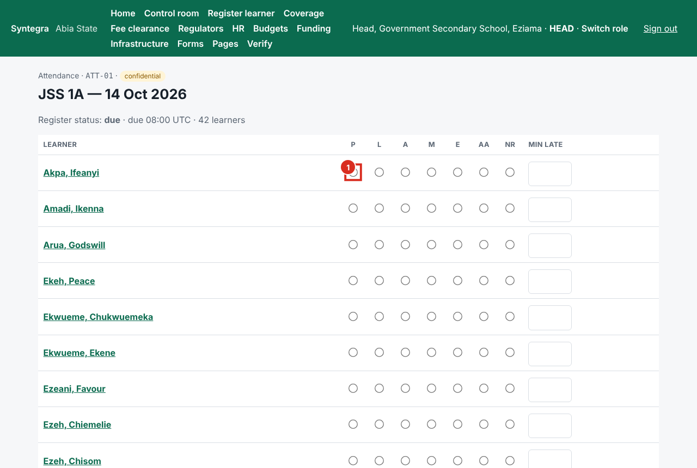

1. For each learner click one mark: **P** present, **L** late, **A** absent (unauthorised), **M** medical, **E**
   excused, **AA** approved activity, **NR** not required. For **L**, type the minutes late.
2. Scroll down and press **Save register**.

A register submitted after its due time is accepted and marked late. Click a learner's name to open their record.

---

### 30.9 Register a new learner

**Where:** menu **Register learner** (`/learners/new`, page LRN-02).

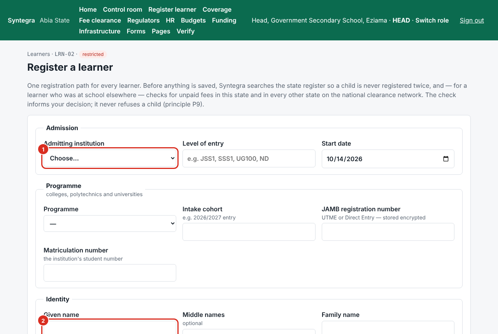

1. **Admission:** choose the institution and the level. For a college, polytechnic or university also choose the
   programme and cohort and enter the JAMB registration and matriculation numbers.
2. **Identity:** given, middle and family names, date of birth and sex. Add the NIN and state of origin if you have
   them.
3. **Parents and guardians:** a learner under 18 needs at least one guardian with parental responsibility. Add up to
   two; tick who the child lives with, who may collect the child and who pays.
4. Press **Check and register**. If Syntegra finds a possible existing record of the same child it shows it: open it, or give the reason and press
   **Register as a different child**.
5. Before admitting a transfer, Syntegra checks unpaid fees at other schools (§30.10). It never stops the child
   attending.

When it is saved you get the learner's **Global Learner ID** (e.g. `LRN-0045-5218-10`) and a link to their record.
Whole classes are loaded by the roll import, not one by one (§29.1).

---

### 30.10 Check unpaid fees before admitting a learner

**Where:** menu **Fee clearance** (`/admissions/clearance`, page FCL-01).

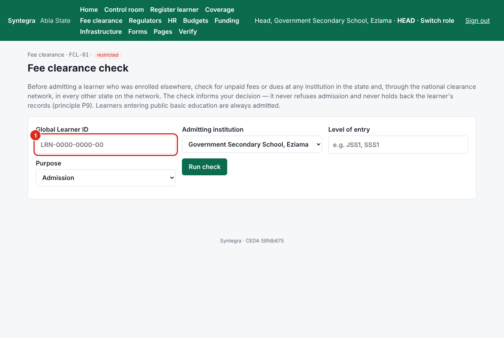

1. Type the learner's **Global Learner ID**, choose your institution, the level and the purpose (admission or
   transfer), and press **Run check**. Syntegra asks every school in your state — and, through the national network,
   every other state — whether the learner owes fees.
2. If nothing is owed, admit. If fees are outstanding you see who is owed and how much; record your decision —
   **admit**, **admit with a payment plan** or **defer pending settlement** — with a reason, and press **Record decision**.

The check never holds back the learner's records, results or right to attend.

---

### 30.11 See everything about one learner (learner 360)

**Where:** click a learner's name anywhere, or `/learners/{id}` (page LRN-04).

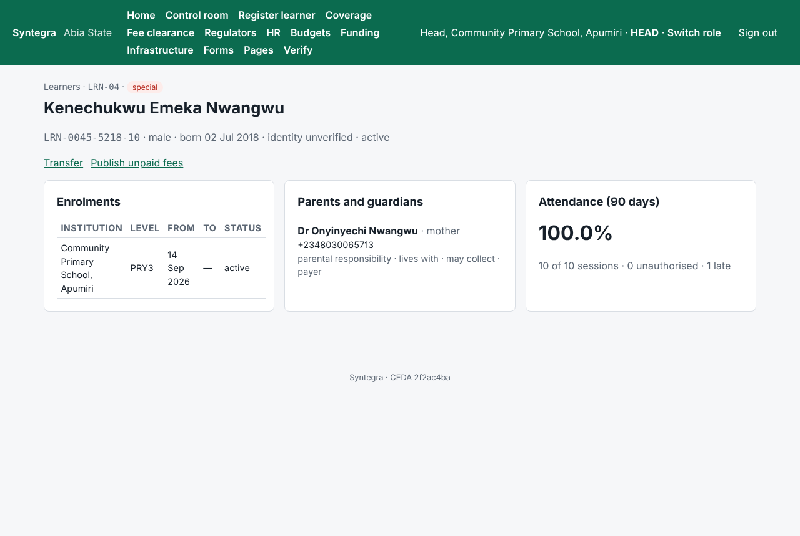

The page shows the learner's enrolments, parents and guardians and attendance over 90 days. **Transfer** moves the
learner to another school (the receiving school's fee check runs first); **Publish unpaid fees** tells other schools
what the learner owes yours.

---

### 30.12 See who regulates your school

**Where:** `/institutions/{id}/regulation` (page REG-02), linked from the school's pages, and the public **Regulators**
directory (`/regulators`).

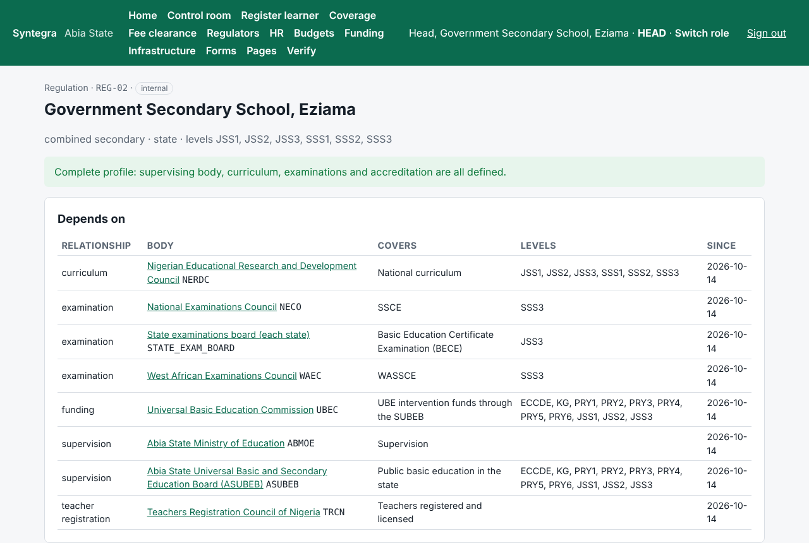

Every body your school depends on — in Abia, the Ministry of Education and ASUBEB (supervision), UBEC (funding),
NERDC (curriculum), TRCN (teachers), WAEC and NECO (examinations) — with any **gaps** the platform found. A state
administrator adds or ends a link with the forms *Link a regulator* and *End a regulator link*.

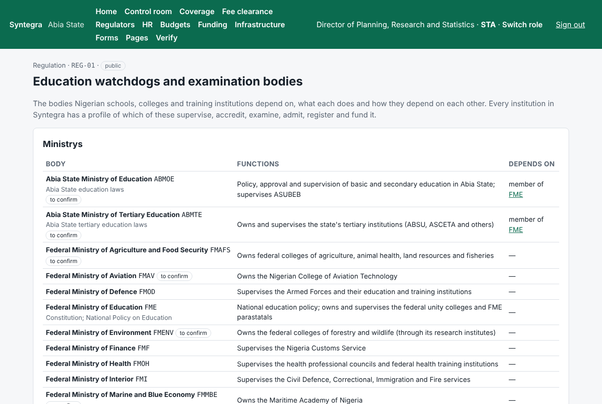

---

### 30.13 Find any form

**Where:** menu **Forms** (`/forms`).

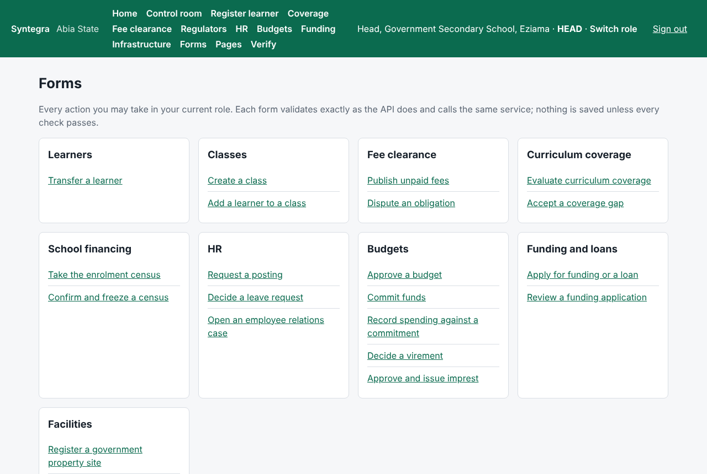

Every action you are allowed to take, grouped by subject. Click a form, fill it in as in §30.1 and press its button.
If you cannot see a form, your role does not include that action.

---

### 30.14 State ministry: register a new school

**Who:** state ministry (STA). **Where:** **Forms → Institutions → Register an institution**.

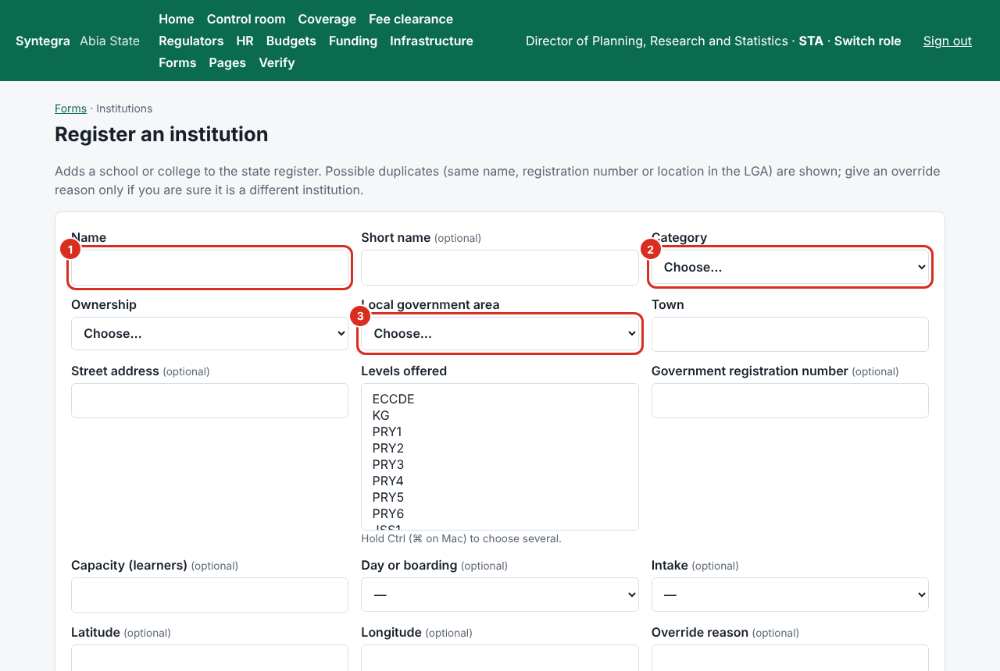

1. Type the **name**.
2. Choose the **category** (primary, junior/senior/combined secondary, technical college, college of education …) and
   the **ownership**.
3. Choose the **LGA**, type the town and choose the **levels offered** (hold Ctrl, or ⌘ on a Mac, to choose several).
4. Add the registration number, capacity, day/boarding, intake and location if known.
5. Press **Register institution**. If a school with the same name, number or location exists in the LGA, Syntegra
   shows it; give an **override reason** only if you are sure it is a different school.

The school gets its institution code, and its regulatory profile is filled in automatically.

---

### 30.15 HR: establishment and appointments

**Who:** head of establishments (HR). **Where:** menu **HR** (`/hr/establishment`, page HRM-01).

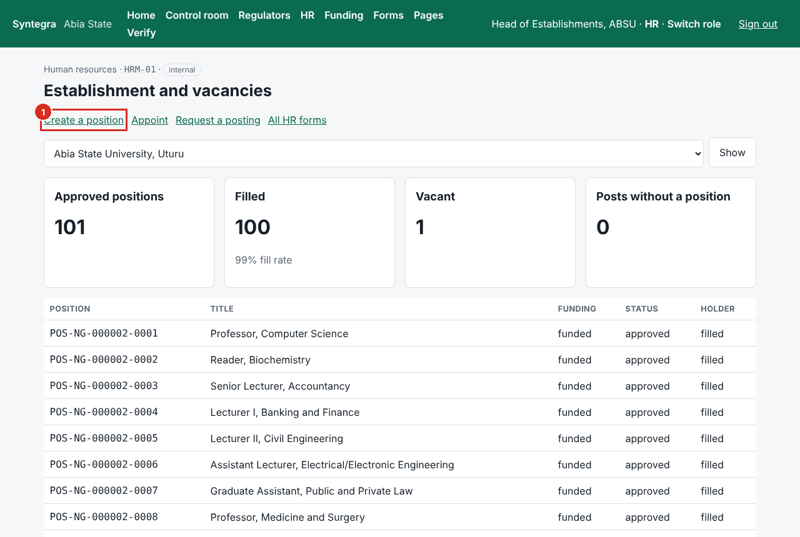

1. Choose the institution and press **Show**: approved positions, filled, vacant, and posts without a position.
2. Use the links above: **Create a position**, **Appoint**, **Request a posting**.

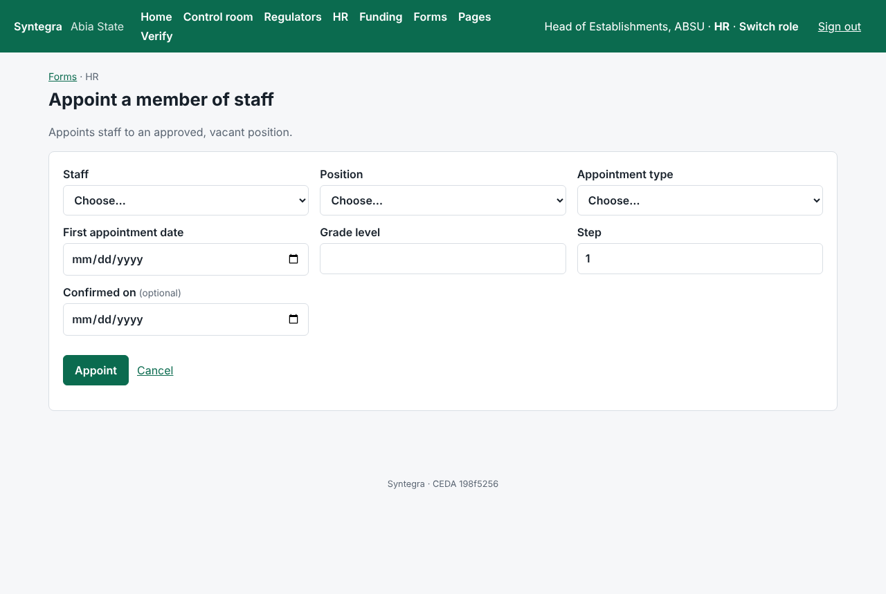

3. To appoint: choose the member of staff and the vacant position, the appointment type, the first appointment date,
   grade level and step, and press **Appoint**. Syntegra refuses an appointment past statutory retirement age or
   outside the position's grade range.

Other HR forms: leave requests and decisions, postings and their approval, separations, promotions, staff relations
cases, payroll integrity scans and holds, payroll runs and approval.

---

### 30.16 Bursar: budget against actual

**Who:** bursar, finance officer, head, state. **Where:** menu **Budgets** (`/finance/performance`, page FIN-02).

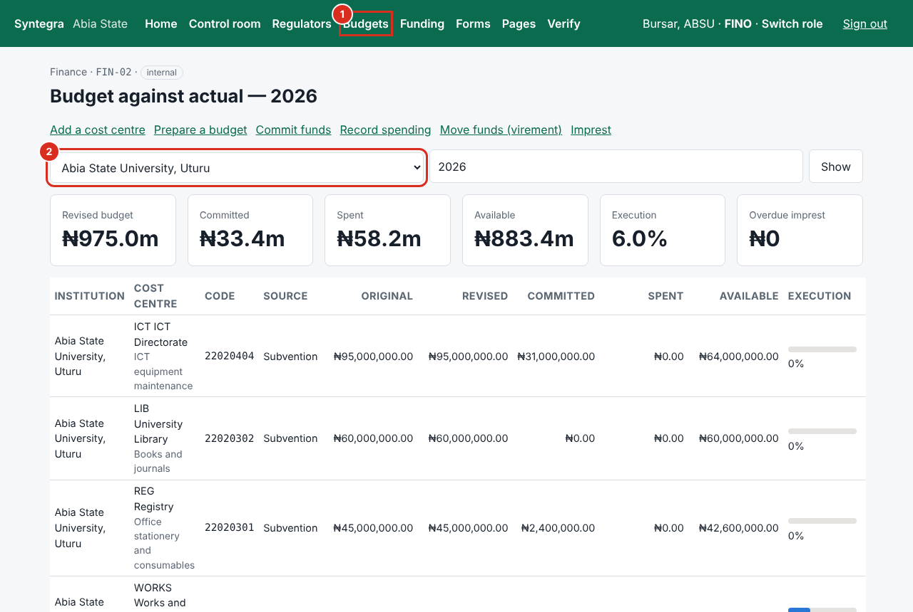

1. Click **Budgets**.
2. Choose the institution and the year and press **Show**.
3. The tiles show the revised budget, how much is committed, spent and still available, the execution rate and any
   overdue imprest. Each line shows its cost centre, economic code, funding source, original and revised amounts,
   committed, spent, available and a bar for execution.

### 30.17 Prepare and approve a budget

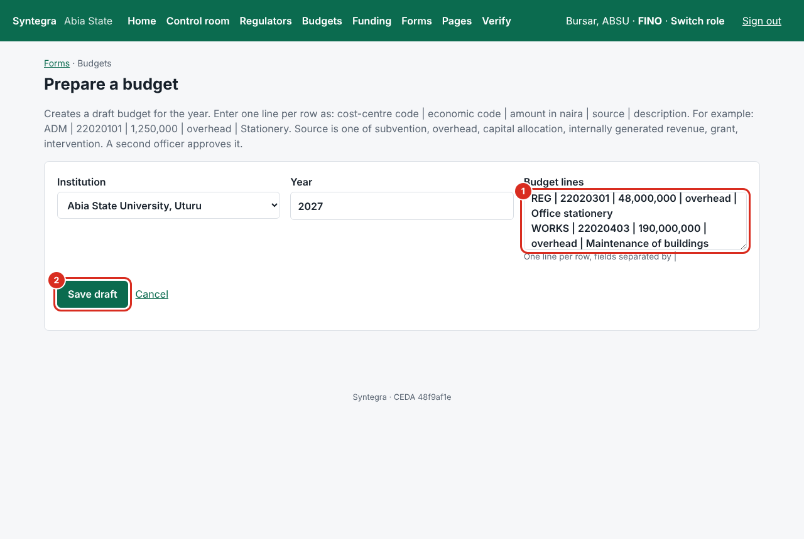

1. First add your **cost centres** (link *Add a cost centre*): code, name and kind.
2. Open **Prepare a budget**, choose the institution and the year.
3. In **Budget lines** type one line per row, with the parts separated by `|`:
   `cost-centre code | economic code | amount in naira | source | description` —
   e.g. `WORKS | 22020403 | 190,000,000 | overhead | Maintenance of buildings`.
4. Press **Save draft**.
5. A second person (the head or vice-chancellor) opens **Approve a budget**, chooses the draft and presses **Approve**.

### 30.18 Commit funds, record spending and move funds

1. Before ordering, open **Commit funds**: choose the budget line (its available amount is shown), the amount and
   what it is for. Syntegra refuses if the line has not enough available.
2. When you pay, open **Record spending**: choose the commitment and the amount. Tick **Final payment** to give any
   balance back to the line.
3. To move budget between lines, open **Move funds (virement)**:

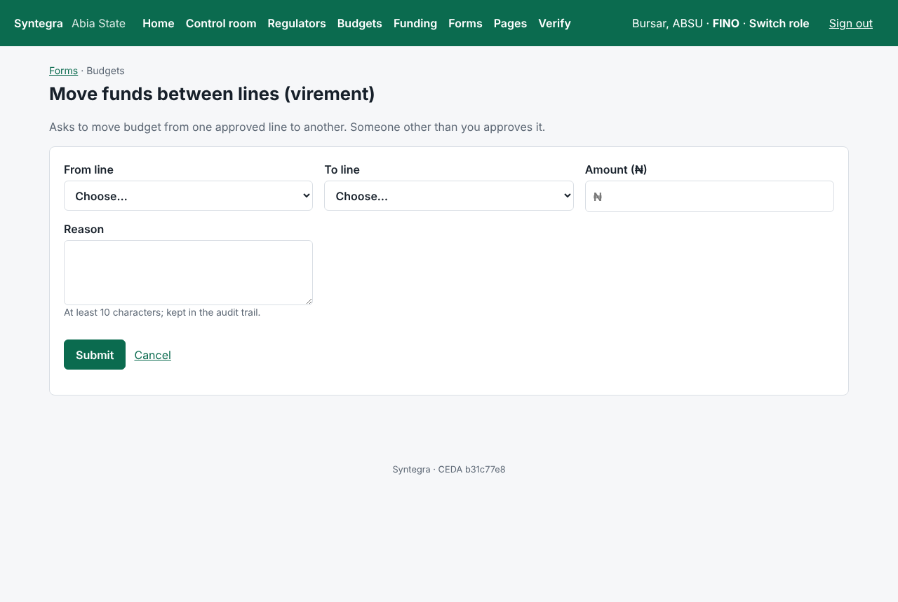

   choose the **from** and **to** lines, the amount and the reason, and press **Submit**. Someone else approves it in
   **Decide a virement**.

### 30.19 Imprest: request, approve, retire

**Where:** `/finance/imprest` (page ACC-01).

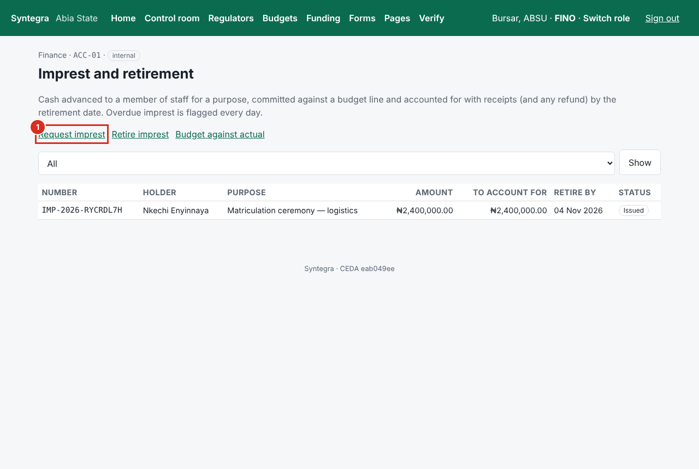

1. **Request imprest:** choose the member of staff, the budget line, the purpose, the amount and the date by which it
   must be accounted for.
2. **Approve and issue** (a different person): choose the imprest and *Approve*. The line is committed.
3. **Retire imprest:** list the receipts one per row — `reference | amount | payee` — enter the total spent and any
   cash refunded. Imprest not retired by its date turns **Overdue** (in red).

### 30.20 Apply for funding or a loan, and follow it to payment

**Where:** **Funding → Apply** (form *Apply for funding or a loan*).

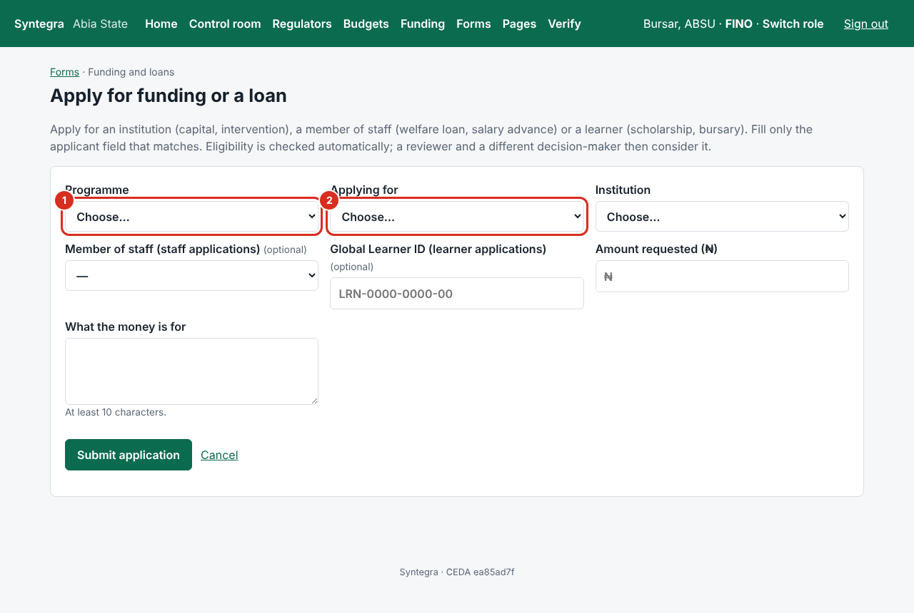

1. Choose the **programme**.
2. Choose who it is for — **institution**, **staff** or **learner** — and fill only the matching field (the
   institution, the member of staff, or the learner's Global Learner ID).
3. Enter the amount and what it is for, and press **Submit application**. The eligibility check runs; a failed check
   is shown to the reviewer but does not decide.
4. **Review** (another person): *Review a funding application* → recommendation.
5. **Decide** (a third person): *Decide a funding application* → approve or reject, with a reason and, if different,
   the amount approved.
6. **Sign the agreement:** *Sign a funding agreement*. For a staff loan repaid from pay, enter the gross monthly pay;
   Syntegra refuses the agreement if the repayment would take net pay below one third of gross.
7. **Disburse:** *Disburse funds* — choose the agreement, amount, payee and reference; choose a budget line to add the
   money to the institution's budget.
8. **Record repayments:** *Record a repayment*; it is applied to the oldest instalment first.

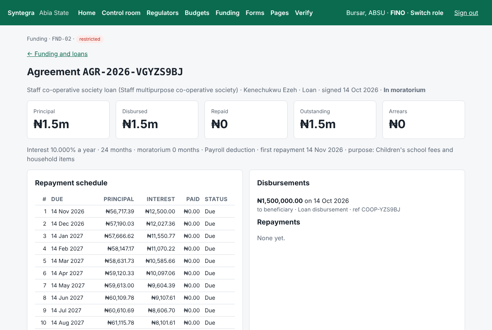

The agreement page shows the terms, balances, repayment schedule, disbursements and repayments. A member of staff sees
their own agreements.

---

### 30.21 Facilities: your workspace

**Who:** head of any institution — nursery, primary, secondary, technical, college, university — and the facilities
officer. **Where:** menu **Facilities** (`/estate`, page OPS-01).

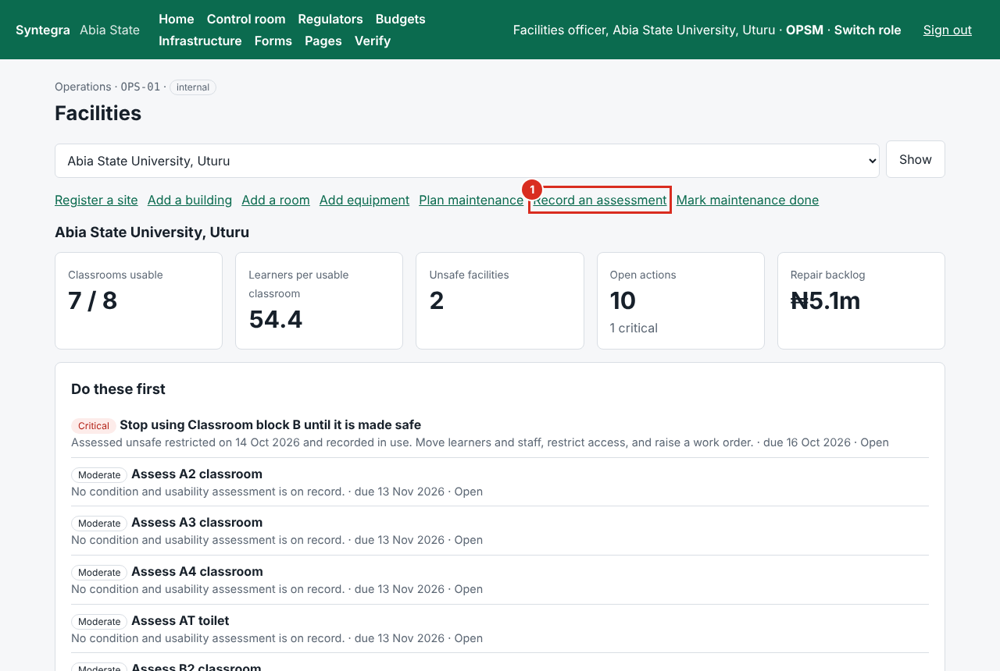

1. Choose the institution and press **Show**.
2. Read the tiles: usable classrooms, learners per usable classroom, unsafe facilities, open actions and the repair
   backlog.
3. **Do these first** lists the actions the platform proposes, most urgent first, with due dates.
4. Below: buildings and rooms with their latest usability, sites, equipment and the maintenance plan.
5. Use the links to **register a site**, **add a building**, **add a room**, **add equipment**, **plan maintenance**,
   **record an assessment** or **mark maintenance done**.

### 30.22 Record a condition assessment

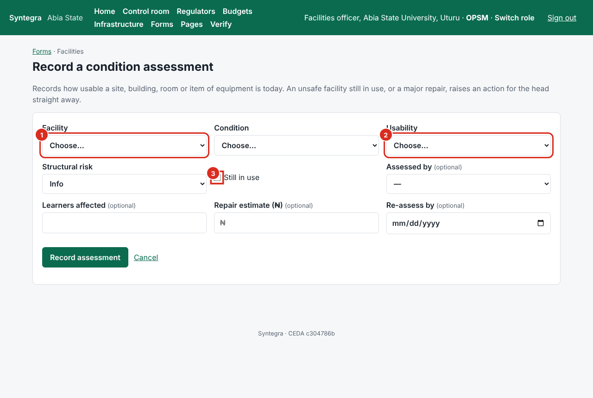

1. Choose the **facility** — a site, building, room or item of equipment.
2. Choose the **condition** and **usability** (fully usable … condemned) and the structural risk.
3. Tick **Still in use** if people are still using it.
4. Add learners affected, the repair estimate and when to re-assess, and press **Record assessment**.

If an unsafe facility is still in use, a **critical** action appears at once for the head: move learners and staff,
restrict access and raise a work order.

### 30.23 Act on facility actions and plan maintenance

**Where:** `/estate/actions` (page EST-02).

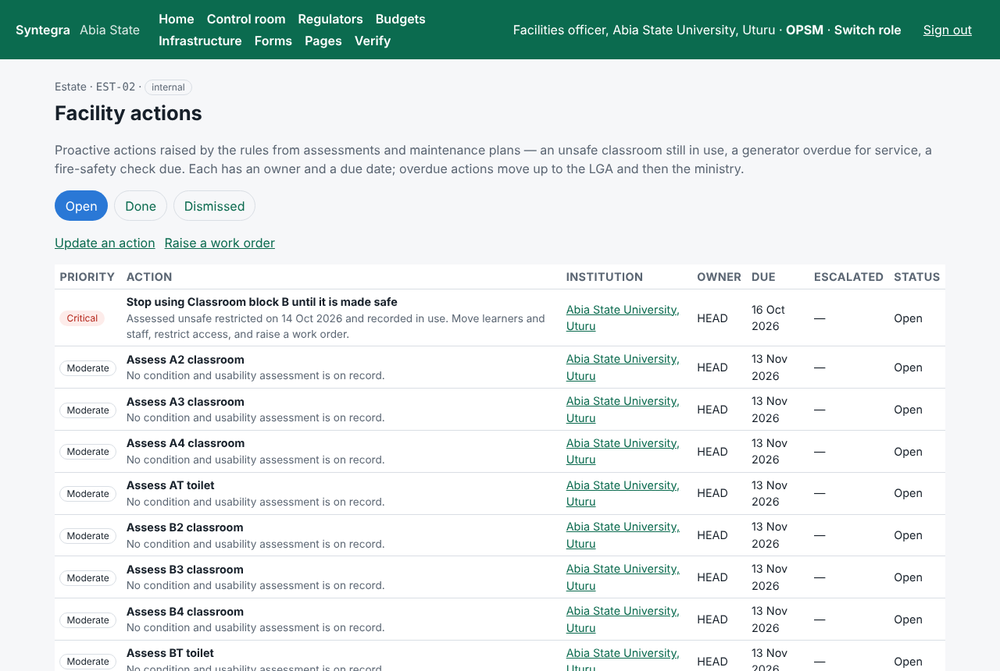

1. Open **Update a facility action**: choose the action and set it to *acknowledged*, *in progress* or *done*. To
   dismiss one, give a reason of at least ten characters.
2. **Raise a work order** turns an action into a maintenance request with the same priority and due date.
3. **Plan preventive maintenance**: the facility, the task, how often (days) and the next due date. When it is done,
   **Mark planned maintenance done** — the next due date moves on.

Actions not dealt with by their due date move up to the LGA and then the ministry.

---

### 30.24 Anyone: verify a certificate

**Where:** **Verify** (`/verify`), no sign-in needed.

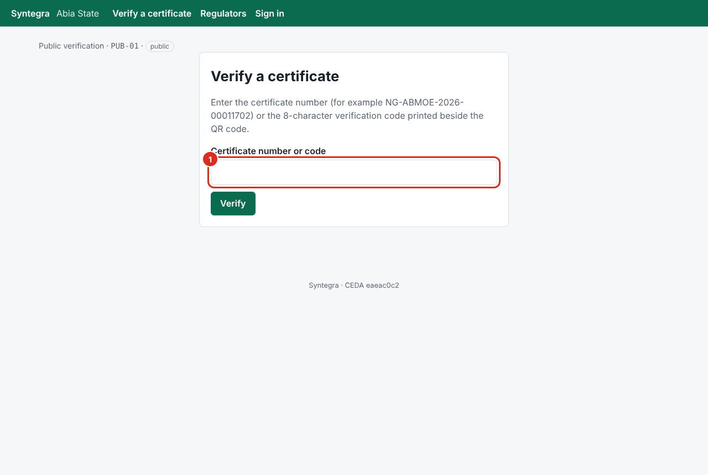

1. Type the certificate number exactly as printed and press **Verify**. Syntegra says whether it is genuine, by whom
   it was issued and whether it has been replaced.

---

### 30.25 Security agencies' training institutions

**Who:** security training administrators and officers, at the Federal Security Education Registry address.
**Where:** menu **Security training** (page STI-01).

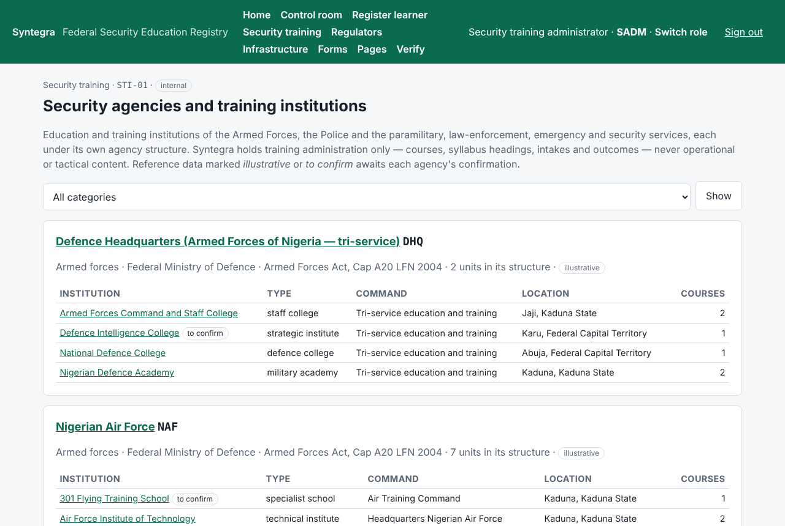

1. Choose an agency to see its own structure (headquarters, commands, formations), its ranks and its training
   institutions; choose an institution to see its courses; a course to see its curriculum and intakes.
2. Forms: **Create a course intake**, **Add a trainee to an intake**, **Record a trainee's outcome**, and the course
   import for official files.

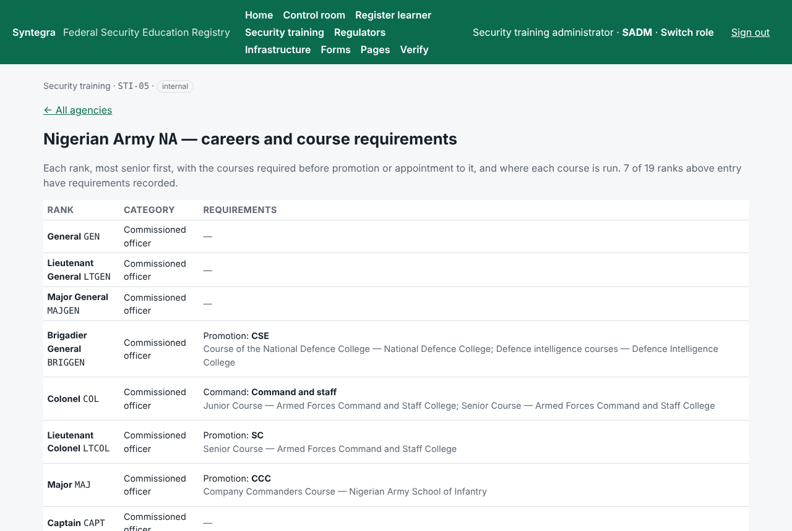

3. On an agency, **Careers and course requirements by rank** (page STI-05) lists each rank, most senior first, the
   courses required before promotion or appointment, where each course is run, and which units sponsor, approve,
   deliver and hold quotas on each course.

---

### 30.26 On a phone

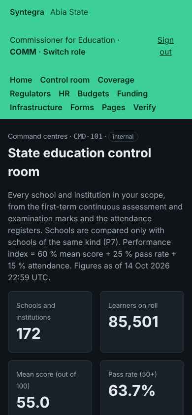

Every page works on a phone; tables scroll sideways and the menu wraps. Dark mode follows your phone's setting.

---

### 30.27 When something goes wrong

| You see | It means | What to do |
|---|---|---|
| Fields in red after pressing the button | Nothing was saved; the message says what is wrong | Correct each field and press the button again |
| "You do not have permission" / the page is missing from the menu | Your role does not include it | Switch role, or ask your administrator |
| "The person who requested … cannot approve it" | Four-eyes rule | Ask a colleague with the approving role |
| "Possible duplicate" when registering | A similar record exists | Open it; register anew only with a reason |
| "No longer enough available on the source line" | The budget line has been committed or spent since | Choose another line or a smaller amount |
| "Repayment would take net pay below the floor" | The staff loan is not affordable from pay | Reduce the amount or lengthen the tenor |
| A list is empty ("nothing waiting") | Nothing in your scope needs that action | No action needed |
| The control room or infrastructure figures look old | Figures are cached for ten minutes; the warehouse loads nightly | Check again later |

Quote the **page code** in the page line (e.g. `FIN-02`) and the time when you report a problem.

### 30.28 For integrators: the same tasks through the API

Every form has an API equivalent under `/api/v1/` with the same validation (problem responses, HTTP 422, never 500).
Sign in with `POST /api/v1/auth/sign-in` and send the token as `Authorization: Bearer …`.

| Task | Endpoint |
|---|---|
| Budget execution / prepare a budget | `GET` / `POST /api/v1/finance/budgets` |
| Approve a budget | `POST /api/v1/finance/budgets/{id}/approve` |
| Commit, spend, release | `POST /api/v1/finance/commitments`, `…/{id}/spend`, `…/{id}/release` |
| Virement and decision | `POST /api/v1/finance/virements`, `…/{id}/decision` |
| Imprest, approval, retirement | `GET`/`POST /api/v1/finance/imprest`, `…/{id}/approval`, `…/{id}/retirement` |
| Funding programmes, overview | `GET /api/v1/funding/programmes`, `GET /api/v1/funding/overview` |
| Apply, recommend, decide, sign | `POST /api/v1/funding/applications`, `…/{id}/recommendation`, `…/{id}/decision`, `…/{id}/agreement` |
| Disburse, repay, own agreements | `POST /api/v1/funding/agreements/{id}/disbursements`, `…/{id}/repayments`, `GET /api/v1/funding/mine` |
| Property register, sites | `GET`/`POST /api/v1/estate/sites` |
| Buildings, rooms, equipment | `POST /api/v1/estate/buildings`, `/rooms`, `/assets` |
| Assessments, maintenance | `POST /api/v1/estate/assessments`, `/schedules`, `/schedules/{id}/done` |
| Actions, work orders | `GET /api/v1/estate/actions`, `POST /api/v1/estate/actions/{id}`, `…/{id}/work-order` |
| Facilities workspace, infrastructure | `GET /api/v1/estate/institutions/{id}/workspace`, `GET /api/v1/estate/infrastructure` |

---

## 31. Sign-in identity, one session per account, documents and access levels (CR-007)

### 31.1 The school or office at sign-in

After a correct username and password, Syntegra shows the school, college or office of each of the user's active role
grants — its name and address, taken from the registry, never typed — and the user confirms one (or chooses, when they
hold several roles). Nothing else opens until they do. The name and address shown are copied onto the session
(`user_session.affiliation_*`, with the time of confirmation, audited as `sign_in_affiliation_confirmed`) and appear in
a bar under the menu on every page, with the user's access level.

| The grant's node | Shown |
|---|---|
| An institution (school, college, university) | `institution.name` and `institution.address` (town, LGA, state) |
| Any other node, or the grant's `office_scope_id` | The office's name and `scope_node.address` — e.g. a commissioner with state-wide scope works in the Abia State Ministry of Education, State Secretariat, Ogurube Layout, Umuahia |

Nothing about the account or its school is revealed until the password has been verified. Accounts with an
authenticator app enter its six-digit code first (AUT-02 `/auth/mfa`, `POST /api/v1/auth/mfa`): a code is accepted
once only, and wrong codes count with wrong passwords towards the account lock (five in ten minutes lock it for
fifteen). API clients confirm too: a session carries no role until `POST /api/v1/auth/role` confirms the school or
office, so pages and API follow the same rule. A role that ends while its holder is signed in (revoked, expired,
moved by a posting) is dropped from the session and the person is asked to choose again.

Offices are recorded by administrators with `access:manage` on ADM-101: each office's name and address (state,
boards, agencies, LGA education offices — `PUT /api/v1/access/offices/{id}/address`) and, for a person whose role has
a wider scope, the office they work in (`role_grant.office_scope_id`, `PUT /api/v1/access/grants/{id}/office`;
`grant_role(..., office_scope_id=...)` when granting).

### 31.2 One account, one session

A sign-in (page or API) is refused while another session of the same account is **in use** — activity within the last
15 minutes (`SYNTEGRA_SESSION_IN_USE_MINUTES`). The refused person is told when the account was signed in and when it
will be free; the person using the account sees a warning on every page that someone tried to sign in. Sessions quieter
than the window end as `replaced` when the account signs in again, so nobody is locked out by a forgotten browser.
Signing in again from the same browser or API client (it presents its own session) replaces that session, and a
session whose school or office was never confirmed does not count as in use. Every
session records why it ended: `signed_out`, `idle_timeout`, `expired`, `replaced`, `ended_by_administrator`,
`account_inactive`; the person whose session ended is told why at the sign-in page. Administrators with
`session:manage` see the sessions of users in their scope (ADM-102, `GET /api/v1/auth/sessions`) and end one with a
reason (`POST /api/v1/auth/sessions/{id}/end`).

### 31.3 Document management

**Documents** is in the main menu for roles with `document:view`, `document:search` or `document:upload`.

| Step | What happens |
|---|---|
| Upload (DOC-107, `POST /api/v1/documents`) | One or more scans (PDF, JPEG, PNG, TIFF or text; type checked from the bytes, 25 MB each) under a school, with category, title, dates or session, class, subject, the reference written on the paper and a description |
| Reference number | `<institution code>/<category>/<year>/<sequence>`, e.g. `INS-NG-000129/ADM/1998/00001`, unique in the state |
| Storage | Write-once, content-addressed object storage (in production under compliance object lock, §32.1); each object is written to a temporary file and linked into place only when complete, so no partial object is ever kept; the SHA-256 is recorded at upload and checked on every read; the same scan is stored once (a second upload is refused and points to the existing reference when the uploader could open it) |
| Index | `document_index`: title, keywords (category, school, session, class, subject, paper reference, description) and the text — the PDF text layer, text files, OCR with Tesseract (installed in the production image), and any transcription typed at upload — under a MySQL FULLTEXT key; special-category documents are never indexed |
| Search (DOC-104, `GET /api/v1/documents`) | Words (all must match, prefixes allowed), a reference number, school, category and year; results ranked by relevance, limited to the caller's scope and access level inside the full-text query itself; restricted documents only with a declared purpose, recorded with the search |
| School register (DOC-108) | Each school's complete register on one page, grouped by category with reference numbers, storage used, and search within the school; restricted documents are counted, and listed once a purpose is declared |
| Viewer (DOC-105) | Metadata, the scan with an on-screen watermark (viewer and time), download, and **Download as Word** |

**Word copies.** A scan is kept as the record — stamps, signatures and handwriting are evidence, and text read by OCR
from old or handwritten pages contains errors. For editing, quoting and retyping, the viewer makes an editable Word
(.docx) copy on demand from the indexed text, with the reference, school, category and dates at the top. It is never
stored, so it takes no space. Space is saved where it matters: one copy per scan, scanning at 200–300 dpi greyscale,
and storage used shown per school.

**Who sees what.** Scope (the school's node in the governance tree) decides which schools; `document:view` opens the
documents of one's schools; `document:search` (Ministry of Education, Commissioner, ASUBEB, LGA education authorities,
records managers) searches across every school in scope; the document's classification must be within the user's
access level; restricted documents (staff files, finance, discipline) also need a declared purpose
(`records_retrieval`); every upload, search, view, download and Word copy is audited.

### 31.4 Access levels

| Level | Classification | What it covers |
|---|---|---|
| 1 · Public | public | Published information: certificate checks, regulators, public directories |
| 2 · Internal | internal | Working information for staff: registers, timetables, aggregates, facilities, summary budgets |
| 3 · Confidential | confidential | Personal records of learners, families and staff; school documents |
| 4 · Restricted | restricted | HR and payroll, investigations, special needs, discipline, loans, restricted documents — a purpose is declared |
| 5 · Special | special | Safeguarding and health — named, cleared users only, never indexed or exported |

A role's `clearance` is its level; `role_grant.clearance_cap` lowers it for one person in one role (ADM-101,
`PUT /api/v1/access/grants/{id}/level`), never above the role's level or the administrator's own, never on one's own
grant, always with a reason — restoring a lowered grant counts as setting the role's level. ADM-101 searches and
counts every grant in scope in the database, a page at a time. The effective level of the active role decides: forms
(the level of the page each form writes through, `web.forms.FORM_PAGES`), pages (each page's catalogue
classification, or a lower entry level for pages that withhold their sensitive parts per viewer — Learner 360,
registration, fee clearance, funding agreements), menu items (hidden when the page is above the level), fields
(`authz.visible_fields`) and documents.

| Page | Route | Who |
|---|---|---|
| DOC-104 Documents | `/documents` | Roles with document permissions |
| DOC-105 Document viewer | `/documents/{id}` | Within scope and level |
| DOC-107 Upload documents | `/documents/upload` | `document:upload` |
| DOC-108 School documents | `/institutions/{id}/documents` | Within scope and level |
| ADM-101 Access levels | `/admin/access-levels` | `access:manage` |
| ADM-102 Active sessions | `/admin/sessions` | `session:manage` |

## 32. Evidence-grade documents, the second factor, single sign-on and staging (CR-008)

### 32.1 Write-once masters under object lock

A document's master — the scan as captured — is evidence. In production (and staging) it is stored only in
S3-compatible object storage, in a bucket created with **object lock** (`SYNTEGRA_OBJECT_STORE=s3`; production refuses
to start without `SYNTEGRA_S3_BUCKET`):

| Guarantee | How |
|---|---|
| Written once | A conditional write (`If-None-Match: *`) under the content-addressed key `<prefix>/<aa>/<sha256>.<ext>`; when the store refuses because the key exists, the existing object is read back and must be byte-identical |
| Arrives intact | The SHA-256 computed at upload is sent as the object's checksum; the store refuses bytes that differ |
| Cannot be changed or deleted | Object lock in **compliance** mode (`SYNTEGRA_S3_LOCK_MODE`) until `document.master_retain_until`: the end of the category's file-plan retention, or `SYNTEGRA_PERMANENT_RETENTION_YEARS` (100) for permanent records. Nobody, administrators included, can shorten it |
| Read back verified | Every read recomputes the SHA-256 and withholds an object that no longer matches |

`document.master_store`, `master_lock_mode` and `master_retain_until` record where the master is and until when; the
viewer (DOC-105, *Evidence*) shows the lock and the master's hash. Development and tests use the filesystem store
(`fs`), which keeps the write-once and hash rules but not the lock.

### 32.2 A searchable copy beside the original

When OCR reads a scan, the same pass produces a **searchable PDF copy**: each page image with the words laid
invisibly (PDF text render mode 3) where they were read. A reader sees the scan exactly as captured and can search,
select and copy its words. The copy is a `document_rendition` (`kind=searchable_pdf`) with its own SHA-256, the SHA-256
of the master it was made from (`source_sha256`), its page count and the OCR engine, stored write-once under the same
lock. The master is never altered; the viewer shows the searchable copy and offers both for download.

### 32.3 Stamped releases and the release register

Every copy that leaves the system is a **release** (`document_release`, append-only):

| Copy | What is released |
|---|---|
| Stamped copy of the scan | A PDF (images are first placed on pages) with a band on every page: released to whom, when, for what purpose, and a release code such as `K7Q2-M9XD-4TPA`, with the code faintly across the page |
| Stamped searchable copy | The searchable copy, stamped the same way |
| Word copy | The editable copy (§31.3), with the stamp at the top and bottom |
| Certified true copy | The master byte for byte, unstamped — only with `document:certify` and a reason of at least ten characters (e.g. the court order), registered like every other copy |

The register records the release code, the copy's kind, who received it, when, the purpose or reason, and the
SHA-256 of the exact bytes released. On DOC-109 (`document:releases`: state administrators, records managers) a release
code typed from paper resolves to its release; a file presented with it is reported as **identical to the copy
released**, **identical to the master**, or **not the copy released**. API: `GET /api/v1/records/releases`,
`GET|POST /api/v1/records/releases/{code}`; every download carries its code in `X-Syntegra-Release`.

### 32.4 The second factor, enrolled by the user and enforced at sign-in

Anyone whose roles act at or above `SYNTEGRA_MFA_REQUIRED_CLEARANCE` (Restricted by default; production refuses to
start without it) must have an authenticator app. After the password, such a user without one is taken straight to
enrolment; no role applies, on the pages or through the API, until it is done:

1. **Enrol** (`/me/authenticator`, `POST /api/v1/me/mfa/totp`): a new TOTP seed, shown as a QR code drawn on the page
   and as a key to type, kept as an *inactive* factor;
2. **Confirm** with the first code from the app (`POST /api/v1/me/mfa/totp/{id}/confirm`): the factor becomes active,
   the session counts as having passed the second factor, and **ten recovery codes** (`XXXXX-XXXXX`) are shown once and
   stored only as keyed hashes (`mfa_recovery_code`);
3. **Every later sign-in** asks for the app's code (AUT-02); a recovery code stands in for it once.

Adding another authenticator, removing one or making new recovery codes needs a session that has passed the second
factor; the last authenticator of an account whose roles need one cannot be removed. Users below the threshold may
enrol and are then always asked. Sessions record how they were authenticated (`password`, `password+totp`,
`password+recovery`, `sso:<provider>`, `sso:<provider>+idp_mfa`). HOM-04 `/me` shows the account's roles,
authenticators and recovery codes left.

### 32.5 Single sign-on (OpenID Connect)

The CR-003 model is built. Each state configures its providers on ADM-103 (`sso:manage`): the state's government ID,
Microsoft Entra ID or Google Workspace, with issuer, client id, client secret (envelope-encrypted, never shown again),
allowed e-mail domains and whether the provider's MFA is trusted. Enabled providers appear as buttons on the sign-in
page.

| Step | Rule |
|---|---|
| Start | Authorization code flow with PKCE (S256); `state`, `nonce` and the verifier in a signed cookie valid for ten minutes |
| Token | The code is exchanged at the provider's token endpoint with the verifier and the client secret |
| ID token | Signature checked against the provider's published keys (RS256, PS256, ES256; keys re-read once on rotation); issuer, audience, `azp`, expiry and nonce checked |
| Account | Only an account the state created: matched by the provider's subject once linked, otherwise by an e-mail address the provider marks verified (Entra: `xms_edov`) in an allowed domain. An account created for single sign-on (no password, *invited*) is activated by its first verified sign-in; suspended or deactivated accounts stay shut. Nothing is created and no role comes from the provider |
| After linking | The password no longer opens the account |
| Second factor | The provider's MFA (`amr`) counts only where the state trusts that provider; otherwise the local code, or enrolment, follows |
| Session | As for a password: one session per account, then the school or office is confirmed |

### 32.6 One rule for pages, forms and the API

A write through the API needs the access level of the web form that performs the same action (FR-ADM-203). The forms
register each write permission's level at start-up (`web.forms.write_levels`: the level of the page each form writes
through); the API refuses an unsafe request below it with `AUTH-LEVEL`, as the form does, before the services' own
data-level checks. A test walks every API route and checks that the level of every form action is enforced there.

### 32.7 Staging: the production image against real infrastructure

Before a release goes to production, CI (`.github/workflows/app.yml`, job *staging*; `deploy/staging/`) runs the
production image and settings against:

| Component | Staging |
|---|---|
| Database | MySQL 9.7 requiring TLS; the application connects with `ssl_mode=VERIFY_IDENTITY` (`SYNTEGRA_DB_SSL_CA`) as a least-privilege account |
| Object storage | An S3-compatible store (Versity Gateway) with versioning and compliance object lock |
| Identity provider | Keycloak, standing in for the state's OpenID Connect provider |
| Keys | The one difference from production: `LocalKeyProvider` with a staging-only secret, because the HSM-backed provider is configured per state (production refuses `LocalKeyProvider`) |

The smoke test signs the administrator in and enrols their authenticator, uploads a scan (OCR, full-text search),
checks the master's compliance lock, the stamped release and its check in the register, the searchable copy, that the
store itself refuses overwriting and deleting, and signs a person in through the identity provider. With the
application stopped, every zone is dumped over TLS by a read-only backup account and every object version mirrored
with its hash; the dumps are restored into an empty MySQL, every table's row count is compared with the live database,
and every recorded master and searchable copy is checked against its recorded SHA-256.

## 33. Subjects and teachers, the timetable and lessons linked to the curriculum

### 33.1 Subjects and teachers (ACA-101)

Each class's page (`/classes/{id}/plan`, heads; `class:view` to open, `class:manage` to change) lists its subjects with
the periods a week, the curriculum version that applies and the teacher of record, and checks the teaching chain on
every row:

| Check | Rule |
|---|---|
| G2 | A mandatory subject has exactly one teacher of record |
| G3 | The teacher of record holds a verified, unexpired teaching authorisation (`staff_qualification`, TRCN) for the subject at the class's level |

The head assigns a teacher from the staff posted to the school, as teacher of record or co-teacher. A second teacher
of record is refused unless the head asks to **replace**: the current assignment then ends and the new one starts in
the same change. A teacher without the authorisation can be assigned only with a written reason (at least ten
characters), which is kept on the assignment (`justification`) and shown on the row; the row stays flagged G3 until
an authorisation is verified. An assignment ended today is no longer current — the hand-over takes effect at once —
but still counts for lessons already taught today. Every change emits `CUR.ASSIGNMENT_CHANGED`. The page also shows
each teacher's subjects and load (teacher-of-record periods a week across the school). The coverage engine (CUR-101)
opens gaps from the same rules.

### 33.2 The timetable

The school's week (`timetable`, `period_structure`, `timetable_lesson`) is built from the class subject plans and their
teachers of record (`timetable:manage`): a bell schedule of nine 35-minute periods with a break and lunch; each lesson
placed so that no class, teacher or room is in two places at once, a subject at most once a day while days remain, in
the class's home room when it is free and otherwise another classroom not assessed unsafe. A class-subject that cannot
be placed in full is recorded in `unmet_requirements` and the timetable stays a draft; a complete one is published and
supersedes the previous version. Dated lessons (`lesson_occurrence`) are materialised only when a delivery log refers
to them.

### 33.3 Lessons linked to the curriculum (CUR-09)

A class-subject carries the curriculum version adopted by the school for its level (`curriculum_adoption`,
`class_subject_plan.curriculum_version_id`). For its teacher of record the **scheme of work** is drafted from that
version: the term's objectives, in curriculum order, spread over the term's teaching weeks in proportion to their
minimum hours, the last two weeks kept for revision and examinations (`scheme_of_work`, `scheme_week`). Within a week the
objectives are shared out over the week's timetabled lessons in order, so **each lesson shows the objectives planned for
it**. After a hand-over the new teacher works from the class-subject's latest scheme.

On `/teaching/plans` (teachers: `lesson:plan`, `lesson:deliver`; heads see every class-subject of the school) the
teacher picks a class and subject and a week and sees each lesson with its day, period, time and room, the planned
objectives with their topic, and what was delivered. After the lesson the teacher logs the objectives actually covered
(the planned ones ticked; the rest of the week's and any the class is behind on offered), the minutes taught, the
learners present and a note (`delivery_log`, append-only, `CUR.LESSON_DELIVERED`). A lesson is logged once, only by the
teacher it is timetabled for, only on its own day, never before it has taken place, and only with objectives of its
class-subject's curriculum; `is_as_planned` records whether every planned objective was covered. The page counts the
term's objectives, those planned up to the week and those delivered, and lists the objectives behind the scheme.

### 33.4 Demonstration data

At the sample secondary schools the demonstration load adds three junior-secondary teachers, every teacher's TRCN
authorisations, a teacher of record for every class-subject from the start of the session (in JSS 1B Basic Science a
Chemistry teacher covers without the authorisation, with the head's reason, so G3 shows; a co-teacher for SS 2A
Biology practicals), the NERDC SS 2 first-term curricula for Mathematics, English Language, Biology, Civic Education and
Igbo Language (authored and approved by two different state curriculum officers) adopted for SS 2, the published
timetable, the SS 2 schemes of work, and the SS 2 Mathematics lessons logged by the teacher (`teacher.<school
code>@abia.demo`, now linked to the Mathematics teacher) up to the day of the load, leaving a lesson unlogged this
week and last.

## 34. Organised marksheets and fully personalised report cards (CR-009, phase 1)

### 34.1 Marksheets (ASM-01)

Each class and subject has one marksheet per term (`/markbook/{class}/{subject}`; `assessment:view` to open). Every
assessment of the class-subject dated within the term is a column — continuous-assessment test, examination,
coursework, practical, homework or quiz — with its maximum mark and weight; every learner of the class is a row. The
sheet works out each learner's weighted total, the percentage, the WAEC/NECO grade (A1 75 and over … F9 below 40) with
its remark, and the position in the subject (competition ranking: equal totals share a position and the next is
skipped); each column shows the class average, highest, lowest and how many marks are entered. The term tabs open the
other terms of the session.

The class-subject's current teacher (of record or co-teacher), or anyone who manages classes, adds assessments
(`assessment:manage`): the term is taken from the date, which must fall within a term, and the weights of a
class-subject's assessments in a term add up to at most 100. Marks are entered a column at a time
(`assessment:enter`): 0 up to the maximum mark, a blank box recording work not done (`is_missing_work`); a mark that is
not a number or is out of range rejects the whole column, and only the class's learners count. The head locks an
assessment once its marks are approved (`assessment:approve`, `ASM.RESULTS_LOCKED`); a locked column cannot be changed.
A teacher cannot lock.

### 34.2 Report cards (ASM-04)

`/reports/class/{id}` (`assessment:view`) shows the class's termly report for every learner, built from the
marksheets and attendance registers of the term being reported on (the term running today):

| On the report card | Source |
|---|---|
| School name, address and contacts; the state's coat of arms | `institution`; `static/img/emblems/<state>.png` |
| Learner's name, learner number, sex, date of birth; learners in class | `learner`, `class_membership` |
| Per subject: CA, examination and total out of 100, grade, remark, position in the subject, class average, highest and lowest | the term's assessments (examination kind → Exam, all others → CA), weighted and scaled to 100 |
| Subjects taken, total, average, grade, position in class ("Nth of N"), class average | the subject totals |
| Attendance: sessions attended of possible, and the rate | `attendance_mark` from the term's start to today or the term's end |
| Form teacher's and head's comments | drafted per learner, editable (below) |
| Next term begins; grading key | the next term of the session; the WAEC/NECO bands |

**Personalised comments.** For each learner a form teacher's and a head's comment are drafted from the learner's own
term: how they stand (average and position, in five bands), their strongest subjects (the best two at 60 % or more), the
subjects needing more practice (up to two below 50 %, with their marks), and attendance against the 90 % expected (or
"excellent" at 97 % and over). The rules are plain, so the same results always draft the same words. Teachers and the
head (`assessment:manage` or `assessment:approve`) edit any comment before issue; only comments that differ from the
draft are kept, with the class's report-card run (`report_card_run.completeness.comments`, status `draft`).

**Issue.** The head issues the class's report cards (`assessment:approve` and `document:upload`) once every
assessment of the term is locked and no mark is blank without being recorded as work not done. Each learner's report
card is written as a one-page A4 PDF (fpdf2; DejaVu Sans when installed, otherwise Helvetica with the text reduced to
Latin-1), filed in the school's document register (category RES — results, broadsheets and report cards; confidential;
write-once master, full-text indexed) and recorded as a `report_card` row with the document and the PDF's SHA-256, under
a `report_card_run` marked `issued` with the time of publication. Report cards are issued once per class and term:
issuing again, or changing comments after issue, is refused. `/reports/class/{id}/learner/{learner}` shows one learner's
report card as it prints, and after issue links to the filed PDF; Learner 360 shows the term's results with the link.

### 34.3 Demonstration data

The 2026/2027 session gains its second term (11 January – 9 April 2027) and third term (26 April – 23 July 2027), so a
report card names the day the next term begins, and every class of the sample secondary schools gets a form teacher in
turn from the school's teachers. The first term's continuous assessment and examination marks were already loaded and
locked, so the report cards are ready to issue.

## 35. The school day, the timetable, staff cover and room booking (CR-009, phase 2)

### 35.1 The school day and the builder (TIM-01)

Each school sets its own day on `/timetable/builder` (`timetable:view` to open, `timetable:manage` to change — the
head): when the day starts, how long a period is, how many periods come before the break, between the break and lunch
and after lunch, and how long the break and lunch are (4–12 teaching periods of 30–80 minutes, starting 06:30–10:00 and
ending by 17:00). The page shows the day in force, the teaching time it gives, the periods each class needs a week
against the week's teaching periods (a class that cannot fit is flagged) and the timetable versions with the day each
was built on. Building on a new day makes a new version of the timetable (§33.2) with that day's periods
(`period_structure`); it is published, superseding the previous one, when every period fits, and kept as a draft listing
what could not be placed otherwise. Later builds keep the school's day; lesson lengths, the scheme of work's minutes and
the times shown everywhere follow it.

### 35.2 The timetable (TIM-02)

`/timetable` (`timetable:view`: teachers, heads, facilities officers) shows one week as a grid — periods down, Monday to
Friday across, with the break and lunch — for a class, a teacher or a room, chosen from the school's lists; a teacher
opens on their own week. The week's changes are shown on the lessons: who covers a lesson (flagged when the cover
teacher is not authorised for the subject), or that it is supervised study, merged or cancelled; a covering teacher sees
the lessons they cover on their own week. A room's week also shows its bookings.

### 35.3 Staff cover (TIM-03)

On `/cover` (`cover:view`, `cover:manage`: the head; confidential) the head records a teacher's absence for one or more
whole school days with its kind — sickness, training, official duty, personal, approved leave, other
(`staff_absence`, status `recorded`; overlapping absences are refused). Every lesson the teacher is timetabled to teach on
the day appears on that day's board. For each, the board offers only staff who are free that period — not teaching, not
absent, not already covering — ranked by: authorised for the subject at the class's level, then the fewest cover lessons
this term, then the fewest lessons that day. The head confirms a teacher or chooses supervised study with work set,
merging the class or cancelling the lesson. Cover is never arranged automatically (G8); a teacher without the
authorisation is recorded as such (`cover_assignment.is_qualified`) with the ranking evidence (`rank_evidence`). The
dated lesson (`lesson_occurrence`) is materialised with the teacher who actually takes it (status `covered`, or
`cancelled` for an alternative), so the absent teacher cannot log it as taught. Cover can be cancelled until the day
has passed, returning the lesson to the board. The board counts absences, lessons affected, arranged and still to
arrange, and each teacher's cover this term (fairness).

### 35.4 Rooms and booking permissions (TIM-04)

`/rooms/bookings` (`room:book`: teachers; `room:*`: the head and the facilities officer) lists the school's bookable rooms
— laboratories, workshops, skills labs, the ICT suite, the library, the hall, sports areas and classrooms — with their
places and booking rule, the week's bookings and, for the head, the requests waiting. Every request is checked: the room
is bookable, not assessed unsafe and big enough for the number of people; the time is in the future, 07:00–18:00,
Monday to Saturday, 15 minutes to 4 hours and at most 60 days ahead; and the room is free — no timetabled lesson in it
then and no other live booking (`room_booking`). Whether it is confirmed at once depends on who asks and for what:

| Request | Outcome |
|---|---|
| By the head or the facilities officer | Confirmed |
| The hall or a sports area | Waits for the head's approval |
| More than 2 hours, or more than 14 days ahead | Waits for the head's approval |
| A laboratory, workshop or skills lab by a teacher of a subject that uses it (e.g. Biology, Chemistry, Physics, Basic Science, Agricultural Science for a laboratory) | Confirmed |
| A laboratory, workshop or skills lab by any other teacher | Waits for the head's approval |
| A classroom, the ICT suite or the library | Confirmed |

The teacher is told the outcome and why. The head approves (the checks run again) or declines; the person who booked,
or the head, cancels a booking that has not started.

### 35.5 Demonstration data

The sample secondary schools gain a Science and ICT block with a science laboratory (40 places), an ICT suite (30), a
library (60) and an assembly hall (400).

## 36. Behaviour, safeguarding and special educational needs (CR-009, phase 3)

### 36.1 Roles

Two roles are added. The **designated safeguarding lead** (`DSL`, access level 5 — special) holds `safeguarding:*`
and sees attendance and behaviour beside a case. The **special educational needs coordinator** (`SENCO`, level 5)
holds `send:*` and logs behaviour and records concerns like any member of staff. Teachers gain `behaviour:log`,
`behaviour:view` and `safeguarding:report`; heads `behaviour:*` and `safeguarding:report`; registrars, examinations
officers, HR, finance and facilities staff `safeguarding:report`. A head is neither the DSL nor the SENCO unless also
granted that role: special-category records stay with the people whose job they are.

### 36.2 Behaviour (BEH-01, BEH-02, BEH-101)

A school records behaviour against its own published policy (`behaviour_policy`, `behaviour_type`); a school without
one adopts the state's default — five positive behaviours (+1 to +3) and nine negative ones (lateness and homework −1
to examination malpractice −5), each with its usual outcome. `/behaviour/new` logs one behaviour for one or several
learners of a class in one step (`behaviour_event`): the points are those of the policy in force; serious negative
behaviours need a description; bullying names the learner(s) it was aimed at; a time in the future or more than 14 days
back is refused. Internal exclusion, suspension and exclusion are the head's decision: a teacher's proposal waits for
it (`decision_by`). An entry is withdrawn (`reversed_at`) by its author on the day or by the head at any time.
`/behaviour` shows a school or a class over a period — entries and net points, by category, by class and by day of
the week, the most positive learners and those needing attention, the decisions waiting for the head and the latest
entries. Learner 360 shows the last 90 days.

### 36.3 Safeguarding (SAF-01, SAF-02, SAF-03)

Any member of staff records a concern on `/safeguarding/concerns/new`: the learner (from a class or by learner number),
the kind of concern (from a Nigerian list: physical, emotional or sexual abuse, neglect, child labour or hawking,
trafficking, early or forced marriage, harmful traditional practice, domestic violence, online harm, self-harm,
serious bullying, missing education, other), when, and what they saw or heard in their own words. The text is sealed at
once with its own key (`safeguarding_concern.body`, vault zone, append-only) and the reporter receives a receipt code;
afterwards they see only their receipts — never the concern or what follows.

The DSL's caseload (`/safeguarding`) lists new concerns, open cases by risk with review dates (overdue flagged) and
recent closures. The DSL opens a case from a concern, or adds it to the learner's open case, setting the risk (low,
medium, high, immediate danger); the case gets its reference (SG-YYYY-NNNN) and a review date (next day for immediate
danger, else 14 days). The case page (`/safeguarding/cases/{id}`) shows the chronology — the concerns as reported and
every action, decision, agency contact, meeting and review, each sealed and append-only (`safeguarding_entry`) —
with the learner's last 60 days of attendance and behaviour beside it. Referrals record the agency, its contact
(sealed), the legal basis for sharing and the outcome (`safeguarding_referral`). A case closes only when every referral
has an outcome, with a reason (sealed) signed by the DSL. **Every opening of a case is written to its access log**
(`case_access_log`, append-only), shown on the case. Only the DSL and users the DSL names on the case
(`case_access_grant`) open it; the head and teachers are refused.

### 36.4 Special educational needs (SEN-01, SEN-02) and what teachers see

The SENCO's register (`/send`) lists each learner with their level of support (monitoring, school support, specialist
support, statutory plan), primary area of need (cognition and learning, specific learning difficulty, communication,
autism, social, emotional and mental health, visual, hearing, physical, medical), current plan, number of adjustments
and next review (overdue flagged), with counts by level and by area. Adding a learner records the needs
(`send_need`) and a profile — strengths, what they find difficult, how they communicate best, what helps them learn,
the learner's and parents' own words — sealed (`send_profile.profile`). The profile page (`/send/learners/{id}`)
updates it, publishes a support plan (individual education or support plan, or statutory plan: outcomes sealed,
participants, review every 1–12 months; a new version supersedes the last), records reviews (sealed notes, attendees;
the next review moves on by the cycle) and authorises adjustments and teaching strategies. **Every opening of a profile
is written to the access log** shown on it.

What teachers need in class is kept apart from the diagnosis: adjustments — a teaching strategy, seating, extra time,
large print, a reader, a scribe, rest breaks, visual supports, assistive technology — each with a short note for the
teacher and where it applies (`adjustment`, confidential, ops zone). A teacher sees these, and only these, for the
learners of the classes they teach, on their lesson page (CUR-09); the seating plan and examination access arrangements
use them too. The needs and profile are never shown to teachers or the head.

### 36.5 Demonstration data

At the sample secondary schools: a DSL (`dsl.<school code>@abia.demo`) and a SENCO (`senco.<school code>@abia.demo`);
the default behaviour policy with two weeks of entries for SS 2A and SS 2B, a bullying report naming who it was aimed
at and a proposed suspension waiting for the head; and three SS 2A learners on the SEN register with their profiles,
adjustments and, for one, an individual education plan. No safeguarding concern is invented.

## 37. Parents, messages, meetings, activities, school forms and remote learning (CR-009, phase 4)

### 37.1 Parents and learners sign in

Two roles are added, both at access level 2 (internal). A **parent** (`PAR`) signs in with the guardian's own account
(`app_user.person_kind = guardian`, linked from `guardian.user_id`) and holds the role at their child's school. The
grant is school-wide only so the school's pages open; a parent never sees the school. Every parent page starts from
the learners the guardian is currently linked to with parental responsibility and enrolled at the school
(`learner_guardian`, `class_membership`), and every action on a learner checks it first. A link marked
contact-restricted gives the parent nothing about that child: the order behind the flag is held by the safeguarding
lead (`contact_restriction`, vault), and the safe reading of an order the school office cannot see is that it
withholds information. A **learner** (`LRN`, `person_kind = learner`) sees only their own work. Parents and learners
are refused every staff page. Teachers gain `message:send`, `meeting:attend`, `activity:lead`, `form:fill` and
`course:teach`; heads `message:*`, `meeting:*`, `activity:*`, `form:*` and `course:*`; facilities managers `activity:*`.

### 37.2 Messages between the school and parents (COM-01, COM-101)

A member of staff writes to the parents of one learner, several or a whole class in one step (up to 60 learners).
Each parent gets the message in their own conversation with that member of staff about that child (`conversation`
linked to the learner, assigned to the sender, on the school's in-app channel `message_channel`; the parent's in-app
contact `channel_contact` with an HMAC lookup and an encrypted endpoint), so a reply is seen by the sender and nobody
else, and one parent never sees another's. Parents write to their child's form teacher or subject teachers who have an
account. A parent with an account receives the message in the app at once (`message.delivery_status = delivered`); a
parent without one is sent it by SMS — queued for the school's gateway, which no release yet connects, so the page
says it is queued. Opening a conversation marks the other side's messages read. Contact-restricted parents are never
listed or written to. A member of staff sees their own conversations; the head sees every conversation at the school
and does not reply in others'.

### 37.3 Parents' meetings (PTM-101)

The head sets up a meeting (`meeting_event`): one to three evenings (each by 20:00, never a Sunday), the classes, the
slot length (5–30 minutes), the gap a parent needs to walk to the next teacher (0–15 minutes), in person and/or by
video, and when booking opens and closes (before the first evening). Every teacher of the classes — form teachers and
teachers of record — has a column of slots. A parent books a slot with each of their child's teachers they want to see
(`meeting_booking`); a booking is refused when the slot is taken, when it overlaps another of the parent's meetings,
when it leaves less than the gap to reach it from another teacher (no gap between two meetings with the same teacher),
when the parent already has that teacher for that child, or outside the booking window. Bookings are made one at a time
under a lock on the meeting. The school office books for parents without an account until the first slot. Teachers see
their list and record attendance and a note after the slot; the head sees every teacher's column. No video service is
connected: the page says the school sends the link.

### 37.4 Clubs and activities (OPS-05)

The head or facilities manager sets up clubs, sports, events and holiday programmes (`activity`): the class levels that
may join, the places, the day and time it meets, the member of staff who leads it and a line for parents. Places are
first come, first served (`activity_enrolment.allocation`); when full a learner joins the waiting list
(`waiting_position`) and moves up in order as soon as someone leaves. A place is refused when the level is not eligible,
when the learner already has a place or is waiting, or when it meets at the same time as another of their activities.
Parents ask for places for their children; the leader or the head adds learners directly. The leader takes a register
once per meeting day, on the club's weekday, on or before today; each learner present has it counted
(`sessions_attended`), and the roster shows attendance rates.

Where the details are kept: the meeting day and time, the leader, the description and the dates registers were taken
are held in `activity.eligibility_rule` alongside the eligible levels until a CEDA release gives them columns of their
own. This is recorded as an open data decision for the next release.

### 37.5 The school's own forms (FRM-101, FRM-102)

The head builds a form (`form_definition`) from questions — short answer, paragraph, number, date, a choice from a
list, yes or no, typed signature — each optional or required, and each shown only when an earlier yes/no or choice
question has a given answer. A form is filled in by parents, about their child, or by staff, about a learner, and its
level (internal, confidential or restricted) decides who may read the answers: medical details belong at restricted.
A form is drafted and published; a published version is never changed — editing starts the next version as a draft,
and publishing it supersedes the old one. Answers (`form_response.answers`) are checked on the server against the
version filled in — required questions among those shown, numbers, dates, choices, a full name for a signature — and
only the answers to questions that were shown are kept, with the version (`form_version`). A parent filling the same
version in again replaces their own earlier answers. The head reads the answers by class, every version together.

### 37.6 Remote learning (LMS-101 to LMS-107)

Each class-subject has an online space (`course_space`) opened by its teacher of record. Its learners are the class
roster (`course_member`), brought into step whenever the teacher opens or refreshes it — joiners added, leavers'
membership ended — and its owner is the teacher of record. The teacher posts units (`lms_unit`) of notes and links
(`lms_content`; links must be https), sets work (`assignment`: homework, coursework, class test or practical, with an
opening and due time, an optional mark, accept-late-and-flag or close-at-due, and whether a new version may be handed
in) and schedules live lessons with the meeting link of the video service the school uses (`live_class`).

Learners see the work set for their classes once it opens. Each hand-in is a new, unchangeable version (`submission`,
append-only) with a receipt — a SHA-256 of the work and the time it was received — and is marked late when it arrives
after the due time; closed work refuses late hand-ins, and work without resubmission refuses a second version. The
learner says whether they used AI tools and, if so, how. The teacher marks the latest version with a score (within the
work's mark) and feedback (`submission_mark`); marks stay with the teacher until released (`released_at`), when the
learner and their parents see them together. Parents see each child's work, due dates and released marks.

### 37.7 Demonstration data

At the sample secondary schools: accounts for six SS 2A parents (`parent1.<school code>@abia.demo` …) and three SS 2A
learners (`learner1.<school code>@abia.demo` …); the Mathematics teacher's message to the class's parents with a
parent's reply and another parent's question; an SS 2 parents' evening ten days ahead, open for booking, with a parent's
two bookings; four clubs (chess full with a waiting list and three registers taken, football, debating, JETS); two
forms parents fill in (medical information and emergency contacts, restricted; consent for inter-house sports day,
internal) with answers from two parents (no medical condition is invented); and the SS 2A Mathematics online class
with a unit of notes and a link, two pieces of work, a live lesson, two hand-ins and one released mark.
