# Syntegra Canonical Enterprise Data Architecture (CEDA)

| | |
|---|---|
| **Document** | SYN-CEDA-001 — Canonical Enterprise Data Architecture |
| **Version** | 1.0.0 — baseline for build |
| **Date** | 13 October 2026 |
| **Derived from** | SYN-MFS-002 v2.4, Master Functional Specification (consolidated single volume: Books 1–3, 517 functional requirements, 260 pages, Appendix J MySQL schema of 174 tables) |
| **Platform** | Python 3.12 · Django 5.2 LTS (+ FastAPI for high-throughput services) · MySQL 9.7 LTS · Red Hat Enterprise Linux 10 / OpenShift |
| **Machine-readable model** | `ceda/model/` (single source of truth) → `ceda/generated/` (DDL, dictionary, ERDs, JSON Schema, OpenAPI components, event schemas, metric catalogue, traceability) |
| **Status of artefacts** | Model validates with 0 errors, 0 warnings; every zone's DDL loads into MySQL 9.7.2; 12 database-level guarantees verified on MySQL 9.7 (§18) |

### Approvals

| Role | Name | Decision | Date |
|---|---|---|---|
| Chief architect | | | |
| Product owner | | | |
| Data protection officer | | | |
| State Ministry of Education / SUBEB representative | | | |
| Head of platform engineering | | | |
| QA lead | | | |

---

## 0. How to read this document

CEDA is the **authoritative data blueprint** for Syntegra. The MFS says *what* the platform must do; CEDA says *how every piece of data is named, identified, typed, classified, owned, placed, related, versioned, retained, moved and consumed*. Everything that touches data is built from it:

| Consumer | What it takes from CEDA | Where |
|---|---|---|
| **Python application** (Django apps, services, workers) | One Django app per CEDA module; models from the entity catalogue; field types from `types.yaml`; choices from `enums.yaml`; code lists from the jurisdiction pack; zone → database alias routing; append-only, effective-dating and versioning patterns | §4–§8, `generated/dictionary/`, `generated/mysql/` |
| **APIs** (DRF, FastAPI, partner and exchange APIs) | Resource shapes and field classifications from the generated JSON Schema / OpenAPI components; ETag = `row_version`; purpose binding; idempotency; event envelope and payloads | §10, `generated/openapi/`, `generated/jsonschema/`, `generated/events/` |
| **UX/UI** (syntegra_ui v2 page registry, Design System v2) | Page → entity → field traceability for all 260 pages; classification per field (masking, board-safe view, small-number suppression rendering); lifecycle states | §11, `generated/traceability/pages.md` |
| **Intelligence engine** (alerts, early warning, matching, agents, assistant, document AI) | Feature store, model register, recommendation/flag/action records, explanation and closed-loop storage, agent service identities and action log | §14 |
| **Government dashboards** (CMD-01…16, CMD-101…104, CUR-101, SUB-105 …) | Scope hierarchy and closure for drill-down and roll-up; the semantic-layer metric catalogue; live KPI read model; suppression and context rules | §12–§13, `generated/metrics/catalog.md` |
| **Reporting layer** (report library and builder, returns, BI connector, lineage) | Warehouse model, metric definitions, return definitions, lineage graph | §12, §15 |
| **Hosting infrastructure** (RHEL 10, OpenShift, MySQL InnoDB Cluster/ClusterSet, OpenSearch, S3 WORM, Kafka, Valkey, Vault/HSM) | Data zones → schemas → clusters; DB accounts and privileges; capacity model; partitioning and retention jobs; backup/RPO/RTO per store; key hierarchy | §6, §16 |

**Precedence.** (1) SYN-MFS-002 v2.4 governs requirements. (2) CEDA governs the data model and its physical realisation; where the MFS Appendix J DDL and CEDA differ, CEDA governs — it is a corrected, normalised re-specification of the same logical model (§19 lists every correction). (3) `BLUEPRINT.md` v1.0 (PostgreSQL/FastAPI/React) is superseded wherever it conflicts with the MFS stack (MySQL 9.7, Django 5.2, RHEL 10) or with CEDA. CEDA never changes a requirement; where it had to choose between readings of the MFS it records a decision (§3) and flags any that need confirmation.

**The model is code.** The narrative below explains the rules; the YAML in `ceda/model/` *is* the model. Nothing in `ceda/generated/` is edited by hand: run `python3 ceda/tools/cedagen.py generate`. CI fails if the model is invalid, if generated artefacts are stale, or if the DDL does not load into MySQL 9.7 with its guarantees intact (§18).

### At a glance

| Measure | Value |
|---|---|
| Domains (subject areas) | 30 operational + 1 warehouse |
| Canonical entities | 458 (174 re-specified from Appendix J, 284 added to give MFS requirements a home) |
| Physical tables | 484 across 6 data zones (platform 22, registry 165, ops 216, vault 25, records 18, warehouse 38) — 17 cross-cutting entities are replicated per zone |
| Columns · enforced foreign keys · soft references | 7,294 · 504 · 202 |
| Append-only tables · partitioned tables | 93 · 21 |
| Fixed enumerations · jurisdiction code lists | 305 · 51 (Nigerian pack) |
| Domain events · semantic-layer metrics · retention series | 133 · 51 · 32 |
| Coverage | 260/260 pages; 517/517 functional requirements accounted for (510 realised in data, 7 behavioural); 174/174 Appendix J tables mapped |

---

## 1. Purpose and scope

The platform holds every learner, teacher, class, curriculum, result and certificate in a state — up to 5 million learners, 15,000 institutions and 250,000 teaching professionals per state, 50 million learners nationally (MFS §1.2) — and every institution reports into one central dashboard. The operating rule is *enter once, verify once, reuse everywhere authorised, analyse once, decide better everywhere.* CEDA turns that rule into a data architecture:

- **one canonical record per real-world thing**, owned by exactly one module and referenced by identifier everywhere else (no copies between modules, P1/P2);
- **one identity per person across public and private institutions** in a state (P4, P14), held in the state registry;
- **one definition per indicator**, in the semantic layer, used by every dashboard, return, briefing and assistant answer;
- **one place per data class**: special-category data in the vault; analytics in a separate warehouse; documents in WORM object storage;
- **one change pipeline** for every consequential write: validate → match → authorise → policy → conflicts → finance → mandatory fields → audit (same transaction) → commit → outbox event (Book 3 §13).

Scope: all 36 MFS modules and the shared engines (identity and access, workflow, master data, validation, policy, audit, events, notifications), the warehouse and semantic layer, the intelligence engine's data, and the physical deployment of data on the binding stack (MFS §16).

---

## 2. Data architecture principles

Each principle is binding on every entity, API, page, job and deployment. The right-hand column shows the MFS principle it implements.

| # | Principle | Rule in CEDA | MFS |
|---|---|---|---|
| D1 | Single system of record | Every entity has exactly one owning module (`module`); other modules reference it by id and read it through that module's API or events. No module stores another module's facts. | P1, P2 |
| D2 | One person, one record | Learner, guardian and staff masters live once per state in the registry; identity matching runs before any create; merges keep aliases; national identifiers are attributes, never keys. | P4 |
| D3 | Identifiers are surrogate and stable | UUID v7 internal keys; human identifiers with check digits; nothing reused, even after merge or revocation. | Book 3 §8.3 |
| D4 | Everything is scoped | Every operational row is owned by a scope node (or derives its scope through a stated relationship); visibility is a subtree test against the closure table. | §2.3 |
| D5 | Classification is data | Every entity and, where higher, every field carries a classification; storage, encryption, search, warehouse, export, messaging and AI eligibility follow from it mechanically. | P6, §2.2 |
| D6 | Special category is isolated | Safeguarding, allegations, SEND detail, health and wellbeing text live in the vault zone (own schema, account, key); elsewhere such text is only ever a sealed (encrypted) field. | §2.2, §9.4, §18.11 |
| D7 | History is never overwritten | Effective-dated relationships, versioned configuration (published = immutable), append-only events and ledgers; queries take an `as_of`. | P10, Book 3 §8.4 |
| D8 | Consequential facts are tamper-evident | Hash-chained audit per zone and tenant, daily anchors to WORM storage; certificates, statements and frozen counts are hashed. | P10, §15 |
| D9 | Configuration, not code | Jurisdiction rules, code lists, thresholds, weights, fees and templates are versioned data validated against schemas; the database enforces only what is universal. | §4.4, Book 3 §7 |
| D10 | Analytics never touches the operational primary | CDC feeds a separate warehouse; dashboards read aggregates; learner keys are pseudonymised. | NFR-PLAT-110 |
| D11 | Define every number once | Every indicator is a metric in the semantic layer with formula, grain, sources, refresh, owner and lineage. | P8, FR-RPT-02/04 |
| D12 | Context before comparison; small numbers suppressed | Comparisons only within comparison groups; aggregates leaving the institution scope suppress cells under 10. | P7, FR-CMD-108 |
| D13 | Events carry identifiers, not data | Domain events are notifications with ids and minimal non-personal facts; consumers fetch under their own permissions. | Book 3 §16.2 |
| D14 | Explainable intelligence, human decisions | Every AI output stores finding, evidence, confidence and the human decision; consequential decisions are human-only by construction. | P5, P16 |
| D15 | Education is never withheld for money | No register, lesson, coursework, result, transfer or certificate path reads payment or subscription state. | P9, FR-SUB-116 |
| D16 | Residency by design | Each zone instance is pinned to an in-country residency region; global views are built from aggregates only. | NFR-PRIV-04, §3.3 |
| D17 | The database is the last line of defence | Isolation, uniqueness, four-eyes, append-only and statutory rules that must never be violated are enforced in MySQL (keys, generated columns, CHECKs, triggers, privileges) as well as in Python. | §16.2–16.3 |

---

## 3. CEDA decisions

Decisions CEDA had to take to make the MFS buildable. Status **Adopted** means the MFS implies or permits the choice; **Confirm** means a product or state decision is needed and CEDA's choice stands until it is made.

| # | Decision | Rationale | Status |
|---|---|---|---|
| CD-01 | **Hub-and-spoke master data.** The state registry zone holds the person masters (learner, guardian, staff and their identifiers), the state enrolment register, the institution register, curriculum library, teacher authorisations, certificate registry and programme financing. Private-provider tenants keep their *operational* data in their own ops schema and reference registry masters by id. | Appendix J places `learner` in each tenant's schema, which duplicates a learner who moves between a public school (state tenant) and a private school (provider tenant). That would break P4, FR-LRN-03, FR-SUB-101 ("never bill a learner in both channels") and FR-SUB-104 ("bill once, by the institution holding the enrolment"). | Adopted |
| CD-02 | **Six data zones** (platform, registry, ops, vault, records, dw), each a separate MySQL schema with its own account and key. Foreign keys are enforced inside a zone; cross-zone references are soft and checked by the nightly integrity job. | Gives MFS §16.3 layer 1 (physical separation) a precise definition; isolates special category (D6) and analytics (D10). | Adopted |
| CD-03 | **Identity and access in the registry.** One sign-in per person per state; role-at-scope grants may point at public or private institutions; the tenant is resolved from the hostname (AUT-01) and the person chooses a workspace grant (AUT-03). | A parent with children in a public and a private school, or a teacher with posts in both, has one account (FR-ACA-116). | Adopted |
| CD-04 | **Tenant-consistent foreign keys** — child `(tenant_id, x_id)` references parent `(tenant_id, id)`. | Adds a fifth, database-enforced isolation layer to the four in MFS §16.3: a row can never reference another tenant's row, even in pooled schemas. Verified on MySQL 9.7 (§18). | Adopted |
| CD-05 | **Owned versus derived scope.** Entities either carry `scope_node_id` (the node that owns them — institution, class, LGA …) or derive scope through a named relationship (a learner through enrolments, a guardian through learners). | Person masters are lifelong and cross-institution; their visibility must follow enrolment, not a fixed node. | Adopted |
| CD-06 | **Registry tenant rule.** In the registry zone `tenant_id` is always the state tenant; private ownership is carried by `operating_tenant_id` / `provider_tenant_id`. | Keeps each registry schema single-tenant so tenant-consistent keys hold and LGA/state queries need no cross-tenant joins. | Adopted |
| CD-07 | **Global Learner ID** = `LRN-NNNN-NNNN-CC` (CC = ISO 7064 MOD 97-10 check digits); serials allocated nationally in leased blocks (`glid_block`) so IDs are unique across states without per-insert coordination. | The MFS example `LRN-0004-1185` leaves no room for the check digits it requires at the 5 million/50 million scale. | **Confirm** (product owner) |
| CD-08 | **Certificate number** = `<country>-<authority>-<year>-<seq><CC>` with MOD 97-10 check digits, plus a separate short verification code. | MFS gives the pattern but not the check-digit scheme. | **Confirm** (certification registrar) |
| CD-09 | **Append-only is structural.** Append-only and snapshot tables have no `updated_*`/`row_version` columns, the application account lacks UPDATE/DELETE on them, and BEFORE UPDATE/DELETE triggers refuse changes. | Appendix J gives 24 append-only tables `updated_at` and `row_version`, contradicting MFS §16.2. | Adopted |
| CD-10 | **Partial uniqueness via stored generated columns** — e.g. one active primary enrolment per learner, one open gap per target per rule, one valid certificate per learner per award, one invoice per learner per period, one teacher of record per class-subject. | MySQL has no partial unique indexes; MFS §16.2 prescribes this technique but Appendix J does not apply it. | Adopted |
| CD-11 | **Lesson occurrences are materialised on demand** (when a register, cover, delivery log or rating needs a dated lesson). | Registers, cover (G8) and delivery evidence (G6) need one dated lesson record; pre-generating every lesson for a state (~190 million a year) is waste. | Adopted |
| CD-12 | **Audit and outbox per zone.** Each zone has its own `audit_event`, `audit_anchor` and `outbox_event`, so the audit row and the event are written in the same transaction and database as the change. | Satisfies "audit in the same transaction" (Book 3 §15) with per-zone accounts. Chains are per tenant and zone. | Adopted |
| CD-13 | **Warehouse is pseudonymised; the vault never replicates.** CDC excludes the vault and encrypted columns; vault indicators reach the warehouse only as counts produced inside the vault. | MFS §28.1 and §2.2. | Adopted |
| CD-14 | **Enumerations versus code lists.** Values fixed by the global core are enums enforced by CHECK; values a country, state or institution may vary are jurisdiction code lists (`code_list`/`code_value`) validated by the application. | Book 3 §7: configuration is data; "do not hard-code 16 or 18". | Adopted |
| CD-15 | **Renames from Appendix J**: `consent_response` → `consent_record` (one consent record for every source); `lesson_plan` → `scheme_of_work` (+ `scheme_week`); reserved-word columns renamed (`condition`, `schema`, `lines`, `key` → `abac_condition`, `field_schema`, `line_items`, `workflow_key`, …). | Clarity and MySQL 9.7 compatibility (§19). | Adopted |
| CD-16 | **Audit granularity is the command**, not the row: a register submission is one audit event summarising its marks. | Per-row audit of ~26 million marks a day would add ~5 TB a year per state with no accountability gain. | Adopted |
| CD-17 | **Retention values not stated in the MFS are proposals** (series marked `basis: proposed` in `retention.yaml`). | Open decision D10 (state archives). | **Confirm** (D10) |

---

## 4. Conceptual model

### 4.1 Zones and the hub-and-spoke pattern

```mermaid
flowchart LR
  subgraph CP["Platform control plane (per residency region)"]
    PLT[Tenants · plans · operator billing · GLID blocks · model register]
  end
  subgraph REG["State registry — master-data hub (one schema per state)"]
    GOV[Hierarchy · config · code lists · policy · workflow defs]
    IAM[Users · roles · grants · service identities]
    PERSON[Learner · Guardian · Staff masters + identifiers]
    ENR[State enrolment register · transfers]
    INS[Institution register · licences · inspections · providers]
    CUR[Curriculum library · subjects · programmes · qualifications]
    CER[Certificate registry · verification · reissue]
    SUB[SDAF census · demand · collection · remittance]
  end
  subgraph OPS["Operational stores (state public pool · large private providers · pooled small privates)"]
    O1[Classes · timetable · attendance · assessment · LMS]
    O2[Behaviour · interventions · plans · finance · operations]
    O3[Comms · forms · alerts · agents · outbox]
  end
  subgraph V["Vault (per ops tenant)"]
    VA[Safeguarding · allegations · SEND detail · health · wellbeing text]
  end
  subgraph R["Records (per tenant)"]
    RD[Documents · file plan · retention · digitisation]
    S3[(S3 WORM object storage)]
  end
  subgraph DW["Analytics warehouse (separate cluster per state)"]
    D1[Dimensions · facts · aggregates · live KPIs · features]
  end
  REG <-- ids / API --> OPS
  OPS -- ids only --> V
  OPS & REG & V -- documents --> R
  RD --- S3
  REG & OPS -- CDC (no vault, no encrypted columns) --> DW
  V -- counts only --> DW
  CP -. tenant config .-> REG
```



### 4.2 Subject areas

| Code | Domain | Module (Django app) | Entities | Zones |
|---|---|---|---|---|
| PLT | Platform, tenancy and operator commercial records | `platform` | 16 | platform |
| GOV | Governance hierarchy, configuration, reference data, policy and workflow | `governance` | 15 | registry; ops (workflow runtime) |
| IAM | Identity, access, permissions and service identities | `iam` | 12 | registry |
| MDM | Master data management, identity matching and data quality | `mdm` | 8 | registry; ops (DQ issues) |
| INS | Institution 360, register, licensing, inspection, compliance | `institutions` | 17 | registry |
| PVT | Private provider admission and regulation | `providers` | 13 | registry |
| LRN | Learner 360, state enrolment register, transfer, Education Passport | `learners` | 9 | registry |
| FAM | Family 360, guardians, contacts, restrictions, consent | `families` | 7 | registry, ops, vault |
| STF | Staff/Teacher 360, authorisations, HR, cover, recruitment, CPD, payroll | `people` | 16 | registry, ops |
| ACA | Academic structure — calendars, subjects, programmes, classes, departments, courses | `academic` | 16 | registry, ops |
| CUR | Curriculum 360, adoption, teaching chain, coverage gaps | `curriculum` | 9 | registry, ops |
| TIM | Timetable, lesson occurrences, duties, bookings | `timetable` | 7 | ops |
| ATT | Attendance, absence reporting, sign-in, visitors, evacuation | `attendance` | 8 | ops |
| ASM | Assessment, grading, moderation, report cards, exams, GPA, transcripts | `assessment` | 20 | registry (scales), ops |
| CER | Certificate 360 and the state certificate registry | `certificates` | 17 | registry |
| BEH | Behaviour, rewards, seating, intelligence events, detentions, on-call, on-report | `success` | 20 | registry (framework), ops |
| SAF | Safeguarding, allegations about adults, community reporting | `safeguarding` | 12 | vault; ops (forms) |
| SEN | SEND, gifted, wellbeing, interventions, learning plans | `success` | 16 | vault, ops |
| SEC | Early years, post-16 and careers, TVET, higher and medical education | `sectors` | 29 | registry, ops, vault |
| LMS | Course spaces, assignments, submissions, quizzes, live classes, digital skills | `lms` | 19 | ops; registry (content library) |
| COM | Messaging gateway, WhatsApp/Zenzap, templates, conversations, campaigns, notifications | `comms` | 14 | ops |
| FIN | Billing, payments, funding, ledger, budgets, procurement | `finance` | 24 | ops |
| SUB | Programme financing (SDAF) | `financing` | 18 | registry |
| OPS | Estate, assets, maintenance, transport, activities, trips, meals, library, textbooks | `operations` | 21 | ops |
| FRM | Forms/Daybook and parents' meetings | `forms` | 4 | ops |
| DOC | Records, archives and digitisation | `records` | 14 | records |
| INT | Alerts, investigations, recommendations, early warning, models, agents, assistant, planning | `intelligence` | 19 | platform, registry, ops, records |
| RPT | Semantic-layer registry, reports, returns | `reporting` | 6 | registry, ops |
| INTG | Integration, exchange, imports, webhooks, idempotency, data-subject requests | `integration` | 11 | registry, ops |
| AUD | Audit, anchors, outbox | `core` | 3 | every zone |
| DW | Analytics warehouse | `analytics` | 38 | dw |

Each domain has a generated data dictionary (`generated/dictionary/<nn>_<domain>.md`) and a Mermaid ERD (`generated/erd/<nn>_<domain>.mmd`).

### 4.3 The intelligence objects (360 records)

A 360 *page* assembles a view; it stores nothing (Book 3 §4.4). Its master record lives in one place:

| 360 object | Master entity (zone) | Key relationships |
|---|---|---|
| Learner 360 | `learner` (registry) | `enrolment` → `institution`; `learner_guardian` → `guardian`; `class_membership`, `attendance_mark`, `assessment_result`, `exam_result`, `certificate`, `passport_entry`; vault: `send_profile`, `safeguarding_case` |
| Institution 360 | `institution` (registry) | `scope_node`, `campus`, `org_unit`, `licence`, `approval`, `inspection`, `compliance_status`, `curriculum_adoption`, `staff_post`, `enrolment` |
| Staff / Teacher 360 | `staff` (registry) | `staff_post`, `staff_qualification`, `teaching_assignment` (ops), `cpd_record`, `training_completion`, `payslip` |
| Family 360 | `guardian` + `learner_guardian` (registry), `family` (ops) | `consent_record`, `account`, `channel_contact`, vault `contact_restriction` |
| Education Administrator 360 | `app_user` + `role_grant` (registry) | `alert`, `investigation`, `recommendation`, `agent`, delegations (`role_grant.delegation_of_id`) |
| Curriculum 360 | `curriculum` → `curriculum_version` → `curriculum_node` | `curriculum_adoption`, `class_subject_plan`, `scheme_of_work`, `delivery_log`, `coverage_gap` |
| Class 360 · Department 360 · Course 360 | `class_group` (ops) · `department` (registry) · `course` / `course_section` | `class_subject_plan`, `teaching_assignment`, `course_registration`, `course_space` |
| Programme / Qualification 360 | `programme`, `qualification` (registry) | `programme_component`, `licence` (accreditation), `exam_series` |
| Certificate 360 | `certificate` (registry) | `certificate_event`, `verification`, `reissue_case`, `security_stock`, `legacy_award` |
| Provider 360 | `provider` (registry) | `provider_application`, `approval`, `sanction`, `reg_snapshot` |
| Document 360 | `document` (records) | `document_link` → any record; `scanned_page`, `extracted_field` |

### 4.4 Cardinality rules (Book 3 §8.2, enforced)

| Rule | Enforcement |
|---|---|
| One person → one learner master | Matching before create; `merge_journal`; aliases (`merged_into`) |
| One learner → many enrolments over time, at most one active primary | `enrolment.active_primary_key` generated unique (CD-10) |
| One learner billed once per period across channels | `billing_period_billed` unique (billing period, learner) |
| One class-subject → exactly one teacher of record at a time | `teaching_assignment.of_record_key` generated unique |
| One class → one resolved curriculum version per subject per period | `class_subject_plan.curriculum_version_id` + effective dating |
| One certificate → one authoritative award; one valid certificate per learner per award | `certificate.award_key` generated unique; numbers never reused |
| One open coverage gap per target per rule | `coverage_gap.open_key` generated unique |
| One guardian → many learners and families | `learner_guardian`, `family_member` |
| One staff member → many posts; one post → one employer | `staff_post.employer_scope_id` |

---

## 5. Logical model conventions

### 5.1 Entity metadata

Every entity in `model/domains/*.yaml` declares:

| Field | Meaning |
|---|---|
| `title`, `notes` | What the entity is (shown in the dictionary, DDL comments, schemas) |
| `kind` | master · reference · config · transaction · link · event · snapshot · projection · queue (warehouse: dimension · fact · aggregate · feature) |
| `zone` | Data zone (or a list, for cross-cutting entities replicated per zone) |
| `class` | Default classification of a row (public … special) |
| `history` | none · lifecycle · effective · versioned · append · snapshot |
| `scope` | `owned` (adds `scope_node_id`), `owned?`, `derived: <rule>`, or `none` with a `scope_note` |
| `module` | Owning Django app (defaults to the domain's) |
| `origin` | `appj` (re-specifies an Appendix J table; `appj_name` when renamed) or `ceda` (added) |
| `retention` | Retention series (defaults to the domain's) |
| `reqs`, `pages`, `events` | Traceability to MFS requirements, pages and the event catalogue |
| `attrs` | Attributes in the DSL `name: type(args)[!] [flags] \| description` |
| `uq`, `ix`, `checks`, `generated`, `partition`, `pk` | Physical hints (unique keys, indexes, CHECK constraints, stored generated columns, partitioning, composite primary key) |

Attribute flags: `!` required · `uq` unique · `ix` indexed · `pii` personal data · `restricted`/`special` field classification above the entity's · `lookup`/`mask4` for secrets · `soft` reference without FK · `derived` generated column.

### 5.2 Canonical types

`model/types.yaml` defines 45 canonical types with their MySQL, Django, JSON Schema and OpenAPI mappings. The most important:

| Type | MySQL | Use |
|---|---|---|
| `uuid` / `ref(entity)` | `BINARY(16)` | UUID v7 keys and references (time-ordered → sequential InnoDB inserts) |
| `name`, `title`, `str(n)` | `VARCHAR(200/300/n) COLLATE utf8mb4_0900_ai_ci` | Human text; NFKC-normalised; accent- and case-insensitive (Hausa, Igbo, Yorùbá, Ibibio, Arabic script — NFR-PLAT-112) |
| `code(n)`, `enum(x)`, `cl(list)` | `VARCHAR(n) CHARACTER SET ascii COLLATE ascii_bin` | Identifiers and codes (exact, cheap to index) |
| `money` | `BIGINT` as `<name>_minor` | Minor units; a `currency CHAR(3)` on the same row is mandatory |
| `ts` / `date` / `time` | `DATETIME(6)` UTC / `DATE` / `TIME` | Instants are UTC (`time_zone '+00:00'`); tenant time zone applied on display |
| `secret` | `<name>_enc VARBINARY(1024)` (+ `_hmac BINARY(32)`, `_last4`) | Envelope-encrypted restricted values (NIN, bank accounts) with keyed lookup and masked display |
| `sealed` | `MEDIUMBLOB` | Special-category free text encrypted with a per-record data key (crypto-shreddable); never indexed |
| `hash` / `hmac` | `BINARY(32)` | SHA-256 digests (receipts, payloads, chains) / keyed lookup tokens |
| `point` | `POINT SRID 4326` | Locations; `ST_Distance_Sphere` for the 500 m / 5 km duplicate checks |
| `path` | `VARCHAR(512) ascii_bin` | Materialised scope path for prefix queries |
| `json` | `JSON` | Documents validated against a named JSON Schema; searched keys get generated columns |

### 5.3 Identifiers

| Identifier | Format | Rules |
|---|---|---|
| Internal key | UUID v7, `BINARY(16)` | Generated in Python (`uuid7`), never exposed as a sequence |
| Global Learner ID | `LRN-NNNN-NNNN-CC` | National block allocation (`glid_block`); never reused; survives merge (CD-07) |
| Staff number | `STF-NNNN-NNNN` + check | Per state |
| Institution ID | `INS-<country>-NNNNNN` | Plus the government registration number |
| Certificate number | `<country>-<authority>-<year>-<seq><CC>` | Authority-wide sequence; never reused (CD-08) |
| Case references | `SG-YYYY-NNNN`, `SC-YYYY-NNNN` | No learner data in the reference |
| External identifiers | Per scheme | `external_identifier`: encrypted value, HMAC lookup, last four for display; NIN never a key or sole match key |

### 5.4 History patterns

| Pattern | Columns and behaviour | Examples |
|---|---|---|
| `lifecycle` | `status` with a fixed enum; transitions audited | `institution`, `learner`, `assessment` |
| `effective` | `valid_from`, `valid_to` (CHECK `valid_to ≥ valid_from`); overlap prevented in the domain service plus a unique key on the open row; queries take `as_of` | `scope_node`, `staff_post`, `role_grant`, `teaching_assignment`, `class_membership`, `curriculum_adoption` |
| `versioned` | `version`/`version_label` + `status` (`version_status`); published versions immutable; edits create a new version | `policy_rule`, `curriculum_version`, `billing_rule`, `sdaf_rate_card`, `form_definition` |
| `append` / `snapshot` | No `updated_*`, no `row_version`; triggers refuse UPDATE/DELETE; corrections are new rows | `certificate_event`, `ledger_entry`, `audit_event`, `census_learner`, `sdaf_collection`, `remittance`, `agent_action` |

### 5.5 Classification

Five classes (MFS §2.2) drive handling everywhere:

| Class | Storage | Search index | Warehouse | External messaging | AI training | Display / API |
|---|---|---|---|---|---|---|
| public | Any zone | Yes | Yes | Yes | Yes | No authentication needed where the page is public |
| internal | Any zone | Yes (trimmed) | Yes | Yes | Yes | Authenticated user in scope |
| confidential | registry/ops/records | Yes (trimmed) | Pseudonymised | Notifications only, no detail beyond need | Only with DPIA | Role + scope; bulk export logged |
| restricted | `secret` fields; restricted entities | Never the value | Never the value | Never | Never | Masked; reveal needs purpose + MFA; every reveal audited |
| special | Vault zone or `sealed` fields | Never | Counts only (produced in the vault) | Never ("You have a new item — sign in to view") | Never without lawful basis and DPIA | Named need-to-know; every view audited with purpose |

Digitised documents inherit the classification of their document category; messages inherit the classification of what they discuss (MFS §2.2).

### 5.6 Scope and visibility

`allow = permission(role, resource, action) ∧ scope_contains(grant.scope, record.scope) ∧ clearance(grant) ≥ classification(record/field) ∧ abac(role, user, record) ∧ purpose_recorded if restricted/special ∧ ¬policy_denied` (Book 3 §10.2).

- **Owned scope**: `scope_contains` is one indexed lookup in `scope_closure (tenant_id, ancestor_id, descendant_id)`.
- **Derived scope**: learners are visible through enrolments at institutions inside the subtree; guardians through their learners; staff through posts; vault records through named access grants (`case_access_grant`).
- **Trimming everywhere**: lists, search, exports, dashboards, assistant answers and notifications all use the same evaluator; the warehouse applies the same rule through `dim_scope_closure`.

---

## 6. Data zones, tenancy and isolation

### 6.1 Zones

| Zone | MySQL schema | DB account | Tenant column | Holds |
|---|---|---|---|---|
| platform | `syn_platform` | `svc_platform` | no | Tenants, residency, operator plans and private subscription billing, GLID blocks, model register, agent library, DR evidence |
| registry | `syn_reg_{state}` | `svc_registry_{state}` | yes — always the state (CD-06) | Masters and registers shared by all public and private institutions in the state |
| ops | `syn_ops_{tenant}` | `svc_ops_{tenant}` | yes | Day-to-day operations; one schema for all public institutions of a state, one per large private provider, one pooled schema for small private institutions |
| vault | `syn_vault_{tenant}` | `svc_vault_{tenant}` | yes | Special-category data, separate key, excluded from search/CDC/AI |
| records | `syn_rec_{tenant}` | `svc_records_{tenant}` | yes | Document metadata, file plan, retention, legal holds, digitisation |
| dw | `syn_dw_{state}` (separate cluster) | `svc_dw_{state}` | yes | Warehouse |

Cross-cutting entities replicated per zone (same definition, zone-local data): `audit_event`, `audit_anchor`, `outbox_event` (all writable zones); `workflow_instance/task/transition`, `alert`, `alert_event`, `investigation`, `agent`, `agent_action`, `data_quality_issue`, `integration_connection`, `inbound_webhook`, `idempotency_key`, `import_job`, `import_row_issue` (registry and ops).

### 6.2 Isolation layers

| Layer | Mechanism | Source |
|---|---|---|
| 1 Physical separation | Zone schemas; state and large private tenants get their own ops schema and account; national/state oversight never reads another tenant's schema (governed query services and the warehouse) | MFS §16.3 |
| 2 Mandatory scoping in the data layer | Every tenant model uses a manager that refuses queries without tenant and scope context; raw SQL only through reviewed repositories; a build test fails if any model lacks it | MFS §16.3 |
| 3 Scope checks on every request | The authorisation evaluator above, subtree tests via the closure table | MFS §16.3 |
| 4 Continuous leakage testing | Cross-tenant tests on every build and nightly on production replicas with synthetic tenants; DB audit rule on any account touching two tenants' schemas | MFS §16.3 |
| **5 Tenant-consistent keys** | Composite foreign keys `(tenant_id, x_id) → (tenant_id, id)` in every zone | CEDA CD-04 |

### 6.3 How public and private data meet

- A private institution's operational data stays in its provider's ops schema. The regulator sees only the configured **regulatory dataset** (`reg_dataset_definition`) delivered as `reg_snapshot` projections into the registry (FR-PVT-111), plus the shared registers (learner identities for exam entry, transfer and certificates; staff authorisations; certificates).
- Learners, guardians and staff of private institutions are registry masters, so transfers, census, certificates and coverage work across ownership without copies.
- Private subscription billing lives in the platform zone (operator ↔ provider); SDAF lives in the registry (state ↔ operator); state regulatory fees live in the registry under `providers` — three separate money flows that never mix (FR-SUB-122, MFS §20.9).

---

## 7. Physical design on MySQL 9.7 LTS

### 7.1 Standard columns

| Column | Type | On |
|---|---|---|
| `id` | `BINARY(16)` UUID v7, primary key | All tables except those with a declared composite key |
| `tenant_id` | `BINARY(16)` | All tenant zones |
| `scope_node_id` | `BINARY(16)` | Entities with `scope: owned`; FK to `scope_node` in the registry zone, soft elsewhere |
| `valid_from`, `valid_to` | `DATE` | `history: effective` |
| `created_at`, `created_by` | `DATETIME(6)`, `BINARY(16)` | All tables (actor = user or service identity) |
| `updated_at`, `updated_by`, `row_version` | `DATETIME(6)`, `BINARY(16)`, `INT UNSIGNED` | Mutable tables only (never append-only) |
| `loaded_at`, `load_batch_id` | `DATETIME(6)`, `BIGINT` | Warehouse tables |

### 7.2 Keys, indexes and constraints

- Every tenant-zone unique key and index is prefixed by `tenant_id` (pooled schemas stay correct).
- Every foreign key column gets a supporting `(tenant_id, col)` index; parents referenced by tenant-consistent keys get `UNIQUE (tenant_id, id)`.
- Foreign keys are `RESTRICT` (no cascades — nothing is deleted except by retention jobs). Partitioned tables neither hold nor receive foreign keys (InnoDB limitation); their integrity is checked by the nightly job.
- Fixed enumerations become `CHECK (col IN (…))`; statutory and four-eyes rules become CHECKs (UBE Act payer rule, recorder ≠ approver, author ≠ approver, one-sided ledger entries, 12-month exception window, frozen census needs hash and confirmation).
- Partial uniqueness uses stored generated columns (CD-10).
- Constraint, foreign-key and trigger names are unique per schema (`ck_<table>__<rule>`, `fk_<table>__<col>`, `tr_<table>__no_update`), hashed when longer than 64 characters.
- No identifier is a MySQL 9.7 reserved word; the validator checks against `information_schema.KEYWORDS` of MySQL 9.7 (`sources/mysql97_reserved_words.txt`).

### 7.3 Partitioning

| Table | Partitioning | Why |
|---|---|---|
| `attendance_mark` | RANGE COLUMNS(`session_date`) monthly | Largest table (≈ 24–26 million marks per school day per state) |
| `staff_attendance`, `boarding_record` | monthly | High-volume logs |
| `message`, `notification` | monthly on `created_on` | 2 million messages/day per state |
| `ledger_entry` | monthly on `posted_on` | NFR-SCAL-03 |
| `verification`, `agent_action`, `case_access_log` | monthly | Logs with retention by age |
| `audit_event`, `outbox_event`, `llm_call_log` | daily | Retention by dropping partitions; outbox purged after 7 days |

The partition manager (a scheduled job per zone) keeps 3 future partitions, merges nothing, and drops or archives expired partitions per the retention series; generated DDL ships an initial window plus `pmax`.

### 7.4 Configuration baseline

As MFS §16.5 (utf8mb4/utf8mb4_0900_ai_ci, strict SQL mode, UTC, READ-COMMITTED, `innodb_flush_log_at_trx_commit=1`, `sync_binlog=1`, ROW/FULL/GTID binlog, encryption of tables/redo/undo/binlog, TLS 1.3 only, `local_infile=OFF`). CEDA adds: `binlog_row_value_options` left empty (full JSON images for Debezium) and `information_schema_stats_expiry=0` on the warehouse cluster.

### 7.5 Schema change rules

Expand/contract only (MFS §16.1): add nullable column or new table → backfill → switch reads → enforce NOT NULL/constraint → drop old in a later release. `INSTANT`/`INPLACE` DDL where possible; `gh-ost` for large tables. Renaming a column, removing an enum value or changing a type is a breaking change that needs a CEDA minor version and an ADR (§17.4).

---

## 8. Security, privacy and data protection controls

### 8.1 Encryption and key hierarchy

```
HSM / KMIP key manager (in-country)
 ├─ Platform KEK ── platform zone data key
 ├─ State KEK (per state) ── registry data key ── secret-field DEKs (per tenant × identifier scheme)
 │                         └─ warehouse data key; pseudonymisation HMAC key (held outside the warehouse)
 ├─ Tenant KEK (per ops tenant) ── ops data key · records data key · secret-field DEKs
 │                              └─ vault key ── per-record DEKs for sealed text (crypto-shredding)
 └─ Certificate signing keys (ES256, HSM-only, dual control, annual rotation; old keys verify forever)
```

- InnoDB tablespace, redo, undo and binary-log encryption with keys from the external key manager (NFR-PLAT-106).
- Application envelope encryption for `secret` and `sealed` types (Python `cryptography`), HMAC-SHA-256 lookup columns keyed per tenant and scheme.
- Phone numbers used for inbound matching are stored as HMAC lookups plus encrypted values (NFR-SEC-102).

### 8.2 Purpose, audit and access logging

- Revealing a restricted field or opening a special-category record requires `X-Syntegra-Purpose` (`purpose_code`); the purpose is written to `audit_event.purpose_code`.
- Reads that are audited: special-category views, restricted reveals, bulk exports (`report_export`), assistant queries, state-level learner opens from the control room (FR-CMD-107).
- Audit chain per zone and tenant: `hash = SHA-256(prev_hash ‖ canonical(event))`; `audit_anchor` daily to WORM; nightly verification; special-category values appear in `field_changes` only as hashes.

### 8.3 Data-subject rights, erasure and legal hold

| Right | Data mechanism |
|---|---|
| Access / portability | `privacy_request` → export assembled from the dictionary's `pii` fields of every entity linked to the subject, permission-checked, delivered as JSON + PDF |
| Rectification | Through the owning module's normal change path (audited) |
| Erasure | Mutable PII → overwritten with redaction markers; `sealed` text → per-record key destroyed (crypto-shredding); append-only and hash-chained rows keep their hashes but lose decryptable content; refused where a legal hold, statutory retention (results, certificates) or safeguarding duty applies — the refusal and basis are recorded |
| Restriction / objection | Flags on the subject's masters honoured by messaging, AI eligibility and exports |

Legal holds (`legal_hold`) suspend every disposal job for matching subjects, institutions or series.

### 8.4 Retention

`model/retention.yaml` defines 32 series (trigger, period, end action, basis). Every entity has one (validated). The records module maps file-plan series to them; jobs drop partitions, purge, anonymise or propose disposal; nothing is destroyed before QA of the digital copy and the records manager's approval (MFS §13.2). Series not fixed by the MFS are proposals awaiting D10 (CD-17).

### 8.5 Residency

Each zone instance runs in the tenant's residency region (`residency_region`, `tenant.residency_region_id`). Message content, documents, prompts and logs stay in-country; providers receive only what they need to deliver. National and global dashboards read aggregates computed in-country (FR-CMD-10).

---

## 9. Data in motion

### 9.1 Write path

```
API / page / job / agent command
  → validate shape & types → match (MDM) → authorise (role × scope × clearance × purpose)
  → policy rules → conflict checks → financial checks → mandatory fields for target state
  → BEGIN; write rows; INSERT audit_event; INSERT outbox_event; COMMIT        (one zone, one transaction)
  → Debezium (outbox router, binlog) → Kafka topic syn.<region>.<domain>.v<major>
  → consumers (modules, search indexer, notifications, agents, warehouse loaders)
```

A command that must change two zones (e.g. enrolment in the registry and class membership in ops) writes its primary zone first and lets the second follow from the event (saga with compensations recorded in the workflow engine); it never holds a distributed transaction.

### 9.2 Events

- 133 events in `model/events.yaml`; envelope = CloudEvents 1.0 with `tenantid`, `scopenodeid`, `actor` ("agent:X for owner:Y"), `schemaversion`, `correlationid`, `classification` (`generated/events/envelope.schema.json`); payload schemas in `generated/events/payloads.schema.json`.
- Payloads are identifiers and non-personal facts; `SAF.*` events carry no detail (FR-SAF-02).
- Versioning: additive payload changes keep the major version; breaking changes publish `v2` alongside `v1` for 12 months.
- Ordering: Kafka key = aggregate id; consumers are idempotent (store processed event ids) and tolerate reordering across aggregates.

### 9.3 CDC to the warehouse and search

- Debezium reads the binlog of registry, ops and records zones (never the vault), excluding `secret`/`sealed` columns via column filters; learner/staff ids are pseudonymised by the loader with the HMAC key.
- OpenSearch indices per tenant and entity family (people, institutions, documents) are fed by events + API fetch, store permission fields (scope ancestors, classification, document category) for trimming, and never contain special-category text or restricted values.

### 9.4 Integration and exchange

Adapters (`integration_connection`) implement ports owned by the module they serve; secrets are referenced in Vault, never stored. Inbound webhooks are signature-verified and processed once (`inbound_webhook` unique on source + external id). Data exchange (`exchange_transfer`) is bound to a `data_sharing_agreement` (purpose, datasets, legal basis, expiry; cross-border flag) and carries OneRoster/Ed-Fi-style payloads with a hash.

### 9.5 Offline and idempotency

Registers, behaviour logging, inspection findings, asset inspections, roll calls and learner submissions work offline. Each client operation carries an idempotency key (`client_op_id` / `idempotency_key`, 24 h); conflicts follow documented rules (latest teacher mark wins; office overrides audited) and device and server times are both stored where lateness matters (`submission.device_submitted_at`, `synced_at`).

---

## 10. API contract derivation

- **Resources map to entities.** Each REST resource in Book 3 §26.2 is backed by one owning entity (and its children); request/response bodies are composed from `generated/openapi/components.yaml`. DTOs never expose physical artefacts: `_enc`/`_hmac` columns appear as one logical field, write-only, with `x-classification`.
- **Field trimming.** The serializer drops fields whose `x-classification` exceeds the caller's grant clearance, masks restricted fields (`_last4`) unless revealed with purpose, and never serialises special-category fields outside vault endpoints.
- **Concurrency.** `ETag` = `row_version`; `If-Match` required on updates (412 on conflict). Append-only resources accept POST only.
- **Idempotency.** `Idempotency-Key` on POSTs that create or move money, issue certificates or enrol learners, stored in `idempotency_key` with the response for 24 h.
- **Errors.** RFC 9457 problem+json with validation codes; validation levels hard/soft/anomaly map to 422 / 409-with-override / 202-queued-for-review.
- **Pagination.** Cursor on `(created_at, id)` — UUID v7 makes `id` order match creation order.
- **Events and webhooks.** Outbound webhooks deliver the same CloudEvents envelope, HMAC-signed, retried for 24 h (`webhook_delivery`).

---

## 11. UX/UI data contract

- **Every page maps to data.** `generated/traceability/pages.md` lists, for each of the 260 pages, the CEDA entities and metrics that serve it and the MFS master objects it names. The syntegra_ui page registry's `DataProvider` for a region reads exactly those entities through their module APIs.
- **Fields.** Page field tables (MFS Book 2) bind to entity attributes; validation messages come from the same rules (hard/soft/anomaly). Code-list fields render the jurisdiction pack's labels in the user's language.
- **Classification on screen.** Restricted values are masked with a "Reveal" action that asks for a purpose; special-category tabs are hidden unless granted; board-safe view hides every sensitive seating field; prints carry viewer name and time (FR-BEH-110, FR-DOC-112).
- **Numbers.** Every KPI tile is a metric: value, unit, target, trend, status word, `label_kind`, as-of, freshness and a lineage link (MFS §14.4 rule 6). Suppressed cells render "< 10".
- **States.** Lifecycle enums drive status chips and allowed actions; versioned records show "draft / published / superseded"; append-only records show corrections as new entries.
- **Offline.** Pages flagged offline in Book 2 cache the entities they need and queue operations with idempotency keys (§9.5).

---

## 12. Analytics warehouse and semantic layer

### 12.1 Layers

| Layer | Content | Store |
|---|---|---|
| Raw | CDC landing tables (one per source table, append, schema-versioned) | Warehouse cluster, not modelled in CEDA |
| Conformed core | 10 dimensions (SCD2 where history matters) and 21 facts | `syn_dw_{state}` — `generated/dictionary/90_warehouse.md` |
| Aggregates | 6 aggregate tables: `agg_*`, `agg_metric`, `live_kpi` | Same |
| Features | `feature_learner_weekly` (point-in-time correct) | Same |
| Semantic layer | 51 metrics (`model/metrics.yaml` → `metric_definition` in the registry) | Service over the warehouse + Valkey cache |

Dimensions: `dim_date`, `dim_scope` (+ `dim_scope_closure`), `dim_institution` (with comparison context), `dim_learner` and `dim_staff` (pseudonymised), `dim_subject`, `dim_curriculum_node`, `dim_class`, `dim_period`. Facts cover enrolment census, attendance, staff presence, class-subject coverage, coverage gaps, curriculum delivery, assessment, exams, behaviour, LMS activity, digital skills, messaging, finance, SDAF, certificates, digitisation, data quality, health index, compliance, infrastructure and alerts.

### 12.2 Rules

- **Pseudonymisation**: `learner_pseudo`/`staff_pseudo` = HMAC(id) with a key held outside the warehouse; re-identification only through the operational API with permissions.
- **Vault data**: only `agg_wellbeing_safeguarding_count`, produced inside the vault, enters the warehouse.
- **Suppression**: applied in the semantic-layer service before any value leaves it (`is_suppressed`), for every aggregate outside the institution scope.
- **Lineage**: metric → `sources` (facts and operational entities) → CDC table → operational records; RPT-04 renders it and drills to permitted records.
- **Freshness**: every fact load updates `dataset_freshness` and the tile's as-of.

### 12.3 Refresh paths

| Need | Path | Latency |
|---|---|---|
| Live tiles in school hours (attendance today, registers, staff present) — FR-CMD-112 | Kafka stream aggregation of `ATT.REGISTER_SUBMITTED` + CDC of marks → `live_kpi` | ≤ 5 min (target ≤ 15 min) |
| Daily indicators (coverage, DQI, health index, compliance) | Nightly ELT → facts → `agg_metric` | Next morning (before the 07:00 briefing) |
| Termly / per series (results, census, infrastructure) | Event-triggered rebuild | On commit |
| BI tools (FR-RPT-101) | Governed connector over the semantic layer (same trimming and suppression) | As the underlying metric |

---

## 13. Government dashboards

- **Levels.** Global (CMD-01), national (CMD-02), state (CMD-03, CMD-101), LGA (CMD-04), network (CMD-05), institution (CMD-06) — each a scope in `dim_scope`; every tile is `agg_metric(metric_code, scope_key, grain, period, dims)`.
- **Drill-down and roll-up** (FR-CMD-02, FR-CMD-118): down through `dim_scope_closure` to the institution, then to records via the operational API (learner opens from the centre require a purpose — FR-CMD-107); up from any record to every ancestor scope with the same metrics ("show in context").
- **Control room (CMD-101)**: KPI row (INS-LIVE, ENR-COUNT, ATT-RATE, STF-PRESENCE, CUR-COVERAGE, CUR-GAPS-OPEN, CERT-INTEGRITY, DQI), where-to-act list (alerts ranked by severity and owner), institution performance table (INST-PERFORMANCE), what's working (`practice_share`, improving trends).
- **Fair comparison** (CMD-102, CMD-11): rankings only within `dim_institution.comparison_group`; context columns from `institution_profile`.
- **Health index** (INS-05): `fact_health_index` stores each indicator's raw value, normalised score, weight and policy version — the tile is decomposable (P8).
- **Coverage assurance** (CUR-101/103): `fact_class_subject_coverage` and `fact_coverage_gap` from the ops gap register; private institutions via `reg_snapshot`.
- **Programme financing** (SUB-105): `fact_sdaf`.
- **Executive and public views**: the monthly briefing pack and public school report cards are reports over the same metrics with publication-level suppression.

---

## 14. Intelligence engine data

| Capability | Data it reads | Data it writes |
|---|---|---|
| Rules and alerts (policy engine) | Operational entities, `agg_metric`, `alert_rule`, `policy_rule` | `alert` (deduplicated by `dedupe_key`), `alert_event` |
| Coverage engine (G1–G12) | Class subject plans, assignments, authorisations, timetable, schemes, delivery logs, assessments | `coverage_gap`, `gap_event` |
| Identity matching | Person masters, `external_identifier.value_hmac`, `match_pair_decision` (training signal) | `match_review`, `merge_journal` |
| Early warning | `feature_learner_weekly` (no protected characteristics) | `risk_flag` (probability, explanation), `recommendation` |
| Recommendations (cover, fee matching, resources, seating) | Module data | `recommendation` → human decision → `outcome` (closed loop) |
| Document intelligence | `document`, `scanned_page` | `document_extraction`, `extracted_field` (with confidence), routed to human QA |
| Agents | Events and schedules under a `service_identity` bound to the owner's grant | `agent_action` (append-only: trigger, evidence, rule, tool, typed parameters, outcome, explanation, undo window) |
| Assistant | Governed APIs and the semantic layer as the user | `assistant_conversation` (30-day retention, never trained on), `llm_call_log` |
| Planning | Warehouse facts and population projections | `planning_scenario`, `resource_proposal` |

Model governance: `ai_model` / `ai_model_version` (platform: purpose, owner, training data, excluded features, metrics, fairness, drift) and `model_deployment` (registry: state approval). Every prediction records `model_version_id`. Human-only decisions are listed in `agent_template.human_only_actions` and enforced in code (FR-INT-05, FR-AGT-103).

---

## 15. Reporting layer

- **Report library and builder** (RPT-01/02): `report_definition` holds metric/dimension queries over the semantic layer — never SQL against operational tables; `min_cell_size` defaults to 10.
- **Exports**: `report_export` logs every export (format, row count, expiring object); bulk exports of confidential data are audited.
- **Government returns** (RPT-03): `return_definition` (recipient, spec, validation, calendar) → `return_submission` generated from live data, anomalies explained (Returns Agent draft), head-certified, hashed and submitted; corrections are made in source records, never in the return.
- **Scheduled delivery**: `report_schedule`.
- **Lineage**: generated from `metrics.yaml` sources and the warehouse `sources` declarations.

---

## 16. Hosting and data infrastructure

### 16.1 Store topology per residency region

| Store | Technology (MFS §16.1) | Contents | HA / DR |
|---|---|---|---|
| Operational database — platform | MySQL 9.7 InnoDB Cluster (3 nodes) + MySQL Router | `syn_platform` | ClusterSet replica in the second in-country site |
| Operational database — state | MySQL 9.7 InnoDB Cluster per state (Enterprise Edition, D17) | `syn_reg_{state}`, `syn_ops_{state}`, `syn_vault_{state}`, `syn_rec_{state}` | ClusterSet; government tier RPO ≤ 5 min, RTO ≤ 1 h |
| Operational database — private | Shared cluster(s) for private providers (Community allowed for institution-only tenants) | `syn_ops_{provider}` / pooled schema, matching vault and records schemas | ClusterSet; standard tier RPO ≤ 15 min, RTO ≤ 4 h |
| Analytics | Separate MySQL 9.7 cluster per state (columnar engine optional at national scale, D18) | `syn_dw_{state}` | Rebuildable from CDC + backups; RPO 24 h acceptable |
| Object storage | S3-compatible with object lock (ODF or MinIO) | Buckets per tenant: `docs`, `archive-worm`, `certs-worm`, `submissions`, `exports` (expiring), `audit-anchors-worm` | Replicated to the second site; WORM retention locks |
| Search | OpenSearch | Permission-trimmed indices per tenant | Rebuildable from source |
| Events | Kafka (Red Hat AMQ Streams) + Debezium | Topics per region and domain | 3 brokers, RF 3, 7-day retention |
| Work queues | RabbitMQ (Celery) | Jobs (billing runs, imports, eligibility, notifications) | Quorum queues |
| Cache, sessions, locks | Valkey | Namespaced `syn:{tenant}:{module}:…`; never the system of record | Replica + sentinel |
| Secrets and keys | Vault; HSM/KMIP key manager | Credentials, adapter tokens, KEKs, signing keys | Per site, dual control |

### 16.2 Database accounts and privileges

| Account | Grants |
|---|---|
| `svc_<zone>_app` (per zone and tenant) | SELECT, INSERT, UPDATE, DELETE on mutable tables; SELECT, INSERT only on append-only tables; no DDL; no access to other zones' schemas |
| `svc_<zone>_migrate` | DDL on its schema only; used by the release pipeline |
| `svc_cdc` | REPLICATION SLAVE, REPLICATION CLIENT, SELECT on registry/ops/records (never vault) |
| `svc_partition_manager` | ALTER on partitioned tables (add/drop partitions) |
| `svc_dw_loader`, `svc_semantic` | Warehouse write / read |
| DBA | Just-in-time via Red Hat IdM with MFA, session recording; break-glass notified to the DPO |

### 16.3 Capacity model (per state at design scale: 5 million learners, 15,000 institutions, 250,000 staff)

Estimates for sizing and partition planning; validated by the pilot and the load tests in Book 3 §33.

| Data | Volume | Growth | Notes |
|---|---|---|---|
| Learner, guardian, staff masters | ≈ 5 M + 8 M + 0.25 M rows (+ historic learners from digitisation, up to 20 M) | Slow | ≈ 2 KB/row incl. indexes → ~ 70 GB |
| Attendance marks | ≈ 26 M per school day (AM/PM for all, lesson registers in secondary) → ≈ 4.9 B/session | ≈ 1.2 TB/session hot | Two sessions hot in ops; older partitions archived to the warehouse and WORM storage under RS-ATT |
| Register submissions at peak | 200,000 registers 07:30–09:30 | — | One multi-row INSERT per register; ≈ 2,000 register transactions/s peak on the primary |
| Audit events | ≈ 5 M/day (command granularity, CD-16) | ≈ 0.5 TB/year | Daily partitions; > 1 year archived to WORM with anchors |
| Messages | 2 M/day | ≈ 0.7 TB/year | Monthly partitions; 2-year retention in ops |
| LMS files | Up to 5 GB per institution per session | ≤ 75 TB/session (object storage) | Compressed uploads; tiered storage |
| Digitisation | 50 M pages in 24 months; ≈ 500 M extracted fields | ≈ 150 TB masters + 10 TB access copies (object storage); ≈ 200 GB metadata | 500,000 pages/day ingest (NFR-SCAL-103) |
| Warehouse | `fact_attendance` ≈ 4.9 B rows/session (~ 0.5 TB) | Linear | D18 columnar engine if national scale needs it |

### 16.4 Operations jobs owned by the data layer

Partition manager (daily) · retention and disposal (daily, proposals to records managers) · audit-chain verification and anchoring (nightly) · cross-zone integrity check of soft references and partitioned tables (nightly) · closure-table rebuild check (nightly) · DQI computation (nightly) · census freeze checks (per period) · outbox purge (hourly) · idempotency-key purge (hourly) · backup/restore tests (`backup_run`, monthly per tenant, quarterly site failover).

---

## 17. Data governance

### 17.1 Ownership

| Domain | Data owner (accountable) | Data steward (operational) |
|---|---|---|
| Governance, policy, code lists | State Ministry (STA) / Federal (FED) for country layer | Platform administrator (PLAT) with DPO |
| Learners, families, enrolment | State Ministry / SUBEB | Data steward (DQ), registrars (REG) |
| Staff, authorisations | State Ministry / TESCOM / SUBEB; HR for private | HR officers, data steward |
| Institutions, providers | State Ministry; Private Schools Regulator (PRA) | Registry officers |
| Curriculum | Curriculum authority (CURA, NERDC/State) | Curriculum officers |
| Certificates | Certification registrar (CERT) | Integrity investigator (INTEG) |
| Safeguarding, SEND | Head of institution with DSL / SENCO | DSL, SENCO |
| Finance, SDAF | Bursar (FINO) / State revenue officer (REV) and SDIN finance (OPF) | Finance officers |
| Records | Records manager (RECM) | Digitisation operators (DIGO) |
| Intelligence, agents | Agent owners (AGTO); DPO for models | Data steward |
| Warehouse and metrics | Chief data officer of the state (STA) | Analytics engineering |

### 17.2 Data quality

Data-quality rules (`data_quality_rule`) per dimension feed `data_quality_issue` queues and the DQI (`fact_data_quality`, metric DQI); stale datasets are tracked in `dataset_freshness`; duplicates in `match_review`; anomalies (exam, certificate, register patterns) in their review queues. The Data Quality Agent prepares fixes; people approve merges.

### 17.3 Reference data

Fixed enums change only through a CEDA release. Jurisdiction code lists change through `code_value` (effective-dated); packs add values, lower layers may extend extensible lists, nobody deletes values.

### 17.4 Changing the model

1. Edit YAML in `ceda/model/` (never `generated/`).
2. `python3 ceda/tools/cedagen.py generate` and review the DDL and dictionary diff.
3. Write the Django migration (expand/contract) that realises the DDL diff.
4. `python3 -m pytest ceda/tests` (with `MYSQL_CMD` set to run against MySQL 9.7).
5. Bump `ceda.version` in `_meta.yaml`: patch = docs only; minor = additive (new entity, column, enum value, event); major = breaking (rename, removal, type change) — needs an ADR and the expand/contract plan.
6. Pull request; CI must be green (§18).

**Definition of done for a data change**: model valid with no warnings; generated artefacts current; DDL loads in MySQL 9.7 and conformance tests pass; every new entity has owner module, zone, classification, scope rule, retention series and traceability; events and metrics updated; migration reviewed.

---

## 18. Conformance and tooling

| Tool | What it does |
|---|---|
| `ceda/tools/cedagen.py validate` | Parses the model; checks names (≤ 64 chars, no MySQL 9.7 reserved words), types, enums, code lists, references, zone rules (special only in vault; sealed fields elsewhere), append-only rules, partition rules (keys include the partition column; no FKs), index sizes (≤ 3,072 bytes), row size (≤ 65,535 bytes), money/currency pairing, events, metrics, retention, and full traceability (260 pages, 517 FRs, 174 Appendix J tables) |
| `ceda/tools/cedagen.py generate` / `check` | Writes / verifies `ceda/generated/` |
| `ceda/tools/mysql_check.py` | Loads every zone's DDL into MySQL 9.7 and proves the database guarantees |
| `ceda/tests/test_ceda.py` | 13 conformance tests (model, coverage, zone rules, append-only, partitions, money, event payloads, MySQL) |
| `.github/workflows/ceda.yml` | Runs all of the above on every change under `ceda/`, with a `mysql:9.7` service |
| `ceda/tools/extract_mfs.py` | Re-extracts the page catalogue and requirement register from the MFS when it is revised |

Verified on MySQL 9.7.2 (13 October 2026): all 7 DDL files load (484 tables); the following hold in the database itself — one active primary enrolment per learner; tenant-consistent keys refuse cross-tenant references; UBE Act payer rule; enum CHECKs; append-only UPDATE and DELETE refused (registry and vault); four-eyes on policy exceptions; 12-month exception window; one-sided ledger entries; one open coverage gap per target per rule; partitioned attendance accepts marks.

---

## 19. Corrections to MFS Appendix J

The Appendix J DDL (174 tables) was extracted from the MFS and loaded into MySQL 9.7.2. **9 of 174 tables fail to create**, and several design rules of MFS §16.2 are not applied. CEDA re-specifies every table; `generated/traceability/appj_mapping.md` maps each one.

| # | Defect in Appendix J | Evidence | CEDA correction |
|---|---|---|---|
| J1 | `audit_event` declares `tenant_id` twice and its primary key uses `occurred_at`, which is not a column (the column is `at`) | MySQL ERROR 1060 (duplicate column); table not created | Composite key `(chain_id, chain_seq, occurred_at)`, daily partitions, per-zone chains (CD-12) |
| J2 | `outbox_event` declares `tenant_id` and `created_at` twice | ERROR 1060 | Re-specified; daily partitions; purge after publication |
| J3 | Reserved words as column names: `condition` (`role_permission`, `billing_rule`, `intel_rule`, `room`), `schema` (`form_definition`), `lines` (`reconciliation_statement`), `key` (`workflow_definition`) | ERROR 1064 × 7 | Renamed (`abac_condition`, `conditions`, `rule_expression`, `condition_grade`, `field_schema`, `line_items`/`reconciliation_line`, `workflow_key`); validator rejects reserved words |
| J4 | `tenant` table carries a `tenant_id` column (a tenant owned by a tenant) | DDL | Platform zone has no tenant column; `parent_id` models nesting |
| J5 | 370 columns typed `VARCHAR(255)` regardless of content (codes, statuses, names, URLs) | DDL | 45 canonical types with fitting lengths and collations (ascii_bin for codes) |
| J6 | 61 `status` columns and most code columns without CHECK constraints (44 CHECKs in total) | DDL | Every enum column has a CHECK generated from `enums.yaml` |
| J7 | 24 append-only tables carry `updated_at`/`row_version` | DDL | Append-only tables have neither; triggers + privileges (CD-09) |
| J8 | Foreign keys are single-column `(x_id) → (id)` — they cannot stop a pooled-schema row referencing another tenant's row | 321 FKs, none tenant-consistent | Tenant-consistent composite keys (CD-04), verified in MySQL |
| J9 | Partial uniqueness rules of the MFS (one active enrolment, one open gap per rule, one certificate per award, no duplicate invoice per learner per period) are not enforced | DDL | Stored generated columns with unique keys (CD-10), verified in MySQL |
| J10 | `scope_node_id` present on only a handful of tables although "every operational row carries a tenant and a scope path" (MFS §2.3) | 19 occurrences | Explicit owned/derived scope on every entity (CD-05) |
| J11 | Learner, guardian and staff masters are tenant-local, duplicating people across public and private tenants | Design | Hub-and-spoke registry (CD-01) |
| J12 | No home for many specified capabilities (payroll, procurement, timetable versions, lesson occurrences, cover, CPD, report cards, transcripts, eligibility runs, signatories, signing keys, alerts rules, investigations, model register, notifications, imports, data-sharing agreements, data-subject requests, warehouse) | Requirements without tables | 284 entities added with requirement traceability |

---

## 20. Open data decisions

| # | Decision | Owner | CEDA position until decided |
|---|---|---|---|
| D10 | Retention periods per record series | State records manager + archives | `retention.yaml` proposals (CD-17) |
| D17 | MySQL edition per tier | Ministry + provider | Enterprise for state clusters; Community allowed for private-only clusters |
| D18 | Columnar engine for national analytics | Chief architect | MySQL analytics cluster per state; `agg_*` tables keep dashboards fast |
| D19 | OpenShift vs Podman on RHEL VMs | Provider + state ICT | Zones are deployment-agnostic schemas |
| D25 | SDAF rates, census dates, payers, exemptions | State + Executive Council | Modelled as versioned config (`sdaf_rate_card`, `billing_period`, `sdaf_payer_rule`, `sdaf_exemption_category`) |
| D26 | Legal and treasury instrument for remittance | Justice + Finance + SDIN | `sdaf_rate_card.approval_instrument`, `remittance` advice fields |
| D27 | Tax treatment of SDAF and subscriptions; e-invoicing | SDIN + state revenue | `tax_rule`, `subscription_invoice.e_invoice_ref` |
| CD-07 / CD-08 | Global Learner ID and certificate number check-digit formats | Product owner; certification registrar | As in §5.3 |
| — | Lesson-register adoption per level (drives the attendance volume in §16.3) | State Ministry | Daily registers for all; lesson registers where institutions choose |

---

## 21. Index of artefacts

| Path | Content |
|---|---|
| `ceda/model/_meta.yaml` | Zones, standard columns, vocabularies, naming |
| `ceda/model/types.yaml` | Canonical types → MySQL, Django, JSON Schema |
| `ceda/model/enums.yaml` | 305 fixed enumerations |
| `ceda/model/reference/ng_core.yaml` | Nigerian jurisdiction pack: 51 code lists |
| `ceda/model/domains/*.yaml` | 31 domain models (458 entities) |
| `ceda/model/events.yaml` | 133 domain events |
| `ceda/model/metrics.yaml` | 51 semantic-layer metrics |
| `ceda/model/retention.yaml` | 32 retention series |
| `ceda/model/traceability.yaml` | Behavioural requirements and Appendix J notes |
| `ceda/sources/` | Extracted MFS page catalogue (260) and requirement register (571), Appendix J table index (174), MySQL 9.7 reserved words |
| `ceda/generated/mysql/` | DDL per zone + jurisdiction code-list seed |
| `ceda/generated/dictionary/` | Data dictionary per domain |
| `ceda/generated/erd/` | Mermaid ERDs per domain |
| `ceda/generated/jsonschema/`, `ceda/generated/openapi/components.yaml` | Canonical resource schemas |
| `ceda/generated/events/` | Event catalogue, envelope and payload schemas |
| `ceda/generated/metrics/catalog.md` | Metric catalogue |
| `ceda/generated/traceability/` | Page, requirement and Appendix J traceability |
| `ceda/generated/summary.json` | Counts |
